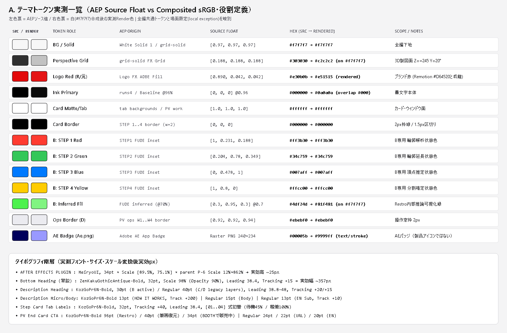

# A. テーマトークン設計（色・タイポグラフィ・線と面）

> ← [設計パッケージ目次へ戻る](./README.md)
> 参照図版: [01-color-and-typo-tokens.png](./diagrams/01-color-and-typo-tokens.png) ／ [ae-app-icon.png](./assets/ae-app-icon.png) ／ [logo-full.png](./assets/logo-full.png)

---

## 1. カラーシステム（Source Float vs 合成後 sRGB 実測値）

`[回収事実 / 実測値]` After Effects プロジェクトでは「レイヤー元の RGB/Opacity 指定値」と「白下地（`#f7f7f7`）および不透明度合成後の画面ピクセル sRGB」が異なる。制作・レビュー・自動化テストで数値齟齬を起こさないため、両者を並記してトークン化する。

### 1.1 全編共通コアイノベーション色（Core Tokens）

| トークン名 | AEP 元指定値（Linear Float / Opacity） | 合成後 sRGB（実画像実測） | 適用対象 | 意味的役割 |
|---|---|---|---|---|
| `bg.canvas` | `[0.97, 0.97, 0.97]` @ `100%` | `#f7f7f7` | `White Solid 1` / `grid-solid` 下地 | 映像全体の明るい製図台ベース（完全白 `#ffffff` と明確に差をつける） |
| `bg.grid.line` | `[0.1882, 0.1882, 0.1882]`（BlendingMode `2`, `2px`） | `#c2c2c2` 前後（`#f7f7f7` 上） | `grid-solid` FX `ADBE Grid` | 3D 傾き（`Z=+245, Y=+20°`）を持つ背景製図格子 |
| `ink.primary` | `[0, 0, 0]` @ `96%`（`runs4`/`Logo stroke`） / `100%` | `#0a0a0a`（重なり部 `#000000`） | 巨大「解」「筆」筆画、見出し文字 | 造形そのものの質量・墨の主役（※96% により交差重畳部だけ完全黒 `#000` になる特性あり） |
| `brand.accent` | `[0.8902, 0.0419, 0.0419]`（FX `ADBE Fill`） | **`#e51515`**（サムネ・`beat-001` 実測） | `Logo` 内の赤6層（`R` の弧・`元` 等）、A2 復元強調候補 | ブランド赤。**注**: Remotion `SceneA2`/`SceneB` 側で使用している `#d64520`（朱色系）とは異なるため統一・是正が必要 |
| `surface.card` | `[1, 1, 1]` @ `100%` | `#ffffff` | `tab backgrounds`、`PV work A/B/C`、`window bg` | 明確な紙面・カード・ウィンドウの白面（背景 `#f7f7f7` から浮く面） |
| `stroke.frame` | `[0, 0, 0]` @ `100%`（`2px` / `1.5px`） | `#000000` | `STEP 1..4 border`（`2px`）、`Divider`（`1.5px`）、`LENS frame`（`3px/2px`） | 製図・UI 枠線の明快な境界線 |
| `ae.badge` | Raster (`assets/images/Ae.png`, `240×234`) | `#00005b`（地） / `#9999ff`（文字） | 左ブランド最上部 [Ae.png](./assets/ae-app-icon.png) | Adobe After Effects 対応プラグインを示すアプリバッジ専用（製品アイコンではない） |

### 1.2 場面限定例外トークン（Local Exceptions — 他場面へ持ち込まない）

`[回収事実 / 実測値]`＋`[導出・推定]` 以下の4色＋推論緑は **Scene B（アルゴリズム機構解説）および推論可視化専用** であり、C・E の完成作品／ブランド締めへ持ち越さない。

| トークン名 | AEP 元指定値 | HEX | 出典レイヤー | 役割境界 |
|---|---|---|---|---|
| `step.s1.outline` | `[1.0, 0.231, 0.188]` | `#ff3b30` | `STEP1 outline` `FUDE outline inset` | STEP 01「輪郭を解析」の抽出輪郭ハイライト（`beat-011`） |
| `step.s2.extend` | `[0.204, 0.780, 0.349]` | `#34c759` | `STEP2 draft` `FUDE outline inset` | STEP 02「輪郭線を延長」の状態色（`beat-012`）＋ 黒3px線 `FUDE extend A/B` |
| `step.s3.infer` | `[0.0, 0.478, 1.0]` | `#007aff` | `STEP3 draft` `FUDE outline inset` | STEP 03「隠れた頂点を推定」の状態色（`beat-014`）＋白丸黒枠2.5px点群 |
| `step.s4.split` | `[1.0, 0.800, 0.0]` | `#ffcc00` | `STEP4 draft` `FUDE outline inset` | STEP 04「一画ずつに分割」確定状態色（`beat-017`） |
| `step.inferred.fill` | `[0.30, 0.95, 0.30]` @ `70%` | `#4df24d`（合成 `#81f481`） | `STEP3 infer` `FUDE inferred` | Restro 内部ソルバーの推定補間領域ポリゴン（緑半透明面） |
| `ops.window.border` | `[0.92, 0.92, 0.94]` @ `2px` | `#ebebf0` | `PV ops` `W1..W4 border` | **改善要**: `#f7f7f7` 上で極めて薄いため、Scene D 本制作では視認可能な枠線（暗色またはAE風クローム）へ見直し推奨 |

### 1.3 `[確定事項と現行Remotion実装の乖離]` 色彩の不整合

1. **Brand Red のズレ**: `samune-v1-master.png` / `46-Logo.ts` の実測赤は **`#e30b0b` → `#e51515`** だが、`video/src/scenes/SceneA2.tsx`（`ACCENT = [0.84, 0.27, 0.13]` → `#d64520`）と `SceneB.tsx`（`ANALYSIS_RED = "#D64520"`）では朱色系に変更されている。サムネとブランド統一のため AEP 赤 `#e51515` を正基準へ戻すべき。
2. **Scene B 色体系の差異**: 実 AEP（`beat-011..017`）では `STEP 1..4` の `FUDE outline inset` が **赤(`#ff3b30`)→緑(`#34c759`)→青(`#007aff`)→黄(`#ffcc00`)** へと切り替わるが、`SceneB.tsx` は黄ステップを外して `VERTEX_BLUE` 等へ単純化している。

---

## 2. タイポグラフィ体系（Font / Scale / Tracking）

`[回収事実 / 実測値]` `pv/generated/` の `ADBE Text Document` 全件検査により確定した書体とサイズ階層：

| UI / コピー役割 | フォント（PostScript 名） | 元サイズ / スケール | 階層パラメータ（Tracking / Leading / Opacity） | 画面実効サイズ・出現コンポ |
|---|---|---|---|---|
| **ブランド標章「Restro」** | ※意匠化済みベクター（原型: `Haettenschweiler` `182pt` 相当、`overlay` 残存） | ベクター座標（`416×260` コンポ上段） | 赤 R 差し替え＋黒筆画分解済み | 左カラム常設 (`46-Logo.ts [1..45]`) |
| **ブランド「筆画復元」** | ※意匠化済みベクター（原型: `HGPSoeiKakugothicUB` `102pt` 相当） | ベクター座標（`416×260` コンポ下段） | 分解済み筆画＋白抜き「元」 | 左カラム常設 |
| **バッジ横「AFTER EFFECTS PLUGIN」** | `MeiryoUI` Regular | `34pt` × `Scale [861.8%, 744.8%]` × 親 `P-6` `12%` | Tracking `+42`, Leading `40.8`, Opacity `100%` | 左最上部、`x≈172..370, y≈227` (`05-master.ts [16]`) |
| **下段見出し `Heading`** | `ZenKakuGothicAntique-Bold` | `32pt` × `Scale 98%`（親 `P-33` `12%` × `833.3%`） | Tracking `+15`, Leading `38.4`, Opacity `90%` | 左下見出し (`43-Heading.ts`)。実効幅 `~357px` |
| **左補足見出し（B 等 active）** | `KozGoPr6N-Bold` | `30pt` | Tracking `+20`, Leading `38.83` | `03-description.ts [3,4]` (`y=65.4`) |
| **左マイクロラベル** | `KozGoPr6N-Bold` | `13pt` | Tracking `+200`, Leading `15.6` | `03-description.ts [5,6]` (`HOW IT WORKS`) |
| **左説明本文（日本語 / 英語）** | `KozGoPr6N-Regular` | JP `15pt` / EN `13pt` | JP Track `+20`, Lead `19.4` / EN Track `+10`, Lead `15.6` | `03-description.ts [1,2]` |
| **Scene B ステップ見出し** | `KozGoPr6N-Bold` | `32pt` | Tracking `+40`, Leading `38.4` | `05-master.ts [166..169]`（式で `45%` / `100%` 切替） |
| **Scene C 作例番号** | `KozGoPr6N-Regular` | `40pt` × 縮小窓 `55.56%`（実効 `~22px`） | Tracking `+15`, Fill `[0.42, 0.42, 0.45]` | `PV work A/B/C [1]` (`pos=[60, 1012]`) |
| **Scene E CTA 階層** | `KozGoPr6N-Bold` / `Regular` | `96 / 40 / 34pt` (Bold), `24 / 22 / 20pt` (Reg) | Tracking `+15`, Fill `#1a1a1f` (主) / `#666670` (副) | `49-PV end.ts [1..6]`（※配置見直し対象） |

> `[導出・推定]` 日本語本文と補足 UI は `Kozuka Gothic Pr6N`（`R`/`B`）で統一され、見出しキャッチ `Heading` のみが `Zen Kaku Gothic Antique Bold` で人格づけられている。Remotion 側で文字組を再構築する場合も、この3階層（`Zen Kaku` キャッチ / `KozGo Bold` 見出し・ステップ / `KozGo Regular` 本文・メタ）を維持すべきである。
