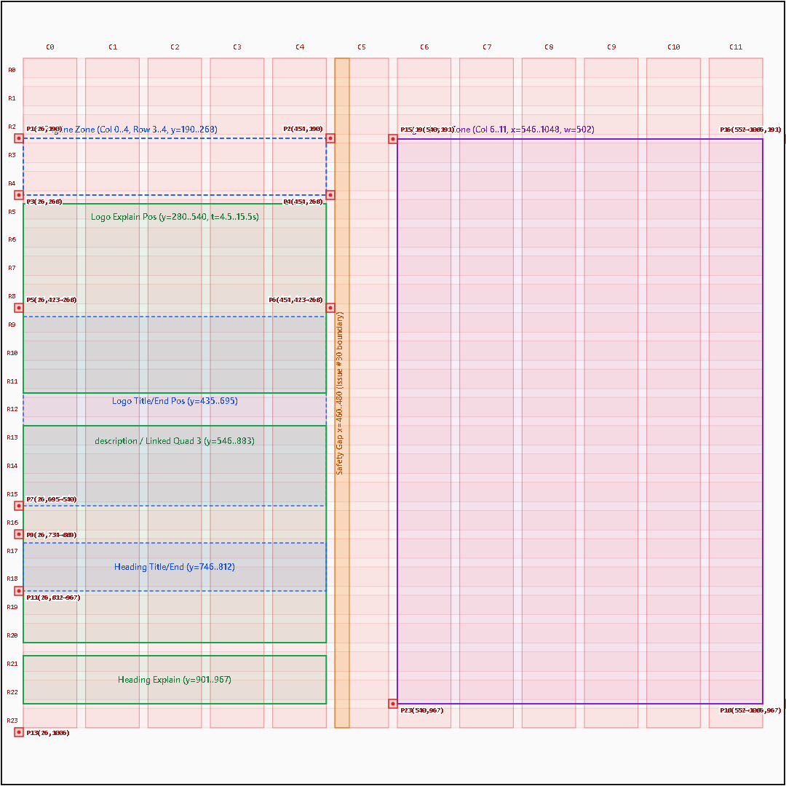
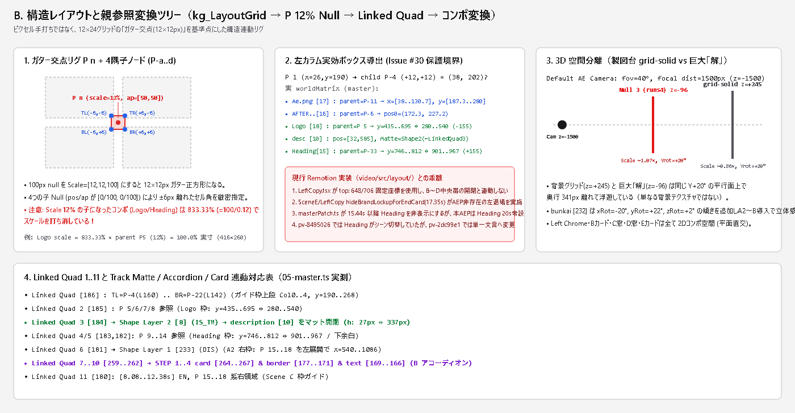
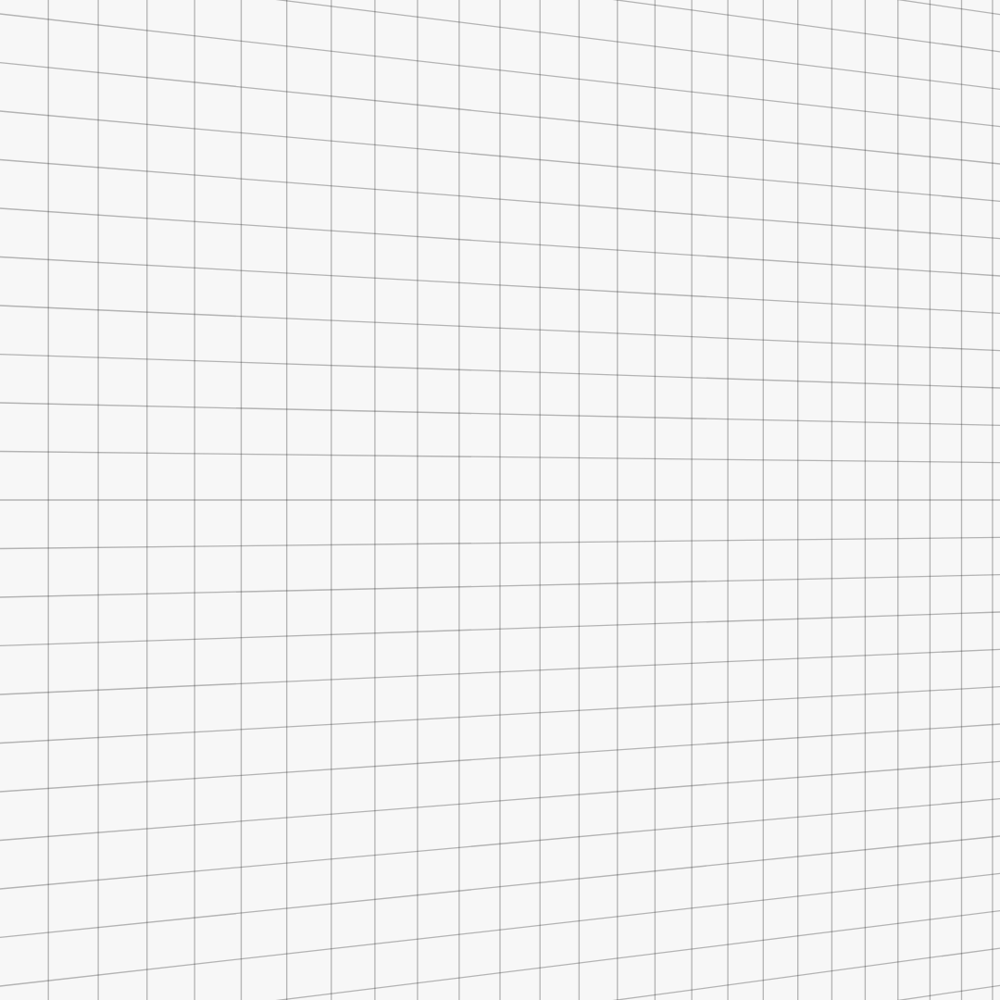
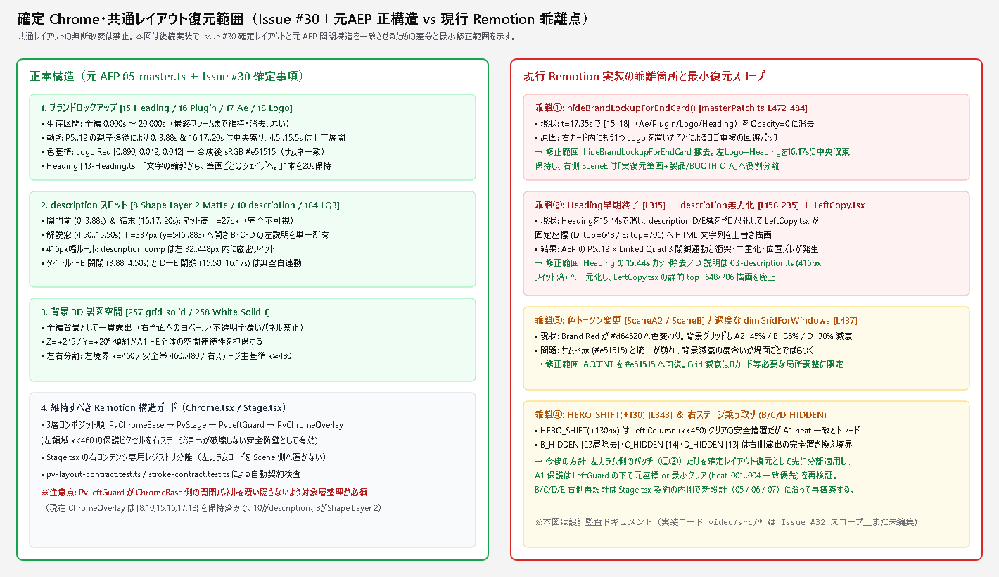

# B. 構造レイアウト設計（グリッド・親リグ・3D空間・確定境界）

> ← [設計パッケージ目次へ戻る](./README.md)
> 参照図版: [layout-kg-grid-overlay.png](./assets/layout-kg-grid-overlay.png) ／ [02-layout-parent-rig.png](./diagrams/02-layout-parent-rig.png) ／ [background-grid-plane.png](./assets/background-grid-plane.png)

| グリッド＆`P`ノード実測オーバレイ | 親子変換リグ＆空間構造図 |
|---|---|
|  |  |

---

## 1. 元 AEP のグリッド正体（`kg_LayoutGrid` 12×24 + ガター交点リグ `P`）

`[回収事実 / 実測値]` 元制作のレイアウトは任意のピクセル数値を手打ちしたものではなく、`05-master.ts` の2枚の基準レイヤーで全座標が生成されている。

1. **基準グリッド定義**: `[188] Adjustment Layer 5`（無効化参照、効果 `kg_LayoutGrid`）および `[187] GRID kg-clone (guide)`（ガイドシェイプ、38グループ：`col 0..11` ＋ `row 0..23`）。
   - **コンポ寸法**: `1080 × 1080`
   - **列（Columns）**: `12列`、左右マージン `32px`、ガター `12px` → **1列幅 `73.6667px`**、**列ピッチ `85.6667px`**
   - **行（Rows）**: `24行`、上下マージン `80px`、ガター `12px` → **1行高 `26.8333px`**、**行ピッチ `38.8333px`**
2. **ガター交点マーカー `P n` と4隅子ノード `P-a..d`**:
   - `[20..160]` に配置された `P 1`〜`P 23` の Null はすべて **`Anchor Point = [50, 50, 0]`**、**`Scale = [12, 12, 100]`** を持つ。
   - 100×100px の Null を `12%` に縮めると **正確に `12 × 12px` のガター交差点正方形**になる。
   - 各 `P n` は4つの子 Null（位置・アンカー `[0,0]`/`[100,0]`/`[0,100]`/`[100,100]`）を持ち、親 `P` 中心から **`±6px` 離れた4つの隣接セル角座標**（左列端 `x=32` や右列端 `x=448.33` 等）へ厳密スナップするアンカーとして機能する。
   - **`[導出・推定]` スケール打ち消し法則**: `Scale=12%` の `P` 階層下に `Logo [18]` や `Heading [15]` を直接ペアレントしたため、子コンポ側では **`Scale = [833.3333, 833.3333, 100]`**（$= 100 / 0.12$）を指定して実寸（`100%`）を復元している。後続実装ではこの二重スケールを世界行列として解釈するか、論理座標に正規化して扱う必要がある。

---

## 2. 左カラム確定領域の実測導出（Col 0..4, `x = 32..448` / 境界 `x = 460`）

`[回収事実 / 実測値]` [docs/issue30-recovery.md](../issue30-recovery.md) で保護された左カラム各要素の `05-master.ts` 上での実空間ボックスは次の通り：

| 要素 (master index) | サイズ / 親チェーン | タイトル・結末時 (`0..3.88s`, `16.17..20s`) | 解説時 (`4.50..15.50s`) | 変化幅・連動機構 |
|---|---|---|---|---|
| **Ae.png** `[17]` | `240×234` × `330%`×`P-11` (`12%`) | `x = 38.0..130.7`, `y = 187.3..280.0` | 不変（固定） | `P 1/2` Row 3..4 上端アンカー |
| **AFTER EFFECTS PLUGIN** `[16]` | テキスト / 親 `P-6` | `pos0 ≈ (172.3, 227.2)` | 不変（固定） | 同上、バッチ右隣 |
| **Logo** `[18]` | `416×260` / 親 `P 5` | **`y = 435..695`** | **`y = 280..540`** | **`-155px` 上方シフト**（`P 5/6/7/8` 移動） |
| **description** `[10]` | `416×298` / `pos=[32, 585]` | マット閉 (`h=27px`・不可視) | **マット開 (`y=546..883`, `h=337px`)** | `Linked Quad 3 [184]` → `Shape Layer 2 [8]` Alpha Matte |
| **Heading** `[15]` | `416×66` / 親 `P-33` | **`y = 746..812`** (`Logo` と `51px` 隙) | **`y = 901..967`** | **`+155px` 下方シフト**（`P 9/10/11/12` 移動） |

### `[確定事項と現行Remotion実装の乖離]`（左カラム挙動）

1. **`LeftCopy.tsx` の固定座標と無関係な二重コピー**: 現行 `video/src/layout/LeftCopy.tsx` は Scene D/E の文言を `top: 648` / `706` へ静的表示しており、元 AEP の `P 5..12` × `Linked Quad 3` による「`Logo` と `Heading` が上下に開いて中央に `description` を迎える」構造的な伸縮と無関係に重なる。
2. **`masterPatch.ts` による `Heading` 早期消去**: 現行 `masterPatch.ts` は `t ≥ 15.44s` で `[15] Heading` を無効化し、`LeftCopy.tsx` の `hideBrandLockupForEndCard` は `t ≥ 17.35s` で左ブランド群を消去している。元 AEP (`05-master.ts`) では `Ae.png`・`AFTER EFFECTS PLUGIN`・`Logo`・`Heading` は全編 `20.00s` 通して維持され、`15.50..16.167s` で中央タイトル位置へ美しく再収束するのが正構造である。
3. **`Heading` 本文のバージョン差（`pv-8495026` vs `pv-2dc99e1`）**: 参照画像 [verification/beats/](../../verification/beats/) (`pv-8495026.aep`) では `Heading` がシーンごとに切り替わっていたが、最新 AEP ダンプ（`43-Heading.ts`, `pv-2dc99e1.aep`）では固定キャッチ文「文字の輪郭から、筆画ごとのシェイプへ。」1本へ整理されている（詳細は [04-structural-timesheet.md](./04-structural-timesheet.md) で扱い、A1保護は `43-Heading.ts` 準拠）。

---

## 3. 背景 3D 空間 vs 2D 平面の分離構造

`[回収事実 / 実測値]`＋`[導出・推定]` 右側コンテンツ設計で絶対に混同してはならない空間規則：

- **空間 A：傾いた 3D 製図空間（背景 `grid-solid` と A1〜A3 巨大「解」）**
  - AE デフォルトカメラ（`fov≈39.6° / 焦点距離 1500px`, 位置 `[540, 540, -1500]`）に対し、`[257] grid-solid` は `Position = [540, 540, +245]`, `Y Rotation = +20°`。
  - `[238] Null 3 (runs4)` および `[214] Null 3 (runs5)`・`[196] Null 3 (runs6)` は同じく `Y Rotation = +20°` でありながら **`Position = [764, 540, -96]`**（背景グリッドより **`341px` 手前**）に浮遊している。
  - `[232] bunkai` は `Position = [780.7, 495.1, 0]` に加え `X=-20°, Y=+22°, Z=+2°` の3軸回転を持ち、A2 終盤から A3 へ空間をねじる。
- **空間 B：平面直交 2D レイヤー（Left Chrome・B カード・C 窓・D 操作窓・E 着地）**
  - 左カラム・`STEP 1..4 card`（`[264..267]`）・`PV reel C`・`PV ops`・`PV end` は 3D カメラ回転を受けない純 2D コンポ平面上に乗る。
- **`[導出・推定]` 右側ステージの基準寸法**: 右側の Col 6..11（`x = 546..1048`）が構造基準 **`502px` 幅**（`y = 191..967`、`P 15..23` 管理）であり、さらに A1/A2/E の巨大文字は左安全帯 **`x = 460..480`** を超えない範囲で右端・上下端（`x=1080`, `y=0/1080`）への意図的なブリードを許す（`[233] Shape Layer 1` / `PV reel C` 等では `x = 480..1080`, `y = 60..1020` を使用）。

---

## 4. 上位決定 → 下位座標の因果導出鎖（数値の「由来」正本）

`[導出・推定]` 後続の制作・改修で「なぜこのピクセル値なのか」を失わないため、主要要素について **表現目的 → 上位構造 → 局所構造 → 実測値** の連鎖を明示する。

1. **左カラム上下開閉（`Logo` `y=435 ↔ 280`, `Heading` `y=746 ↔ 901`, `description` `h=27 ↔ 337`）**:
   - **表現目的**: タイトル（A）・結末（E）ではブランド標章とキャッチを中段へ寄せて右主役を引き立て、説明区間（B/C/D）だけ中央に十分な解説欄を開く。
   - **上位構造**: `kg_LayoutGrid` Col `0..4`（左右マージン `32px` 基準幅 `416.33px`）と、左ガター `x=26` / 右ガター `x=454` に跨ぐ親リグ `P 5..12`。
   - **局所構造**: `Logo [18]`・`Heading [15]` は `P`（`Scale=12%`）を `Scale=833.33%` で打ち消して `y` キー移動のみを継承する。`description [10]` は動かず、背後の `Linked Quad 3 [184]` → `Shape Layer 2 [8]` が上下エッジのみ伸縮して Alpha Matte を開閉する。
   - **結果値**: `P 5/6` 上昇 `-155px` ＋ `P 9..12` 下降 `+155px` により、`Logo` 下端 `y=540` と `Heading` 上端 `y=901` の間に解説空間 `361px`（うちマット可視域 `y=546..883`, **`h=337px`**）が競合ゼロで生まれる。
2. **巨大「解」と背景格子の遠近差（`Z=-96` vs `Z=+245`）**:
   - **表現目的**: 主役の漢字を製図台（背景グリッド）と同じ傾き世界へ置きつつ、地面に貼り付けず空気層を隔てて浮き上がらせる。
   - **上位構造**: デフォルトカメラ（`f=1500px`, `Z=-1500`）＋基準角 `Y Rotation = +20°`。
   - **局所構造**: `grid-solid [257]` と `Null 3 (runs4) [238]` の両方に `Y=+20°` を与え、Z 深度だけを分離する。`bunkai [232]` はこの直交関係から一時的に `X=-20°, Y=+22°, Z=+2°` へねじれを加え、空間上昇のきっかけを作る **局所的芸術判断** である。
   - **結果値**: 背景面（`1500+245 = 1745`）に対する主役面（`1500-96 = 1404`）の投影拡大比は $\approx 1.24\times$ となり、右奥へ遠ざかりながらも前面存在感を保つ。
3. **Scene B カード列幅 `502.08px` と展開高さ `660px`**:
   - **表現目的**: 左解説帯の解説本文と対比しながら、4段階の内部処理が同一空間上で順序通りに展開・蓄積することを示す。
   - **上位構造**: 左安全帯（Col `0..4`）＋ガター間隔 Col `5`（遊び帯）を隔てた **Col `6..11`** と **Row `3..22`**。
   - **局所構造**: 親 `P 15..23`（左右 `x=540..1086`, 6列ピッチ基準）に対し、`Linked Quad 7..10` が上下タブ高さ `38〜39px` を差し引いた残りを稼働スロットに割り当てる。
   - **結果値**: `colW×6 + gutter×5 = 73.6667×6 + 12×5 = 502.0px`（AEP実測 `502.08px`）、全高 `967 - 191 = 776px` から非稼働 3タブ分（約 `116px`）を引いた **`660px`** が常に稼働領域として保証される。

---

## 5. 確定 Chrome 復元範囲と現行 Remotion 実装の差分整理

> **重要境界**: Issue #32 現段階では `video/src/*` のコード編集には着手しない。本節は、次期実装フェーズで **Issue #30 確定レイアウト＋元 AEP の動的開閉構造を復元する際の正確な修正範囲と根拠** を整理したものである。

### 5.1 維持すべき Remotion 基盤（壊してはならないガード）

- [`video/src/layout/Chrome.tsx`](../../video/src/layout/Chrome.tsx): **`PvChromeBase` → `PvStage` → `PvLeftGuard` → `PvChromeOverlay`** の3平面合成構造と `PROTECTED_MASTER_LAYERS = {8, 10, 15, 16, 17, 18}`・`BACKGROUND_MASTER_LAYERS = {257, 258, 260, 261, 262}` による左カラムピクセル保護機構（および [`tests/pv-layout-contract.test.ts`](../../tests/pv-layout-contract.test.ts) の不変契約）。
- [`video/src/layout/Stage.tsx`](../../video/src/layout/Stage.tsx) ＋ [`zones.ts`](../../video/src/layout/zones.ts): 右ステージ演出が `Stage.tsx` 経由でのみ供給され、Scene コンポーネントが左カラム・背景・ブランドを直書きしない責務分離。

### 5.2 確定レイアウト復元に向けた修正スコープ一覧

| 対象ファイル・箇所 | 現行 Remotion の挙動（乖離実態） | 元 AEP / Issue #30 上の正本 | 復元時の最小修正範囲と根拠 |
|---|---|---|---|
| **`masterPatch.ts` L472–484** `hideBrandLockupForEndCard()` | `t >= 17.35s` で `[15 Heading, 16 Plugin, 17 Ae, 18 Logo]` の Opacity を `0%` へ消去 | 左ブランド・`Heading` は `0.00..20.00s` 全編維持され、`15.50..16.167s` に中央へ戻る | **撤去対象**。右カード内の重複 `Logo` を排除すれば左ブランド消去の理由が消滅し、サムネ対称の終着が復元される |
| **`masterPatch.ts` L315–327** `Heading` 早期カット | `Heading` / `overlay` 内のキャッチコピーを `outPoint = 15.44s` で強制終了 | `[15] Heading`（`43-Heading.ts`）は `0.00..20.00s` 生存し E で `y=746..812` に復帰 | **撤去対象**。E の左コピー重複を避けるなら E 側文言・役割整理（左キャッチ保持＋右 CTA）で解決する |
| **`masterPatch.ts` L158–235** ＋ **`LeftCopy.tsx` L1–87** | `03-description.ts` の D/E 域をゼロ尺化し、`LeftCopy.tsx` が HTML 固定 `top: 648 / 706` を上書き描画 | `description [10]` が `Shape Layer 2 [8]` マット（`Linked Quad 3 [184]`）内で `4.50..15.50s` の間だけ開門・表示 | **役割整理対象**。Scene D 左説明は `03-description.ts [26..29]`（416px 自動フィット済み）を優先経路として復活させ、Scene E では `15.50..16.167s` 閉鎖構造に従い `LeftCopy.tsx` 固定文字を出さない |
| **`masterPatch.ts` L437–446** `dimGridForWindows()` | A2/A3 で `45%`、B で `35%`、D で `30%` に全画面背景格子を一括減光 | `grid-solid` は `100%` 空間連続性。混線箇所のみ局所白カード/マットで保護 | **調整対象**。共通背景の連続性を損なわないよう、一律減光ではなく必要箇所のみ最小限の抑えへ見直す |
| **`SceneA2.tsx` / `SceneB.tsx`** 色定数 | 赤アクセントに `#d64520`（朱色系）を使用 | `samune-v1-master.png` / `46-Logo.ts` 実測 **`#e51515`** | **色修正対象**。ブランド整合のため `#e51515` へ統一する |
| **`masterPatch.ts` L330–420** `HERO_SHIFT (+130)` 等 | `239..254` を `+130px` シフトし左カラム侵入を回避（A1 beat 一致に影響） | `PvLeftGuard` が `x < 460` を防護しつつ、A1 (`beat-001..004`) の構図バランスを保持 | **要検証対象**。`HERO_SHIFT` は確定左保護を壊さない前提で、`beat-001..004` の視覚基準と左右安全帯（`x=460..480`）の両立値を検証のうえ最小値化する |
| **`masterPatch.ts` L520–565** `B/C/D/E_HIDDEN` | 右ステージ系コンポ（`PV reel C`, `PV ops`, `PV end`, B タブ/カード, A2 残骸）を非表示化し `Stage.tsx` 側で代替描画 | 元 AEP の問題箇所（C 同文字反復、D 4窓分散、E 左衝突等）を含む | **維持＋中身刷新対象**。`Stage.tsx` 境界を保つためこれら右ステージ乗っ取り機構自体は維持し、`SceneA2..SceneE` の中身を本設計パッケージ（05/06/07）へ刷新する |
