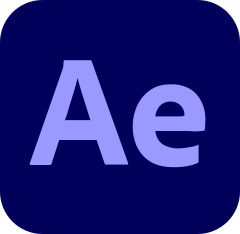
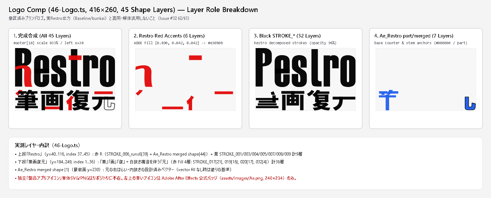
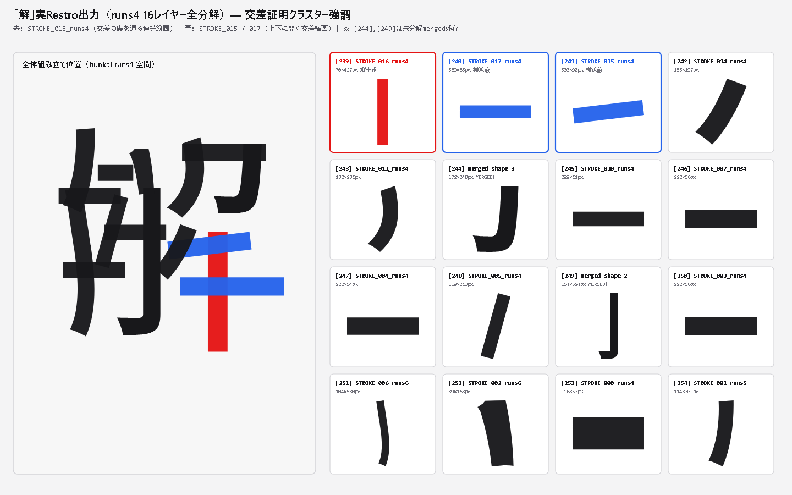
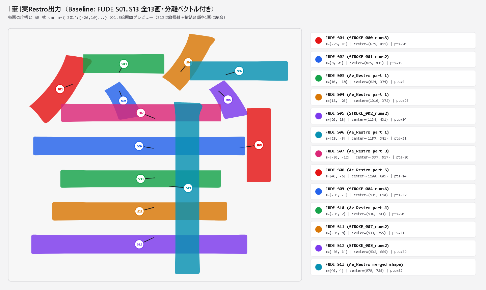
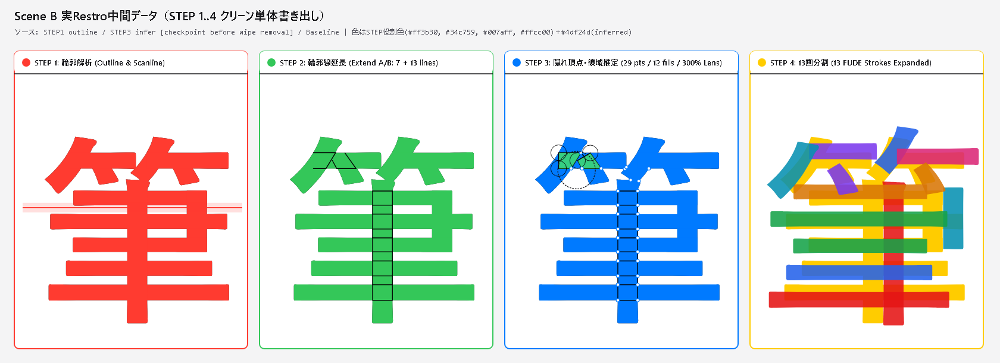

# C. 実アセット／コンポ単位の書き出し目録

> ← [設計パッケージ目次へ戻る](./README.md)
> 本書は、元 AEP・制作資産から個別要素をクリーンに分離・書き出したファイル群の台帳、および素材の**由来区別（製品仕様・意匠ロゴ・実 Restro 出力・不足素材）**を定義する。

---

## 1. ブランド系素材（意匠アートワーク ／ 製品本体出力と混同厳禁）

| 資産 | 実物ファイル（SVG / PNG） | 元データ出典・寸法 | 構成・役割と使用制約 |
|---|---|---|---|
| **After Effects アプリバッジ** | [ae-app-icon.png](./assets/ae-app-icon.png) | `assets/images/Ae.png` (`240×234` RGBA) | Adobe After Effects の公式アプリアイコン。`master[17]` 左上専用。**製品アプリアイコンではない** |
| **Restro 公式 `Logo`** | [logo-full.svg](./assets/logo-full.svg) / [PNG](./assets/logo-full.png) | `pv/generated/46-Logo.ts` (`416×260`, 45層) | **`[回収事実 / 実測値]`** Restro ワードマーク＋「筆画復元」から成る**完成済みブランドロゴアートワーク** |
| **`Logo` 構成層分解** | [logo-layers-breakdown.svg](./assets/logo-layers-breakdown.svg) / [PNG](./assets/logo-layers-breakdown.png) | `pv/generated/46-Logo.ts` | 赤強調6層 (`#e30b0b`)＋黒分解 stroke 32層＋`Ae_Restro` 基礎/合体7層。**作例や汎用筆画へ解体流用禁止** |
| **独立製品アイコン** | — **（不在）** | 調査対象AEP・画像群全体に存在せず | **`[未確定・不足事項]`** `Logo` コンポ以外の独立製品アイコン（正方形マーク等）はリポジトリに存在しない。必要なら製品側正本から受領するか不要と確定すること |

| After Effects バッジ (`Ae.png`) | 公式 `Logo` 原型 (`416×260`) | `Logo` 45層構造分解 |
|---|---|---|
|  |  |  |

---

## 2. 背景・グリッド・構造オーバーレイ

| 資産 | 実物ファイル | 元コンポ / パラメータ | 備考 |
|---|---|---|---|
| **3D パース背景格子** | [background-grid-plane.svg](./assets/background-grid-plane.svg) / [PNG](./assets/background-grid-plane.png) | `05-master.ts [257] grid-solid` (`3000×3000` solid, `#f7f7f7` + `#303030` 54px格子, `Z=+245, Y=+20°`) | サムネイル・全編共通下地 |
| **`kg_LayoutGrid` + `P` リグ** | [layout-kg-grid-overlay.svg](./assets/layout-kg-grid-overlay.svg) / [PNG](./assets/layout-kg-grid-overlay.png) | `05-master.ts [187,188]` + `P1..23` (`12×24`, マージン `32/80`, ガター `12`) | 全配置・伸縮の設計基準 |

---

## 3. 実 Restro 筆画出力素材（「解」および「筆」）

> **`[導出・推定]`** Restro プラグインが実際にベクターアウトラインから分解・生成した一次素材は、現在リポジトリ内に **「解」（`bunkai` / `kai-zoom`）と「筆」（`Baseline` / `STEP1..4`）の2文字のみ** が存在する。

### 3.1 「解」（Giant Kai & Crossing Proof）

| 資産 | 実物ファイル | 元出典・層数 | 実測内容と制作上の注意点 |
|---|---|---|---|
| **分解前の一体輪郭** | [kai-original-outline.svg](./assets/kai-original-outline.svg) / [PNG](./assets/kai-original-outline.png) | `04-kai-zoom.ts [20]` (`Ae_Restro merged shape`) | 交差部が一体結合した元形状 |
| **`runs4` 全16層分解** | [kai-strokes-exploded.svg](./assets/kai-strokes-exploded.svg) / [PNG](./assets/kai-strokes-exploded.png) | `05-master.ts [239..254]` / `02-bunkai.ts [21..36]` | **`[回収事実 / 実測値]`** 14本の独立 `STROKE_*` ＋ **2本の未分解残存 `Ae_Restro merged shape`（`[244]`, `[249]`）**。A2 交差証明の主役は右側「牛」の縦画 **`STROKE_016_runs4` (`[239]`)** と遮蔽横画 **`STROKE_017` (`[240]`)・`STROKE_015` (`[241]`)** |

### 3.2 「筆」（Baseline & STEP 1..4 中間工程）

| 資産 | 実物ファイル | 元出典・層数 | 実測内容と注意点 |
|---|---|---|---|
| **解析前の連結輪郭** | [fude-original-outline.svg](./assets/fude-original-outline.svg) / [PNG](./assets/fude-original-outline.png) | `01-Baseline.ts [1,2]` (`FUDE outline base` / `inset`) | 元 `1080×1080` コンポ上では `x=583..1309` へ右端はみ出しクリップ（`PV glyph` `1400×1080` で全体保持） |
| **実分解 13画（ベクトル付）** | [fude-strokes-exploded.svg](./assets/fude-strokes-exploded.svg) / [PNG](./assets/fude-strokes-exploded.png) | `01-Baseline.ts [3..15]` (`FUDE S01..S13`) | `S01..S12` は独立、`S13`（`Ae_Restro merged shape`）は中心縦軸と下部接合を含む `92pts` 形状。`op=0` 静止から表現展開式 `var m=...` で13画分離 |
| **STEP 1..4 中間データ** | [step1-4-intermediates.svg](./assets/step1-4-intermediates.svg) / [PNG](./assets/step1-4-intermediates.png) | `38-STEP1` / `40-STEP3 [checkpoint]` / `Baseline` | 1: `FUDE scanline` (`y223→980`), 2: `extend A(7)+B(13)`, 3: `inferred` 12緑面 (`70%`)＋**`FUDE points` 29個の推定頂点**＋`300%` レンズターゲット `(757,422)`, 4: 13画展開 |

---

## 4. 後半シーン要素と「不足している素材」の明確化

| 区分 | 実物ファイル / 実体 | 現状の実測評価と不足リスト |
|---|---|---|
| **Scene E 終着構造** | [e-end-card-clean.svg](./assets/e-end-card-clean.svg) / [PNG](./assets/e-end-card-clean.png) | `49-PV end.ts` + `11-PV glyph EE.ts` (`±5〜20px` 呼吸キー)。元 `PV end` の CTA 文字は `x=120` へ置かれ確定左領域と衝突するバグを抱える |
| **C: 作例用の新規文字／作例** | — **`[未確定・不足事項]`** | 現行 `pv/generated/`（`PV work A/B/C`）と `SceneC.tsx` はすべて同一「筆」1文字の色・並べ替え使い回しに留まる。異なる文字・異なる映像作品を作るための実プラグイン出力文字（例：曲線や斜画を含む別文字、テキストレイヤー分解素材等）が未生成 |
| **D: 実 AE 操作の単一コンポ録画** | （[06-recordings-audit.md](./06-recordings-audit.md) 参照） | 既存録画6本はいずれもクリップ・コンポ切り替え分断・高視認性不足のため、新規収録（テキスト/シェイプ→`Decompose` 押下→生成→編集の連続収録）が必要 |
| **素材取得方針（[AGENTS.md](../../AGENTS.md) 境界）** | — | このリポジトリから `Ae_Restro` 本体のコードを編集しない。新規文字の実 Restro 出力や UI 録画は実機 After Effects 上で正規の Restro プラグインを実行して新規ダンプ／収録する |
