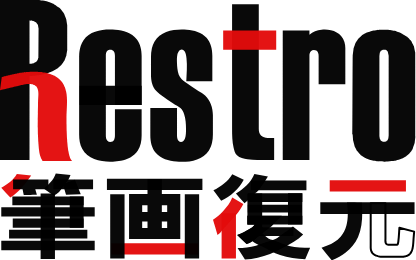
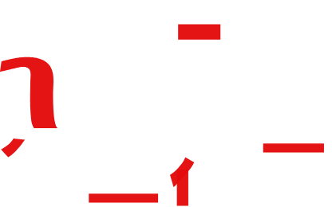

# C. 実アセット／コンポ単位の書き出し目録

> ← [設計パッケージ目次へ戻る](./README.md)
> 本書は、元 AEP・制作資産から個別要素をクリーンに分離・書き出したファイル群の台帳、および素材の**由来区別（製品仕様・意匠ロゴ・実 Restro 出力・不足素材）**を定義する。

> **独立単体書き出し規約（Issue #32 §3 C）**: 下記の構造解説図版（`docs/design/assets/`）に加え、**すべての独立コンポーネント・全筆画・全処理中間素材を個別のクリーン透過 SVG＋PNG（計54点）として [`assets/individual/`](./assets/individual/manifest.json) 配下へ個別に書き出し済み**である。一覧表の切り抜きではなく、後続制作で要素単位に直接配置・参照・差し替え検証できる。

---

## 1. ブランド・クローム系個別アセット（意匠アートワーク ／ 製品本体出力と混同厳禁）

| 資産 | 独立単体ファイル（SVG / PNG） | 一覧参考図 | 出典・寸法 | 構成・役割と使用制約 |
|---|---|---|---|---|
| **After Effects アプリバッジ** | [ae-app-icon.png](./assets/ae-app-icon.png) | — | `assets/images/Ae.png` (`240×234`) | Adobe AE 公式アプリアイコン。`master[17]` 左上専用。**製品アプリアイコンではない** |
| **バッジ＋PLUGIN ロックアップ** | [badge-after-effects-plugin.svg](./assets/individual/chrome/badge-after-effects-plugin.svg) / [PNG](./assets/individual/chrome/badge-after-effects-plugin.png) | — | `05-master.ts [16,17]` (`380×96`) | 左上固定ロックアップ単体（透過） |
| **Restro 公式 `Logo` 全姿** | [logo-full-clean.svg](./assets/individual/logo/logo-full-clean.svg) / [PNG](./assets/individual/logo/logo-full-clean.png) | [logo-full.png](./assets/logo-full.png) | `46-Logo.ts [1..45]` (`416×260`) | **`[回収事実 / 実測値]`** Restro＋「筆画復元」完成ブランドロゴアートワーク |
| **`Logo` 赤アクセント6層** | [logo-red-accents.svg](./assets/individual/logo/logo-red-accents.svg) / [PNG](./assets/individual/logo/logo-red-accents.png) | [分解図](./assets/logo-layers-breakdown.png) | `46-Logo.ts` (`#e30b0b`, `416×260`) | `R` の一部＋「元」赤パーツ単体（※解体流用禁止） |
| **`Logo` 黒32画 / 基礎7層** | [黒32層 PNG](./assets/individual/logo/logo-black-strokes.png) ([SVG](./assets/individual/logo/logo-black-strokes.svg)) / [基礎7層 PNG](./assets/individual/logo/logo-ae-restro-base.png) ([SVG](./assets/individual/logo/logo-ae-restro-base.svg)) | [分解図](./assets/logo-layers-breakdown.png) | `46-Logo.ts` (`416×260`) | ロゴ内部の役割検証・誤流用検知用の独立成分 |
| **固定見出し `Heading`** | [heading-main.svg](./assets/individual/chrome/heading-main.svg) / [PNG](./assets/individual/chrome/heading-main.png) | — | `43-Heading.ts [1]` (`416×66`) | 「文字の輪郭から、筆画ごとのシェイプへ。」単体透過。**※SVGは手動再配置の参考再構成（実コンポ書き出しではない）。正本データは `data/heading.composition.json`** |
| **解説枠 `description` 各幕** | [B PNG](./assets/individual/chrome/desc-b-how-it-works.png) ([SVG](./assets/individual/chrome/desc-b-how-it-works.svg)) [C PNG](./assets/individual/chrome/desc-c-case-studies.png) ([SVG](./assets/individual/chrome/desc-c-case-studies.svg)) [D PNG](./assets/individual/chrome/desc-d-ae-workflow.png) ([SVG](./assets/individual/chrome/desc-d-ae-workflow.svg)) | — | `03-description.ts` (`416×298`) | 解説窓開門時に表示される B・C・D 正本文字組単体（D は Remotion 復元対象）。**※SVGは参考再構成。正本データは `data/description.composition.json`** |
| **独立製品アイコン** | — **（不在）** | — | 調査対象AEP・画像群全体に存在せず | **`[未確定・不足事項]`** `Logo` コンポ以外の独立製品アイコン（正方形マーク等）はリポジトリに存在しない。必要なら製品側正本から受領するか不要と確定すること |

| 公式 `Logo` 透過 (`416×260`) | `Logo` 赤アクセント6層 (`416×260`) | `Heading` 単体 (`416×66`) | `description` B状態 (`416×298`) |
|---|---|---|---|
|  |  |  |  |

---

## 2. 背景・グリッド・構造オーバーレイ

| 資産 | 実物ファイル | 元コンポ / パラメータ | 備考 |
|---|---|---|---|
| **3D パース背景格子** | [background-grid-plane.svg](./assets/background-grid-plane.svg) / [PNG](./assets/background-grid-plane.png) | `05-master.ts [257] grid-solid` (`3000×3000` solid, `#f7f7f7` + `#303030` 54px格子, `Z=+245, Y=+20°`) | サムネイル・全編共通下地。**2026-11 再生成：手描き図を廃し、`worldMatrix`＋カメラ行列（`video/src/ae/`）で全格子線を解析投影した実幾何書き出し（右側＝手前、確定サムネイルと整合）。再生成：`bun tools/design/render-grid.ts`** |
| **`kg_LayoutGrid` + `P` リグ** | [layout-kg-grid-overlay.svg](./assets/layout-kg-grid-overlay.svg) / [PNG](./assets/layout-kg-grid-overlay.png) | `05-master.ts [187,188]` + `P1..23` (`12×24`, マージン `32/80`, ガター `12`) | 全配置・伸縮の設計基準 |

---

## 3. 実 Restro 筆画出力素材（「解」全16層・元輪郭 ＆「筆」全13画・中間7層）

> **`[導出・推定]`** Restro プラグインが実際にベクターアウトラインから分解・生成した一次素材は、現在リポジトリ内に **「解」（`bunkai` / `kai-zoom`）と「筆」（`Baseline` / `06-PV glyph` / `STEP1..4`）の2文字のみ** が存在する。
>
> **`[回収事実 / 実測値]`（2026-11 再検証訂正）** `02-bunkai.ts` / `05-master.ts runs4` の `STROKE_*` 14層および未分解 `merged shape` 2層（全16層）は**いずれも実「解」グリフに属する正統な Restro 出力形状**である。直画ゴシック部 9層（`000,003,004,005,007,010,015,016,017`）が4頂点四辺形なのは直線画ゆえの正常表現であり、`001,002,006,011,014` の5層には実測 **12〜22 頂点の3次ベジェ曲線ハンドル** が存在する（`data/kai-stroke-runs-2d.composition.json` 参照）。一時記録されていた「プロキシ図形」分類は誤りとして撤回した。
>
> **`[回収事実 / 実測値]` `kai-zoom [20]` との整合証明**: `04-kai-zoom.ts [20]` は `Null 4`（130%ズーム）空間における「解」の一体輪郭（外周＋「角」内部4孔）から **左上の「ク」3画（`STROKE_000/001/002`）を意図的に差し引いた切り欠きベース**（上重ねレイヤー `[3..19]` の「ク」拡大アニメ用）である。同一ズーム空間での非クロップ検証（[`verification/assembly-metrics.json`](./verification/assembly-metrics.json)）により、全16層合算で `recallOfOutline = 0.9999`（`IoU = 0.8865`）、左上「ク」3画を除く 13層で **`IoU = 0.9999`**（`onlyAssembledPx = 23`, `onlyOutlinePx = 20`）が確認された。

### 3.1 「解」（Giant Kai：元輪郭＋`runs4` 16レイヤー個別単体書き出し）

- 全体確認図：[kai-original-outline.png](./assets/kai-original-outline.png)（複合パス `evenodd` で「角」4孔抜き反映済）／ [kai-strokes-exploded.png](./assets/kai-strokes-exploded.png) ／ [差分検証図](./verification/kai-runs4-vs-zoom-diff.png)
- 独立単体（透過・タイトクロップ）：[元一体輪郭 PNG](./assets/individual/kai/kai-outline-merged.png) ([SVG](./assets/individual/kai/kai-outline-merged.svg), `991×932` / 4孔抜き済) ／ [16層 rest組み上がり PNG](./assets/individual/kai/kai-runs4-assembled.png) ([SVG](./assets/individual/kai/kai-runs4-assembled.svg), `847×841`)

| # | master / bunkai 層 | 個別単体ファイル（SVG / PNG・寸法） | 役割・特性 |
|---|---|---|---|
| 01 | `[239]` / `[21]` `STROKE_016_runs4` | [SVG](./assets/individual/kai/kai-01-STROKE_016_runs4.svg) / [PNG](./assets/individual/kai/kai-01-STROKE_016_runs4.png) (`107×463`) | **A2 交差主役（連続縦画・不動軸 Δ=0, 赤強調対象）** |
| 02 | `[240]` / `[22]` `STROKE_017_runs4` | [SVG](./assets/individual/kai/kai-02-STROKE_017_runs4.svg) / [PNG](./assets/individual/kai/kai-02-STROKE_017_runs4.png) (`405×101`) | **A2 交差下遮蔽横画（Y+300 下方開門）** |
| 03 | `[241]` / `[23]` `STROKE_015_runs4` | [SVG](./assets/individual/kai/kai-03-STROKE_015_runs4.svg) / [PNG](./assets/individual/kai/kai-03-STROKE_015_runs4.png) (`337×135`) | **A2 交差上遮蔽横画（Y-374 / +8° 上方開門）** |
| 04 | `[242]` / `[24]` `STROKE_014_runs4` | [SVG](./assets/individual/kai/kai-04-STROKE_014_runs4.svg) / [PNG](./assets/individual/kai/kai-04-STROKE_014_runs4.png) (`190×234`) | 副筆画（Δ=(+161,+65), rot=-13°） |
| 05 | `[243]` / `[25]` `STROKE_011_runs4` | [SVG](./assets/individual/kai/kai-05-STROKE_011_runs4.svg) / [PNG](./assets/individual/kai/kai-05-STROKE_011_runs4.png) (`169×323`) | 副筆画（Δ=(+51,+7), rot=+25°） |
| 06 | `[244]` / `[26]` `merged shape 3/A` | [SVG](./assets/individual/kai/kai-06-merged_shape_3.svg) / [PNG](./assets/individual/kai/kai-06-merged_shape_3.png) (`277×263`) | **未分解残存 merged 層**（連結体として扱う） |
| 07 | `[245]` / `[27]` `STROKE_010_runs4` | [SVG](./assets/individual/kai/kai-07-STROKE_010_runs4.svg) / [PNG](./assets/individual/kai/kai-07-STROKE_010_runs4.png) (`335×97`) | 水平 X 限定（Δ=(-69,0)）※左境界注意 |
| 08 | `[246]` / `[28]` `STROKE_007_runs4` | [SVG](./assets/individual/kai/kai-08-STROKE_007_runs4.svg) / [PNG](./assets/individual/kai/kai-08-STROKE_007_runs4.png) (`258×93`) | 水平 X 限定（Δ=(+99,0)） |
| 09 | `[247]` / `[29]` `STROKE_004_runs4` | [SVG](./assets/individual/kai/kai-09-STROKE_004_runs4.svg) / [PNG](./assets/individual/kai/kai-09-STROKE_004_runs4.png) (`258×90`) | 水平 X 限定（Δ=(-72,0)）※左境界注意 |
| 10 | `[248]` / `[30]` `STROKE_005_runs4` | [SVG](./assets/individual/kai/kai-10-STROKE_005_runs4.svg) / [PNG](./assets/individual/kai/kai-10-STROKE_005_runs4.png) (`155×299`) | 垂直 Y＋回転（Δ=(0,+105), rot=-24°） |
| 11 | `[249]` / `[31]` `merged shape 2/B` | [SVG](./assets/individual/kai/kai-11-merged_shape_2.svg) / [PNG](./assets/individual/kai/kai-11-merged_shape_2.png) (`212×558`) | **未分解残存 merged 層**（左下結合縦部） |
| 12 | `[250]` / `[32]` `STROKE_003_runs4` | [SVG](./assets/individual/kai/kai-12-STROKE_003_runs4.svg) / [PNG](./assets/individual/kai/kai-12-STROKE_003_runs4.png) (`258×93`) | 水平 X 限定（Δ=(+116,0)） |
| 13 | `[251]` / `[33]` `STROKE_006_runs6` | [SVG](./assets/individual/kai/kai-13-STROKE_006_runs6.svg) / [PNG](./assets/individual/kai/kai-13-STROKE_006_runs6.png) (`140×567`) | 左角長画（Δ=(-25,-59), rot=+4°） |
| 14 | `[252]` / `[34]` `STROKE_002_runs6` | [SVG](./assets/individual/kai/kai-14-STROKE_002_runs6.svg) / [PNG](./assets/individual/kai/kai-14-STROKE_002_runs6.png) (`125×199`) | 垂直 Y＋回転（Δ=(0,+86), rot=-42°） |
| 15 | `[253]` / `[35]` `STROKE_000_runs4` | [SVG](./assets/individual/kai/kai-15-STROKE_000_runs4.svg) / [PNG](./assets/individual/kai/kai-15-STROKE_000_runs4.png) (`163×93`) | 垂直 Y 限定（Δ=(0,-45)） |
| 16 | `[254]` / `[36]` `STROKE_001_runs5` | [SVG](./assets/individual/kai/kai-16-STROKE_001_runs5.svg) / [PNG](./assets/individual/kai/kai-16-STROKE_001_runs5.png) (`151×337`) | 角左肩（Δ=(+40,-90), rot=+12°） |

### 3.2 「筆」（`06-PV glyph` 正止Rest＋`Baseline` 13画＆元輪郭）＋ Scene B 中間7データ個別書き出し

> **`[回収事実 / 実測値]`（rest 組み上がり IoU 検証・`01-Baseline` 差異の原因特定）**
> - **rest ポーズ正本（[`data/pv-glyph-fude.composition.json`](./data/pv-glyph-fude.composition.json) / `06-PV glyph.ts`, `1400×1080`）**: 同一コンポ空間（クロップ・拡縮補正一切なし）で `S01..S13` を結合すると、`FUDE outline base` に対し **`IoU = 0.9998`**（`onlyAssembledPx = 26`, `onlyOutlinePx = 32`）で完全一致する（[`fude-rest-diff.png`](./verification/fude-rest-diff.png)）。
> - **`01-Baseline.ts` における `IoU = 0.7310`（1080クリップ時 `0.7423`）の原因**: `01-Baseline.ts` は AEP ダンプ時の再生時刻（CTI）における式適用後の散開変位（`≈ 0.7278 × m[k]`、例 `S01` で `[-18.92, +7.28]`）が `Position.value` に焼き込まれた状態で保存されており、`t = 0` でも元輪郭から既にずれている（未解消のまま正本注記として区別保存）。また元 `1080×1080` コンポの右端（`x = 1080..1290`）がはみ出しクリップされていたことも併せて確認した。

- 全体比較図：[fude-original-outline.png](./assets/fude-original-outline.png) ／ [fude-strokes-exploded.png](./assets/fude-strokes-exploded.png) ／ [step1-4-intermediates.png](./assets/step1-4-intermediates.png) ／ [rest 一致検証図](./verification/fude-rest-diff.png)
- 独立単体・輪郭系：[base outline PNG](./assets/individual/fude/fude-outline-base.png) ([SVG](./assets/individual/fude/fude-outline-base.svg), `733×742`) ／ [inset outline PNG](./assets/individual/fude/fude-outline-inset.png) ([SVG](./assets/individual/fude/fude-outline-inset.svg), `733×742`) ／ [13画組み上がり PNG](./assets/individual/fude/fude-13-assembled.png) ([SVG](./assets/individual/fude/fude-13-assembled.svg), `771×759`)

| 対象 | 個別ファイル群（SVG / PNG・寸法） | 出典・備考 |
|---|---|---|
| **「筆」竹冠 (`S01..S06`)** | [S01](./assets/individual/fude/fude-s01.png) (`232×249`, [SVG](./assets/individual/fude/fude-s01.svg)), [S02](./assets/individual/fude/fude-s02.png) (`154×155`), [S03](./assets/individual/fude/fude-s03.png) (`289×98`), [S04](./assets/individual/fude/fude-s04.png) (`202×215`), [S05](./assets/individual/fude/fude-s05.png) (`157×157`), [S06](./assets/individual/fude/fude-s06.png) (`342×98`) | `01-Baseline.ts` 実分離 6画（S01..03左冠 / S04..06右冠） |
| **「筆」中部・平行横画 (`S07..S12`)** | [S07](./assets/individual/fude/fude-s07.png) (`536×93`, [SVG](./assets/individual/fude/fude-s07.svg)), [S08](./assets/individual/fude/fude-s08.png) (`112×267`), [S09](./assets/individual/fude/fude-s09.png) (`697×95`), [S10](./assets/individual/fude/fude-s10.png) (`537×92`), [S11](./assets/individual/fude/fude-s11.png) (`582×95`), [S12](./assets/individual/fude/fude-s12.png) (`710×97`) | 横並列「日/聿」段差群 `S09..S12`（[SVG S08–12](./assets/individual/fude/fude-s12.svg) 含め個別保存） |
| **「筆」中心統合軸 (`S13`)** | [fude-s13.svg](./assets/individual/fude/fude-s13.svg) / [PNG](./assets/individual/fude/fude-s13.png) (`125×574`) | `Ae_Restro merged shape`（`92pts`・主縦軸＋下部結合） |
| **Scene B 中間素材7点** | [scanline](./assets/individual/scene-b/b-scanline.png) (`820×60`, [SVG](./assets/individual/scene-b/b-scanline.svg)) [extend A (7線)](./assets/individual/scene-b/b-extend-a.png) (`205×105`, [SVG](./assets/individual/scene-b/b-extend-a.svg)) [extend B (13線)](./assets/individual/scene-b/b-extend-b.png) (`120×454`, [SVG](./assets/individual/scene-b/b-extend-b.svg)) [inferred 緑補間面](./assets/individual/scene-b/b-inferred-polygons.png) (`233×162`, [SVG](./assets/individual/scene-b/b-inferred-polygons.svg)) [points 29頂点](./assets/individual/scene-b/b-points-29.png) (`330×591`, [SVG](./assets/individual/scene-b/b-points-29.svg)) [LENS 枠 420/140px](./assets/individual/scene-b/b-lens-frame.png) (`496×716`, [SVG](./assets/individual/scene-b/b-lens-frame.svg)) [STEP1..4 タブ帯](./assets/individual/scene-b/b-tab-strip-chrome.png) (`522×180`, [SVG](./assets/individual/scene-b/b-tab-strip-chrome.svg)) | `38-STEP1` / `40-STEP3 infer` / `05-master.ts [9,170..177]` からの純粋単体書き出し |

---

## 4. 後半シーン個別要素と「不足している素材」の明確化

| 区分 | 独立書き出し / 実物ファイル | 現状の実測評価と不足リスト |
|---|---|---|
| **Scene C ビューポート枠** | [c-viewport-frame.svg](./assets/individual/scene-c-d-e/c-viewport-frame.svg) / [PNG](./assets/individual/scene-c-d-e/c-viewport-frame.png) (`612×972`) | 右ステージ `600×960` 外枠単体（作例3セルの背景色・文字組から完全分離） |
| **Scene D 窓枠マット構造** | [d-ops-window-chrome.svg](./assets/individual/scene-c-d-e/d-ops-window-chrome.svg) / [PNG](./assets/individual/scene-c-d-e/d-ops-window-chrome.png) (`600×960`) | 旧 `52-PV ops.ts` 4窓構造の可視化基準（新設計では主窓＋副窓の2系統へ統合、枠色対比強化） |
| **Scene E 復元筆画＆CTA単体** | [e-glyph-ee.png](./assets/individual/scene-c-d-e/e-glyph-ee.png) (`733×742`, [SVG](./assets/individual/scene-c-d-e/e-glyph-ee.svg)) ／ [e-cta-typography.png](./assets/individual/scene-c-d-e/e-cta-typography.png) (`500×380`, [SVG](./assets/individual/scene-c-d-e/e-cta-typography.svg)) ／ [衝突検証図](./assets/e-end-card-clean.png) | E の右筆画 (`11-PV glyph EE`) と CTA 6階層文字 (`49-PV end [1..6]`) を完全分離して書き出し済。右カラム側再配置に即転用可能 |
| **C: 作例用の新規文字／作例** | `SceneC.tsx` `WORK_SOURCES`（2026-11 実装済み） | **解消**: 3作例を別ソースへ分離した。W1「筆墨」=`06-PV glyph` FUDE S01..S13（検証済み rest 正本）、W2「解彩」=`02-bunkai` `STROKE_*_runs5` 12画の粗い別分解（別文字「解」、assembled pose ~t1.8）、W3「筆構」=`41-BG decomposed strokes` FUDE S01..S13（同一「筆」の**第2の実分解**、part1/3/4/5+runs2/5/6/8 親を持つ別ストローク境界）。いずれも実 Restro 出力の個別筆画で、`compStrokes` の実形状・実変換から直接描画される。キャプションは各ソースの文字と一致（「筆彩」→「解彩」に改題）。なお「曲線や斜画を含む第3の文字」など更に異なる文字の新規プラグイン出力は依然として実機 AE での新規ダンプが必要（§素材取得方針） |
| **D: 実 AE 操作の単一コンポ録画** | （[06-recordings-audit.md](./06-recordings-audit.md) 参照） | 既存録画6本はいずれもクリップ・コンポ切り替え分断・高視認性不足のため、新規収録（テキスト/シェイプ→`Decompose` 押下→生成→編集の連続収録）が必要 |
| **素材取得方針（[AGENTS.md](../../AGENTS.md) 境界）** | — | このリポジトリから `Ae_Restro` 本体のコードを編集しない。新規文字の実 Restro 出力や UI 録画は実機 After Effects 上で正規の Restro プラグインを実行して新規ダンプ／収録する |

> 全54点の個別SVG・PNGのメタデータとパス一覧は [assets/individual/manifest.json](./assets/individual/manifest.json) にも機械可読 JSON として収録済み。
