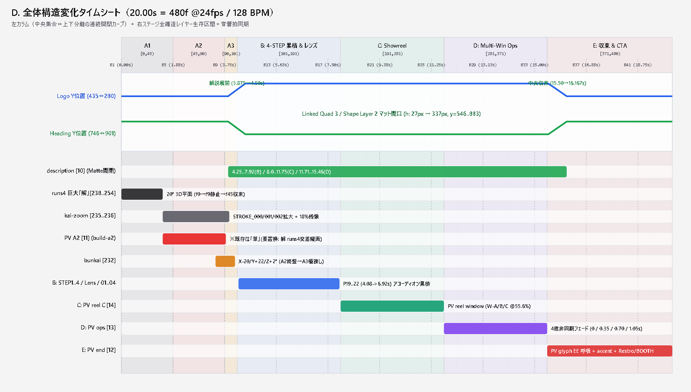

# D. 全体構造変化のタイムシート（全編時間構造・左側変形・場面間因果）

> ← [設計パッケージ目次へ戻る](./README.md)
> 参照図版: [03-structural-timesheet.png](./diagrams/03-structural-timesheet.png)



---

## 1. 尺・テンポ・実測音響アタックの確定事実

`[回収事実 / 実測値]`
- **全体仕様**: `1080 × 1080`、**`24 fps`**、**`20.00s`（全 `480` フレーム：`f0..f479`）**。
- **使用楽曲**: `assets/audio/drums-and-somps-background-music-458414.mp3`（Pixabay Content License — mp3 単体配布禁止）。
- **BPM と立ち上がりオフセットの正値**:
  - `docs/SPEC.md` §3 と AE `05-master.ts` のマーカー位置は **128 BPM（1拍 = `0.46875s` = `11.25f`）** を基準としている。
  - `video/src/rejected/pv-full/music-analysis.json` の `tempoBpm: 129.2` は、[tools/analyze-music.ts](../../tools/analyze-music.ts) のフレームホップ（`512 / 22050 = 0.02322s`）における整数ラグ量子化（`bestLag = 20` 付近）の端数誤差であり、楽曲自体は 128 BPM 基準、かつ冒頭立ち上がりに実測約 `+40〜90ms`（`beatsSec[0] = 0.093s` 相当）の前置きが含まれる。
  - したがって設計上のタイムシートは **480f 拍窓（`f0, f45, f90, f101, f191, f281, f371`）** で区切り、右ステージの動作ピーク着地のみ実音アタック付近へ合わせる（+1f 程度の着地吸着は設計方針として許容）。

---

## 2. 左カラムの構造変形サイクル（Title → Explain → Ending）

`[回収事実 / 実測値]` `05-master.ts` の `P 5..12` と `Linked Quad 3 [184]` → `Shape Layer 2 [8]` によって、確定済み左カラムは静止固定ではなく **2回の連続的な空間開閉** を行う。

| 時刻 / フレーム | 状態 | `Logo` 上端 (`P5`) | `description` 窓 (`Linked Quad 3`) | `Heading` 上端 (`P11`) | 演出上の意味 |
|---|---|---|---|---|---|
| **`0.000..3.875s`** (`f0..93`) | **Title / Hook 姿勢** | **`y = 435`** (`435..695`) | **閉** (`y=695..722`, 不可視) | **`y = 746`** (`746..812`) | `Logo` と `Heading` が `51px` 隙で中央集合。右の巨大「解」に視線を譲る |
| **`3.875..4.500s`** (`f93..108`) | **開門トランジション** | `435 → 280` (`-155px`) | 窓高 `27px → 337px` | `746 → 901` (`+155px`) | 拍9（A3橋渡し）に連動し、`Logo` 上・`Heading` 下へ開いて解説帯 `HOW IT WORKS` を露出 |
| **`4.500..15.500s`** (`f108..372`) | **Explain 姿勢 (B/C/D)** | **`y = 280`** (`280..540`) | **開 (`y=546..883`, 337px)** | **`y = 901`** (`901..967`) | 左中段が常時解説エリアとして稼働。シーンごとに `description` 内部テキストが切替 |
| **`15.500..16.167s`** (`f372..388`) | **収束トランジション** | `280 → 435` (`+155px`) | 窓高 `337px → 27px` | `901 → 746` (`-155px`) | Scene E 突入直後に再び `description` を閉じ、冒頭と対称なブランド構造へ戻る |
| **`16.167..20.000s`** (`f388..480`) | **Ending 姿勢** | **`y = 435`** (`435..695`) | **閉**（不可視） | **`y = 746`** (`746..812`) | 左ブランド群が冒頭同一姿勢へ帰着（`Logo` や `Heading` を消さない） |

> **`[未確定・不足事項]`**: `legacy/pv-8495026.aep`（`beats/` / `pv-review.mp4`）では `Heading` 文言が各幕で変化し、`03-description.ts` でも `[30..35]` に Scene E 案内文（現無効化）が残っていたが、最新 `43-Heading.ts` では単一文言に統一されている。後続の制作では Left Chrome は [docs/issue30-recovery.md](../issue30-recovery.md) ＋現行 `05-master.ts` の開閉構造を正とし、右ステージ側の説明・CTA との重複を排除する。

---

## 3. 全20秒・全シーン構成要素の生存区間と因果連鎖

```
[A1: f0..45] 巨大「解」がY=20°面上で瞬発的にズレ→再定着（製品タイトルと一体輪郭の違和感）
   │ (同じ巨大「解」を継続所有したままf45へ無空白接続)
[A2: f45..90] 交差縦画(STROKE_016)に注目→横2画が開き、裏で繋がっていた赤い連続縦画が抜ける
   │ (分離の運動エネルギーを上へ送り、空間をY+22/X-20に傾けて次字面を引き上げる)
[A3: f90..101] 空白ゼロ橋渡し：bunkai退場＋左カラム開閉開始＋Bアコーディオン第1枠せり出し
   │
[B: f101..191] 同一「筆」1文字上で、STEP 1(スキャン)→2(延長)→3(29頂点＆300%レンズ)→4(13画解放)
   │ (解放された筆画のテンションが縦スクロール窓を押し開く)
[C: f191..281] 3つの異なる作品（作例1..3）を独立設計・縦スクロール切替
   │ (最後の完成作品または筆画操作からメタ転換＝AE画面内へ引き戻す)
[D: f281..371] 実AE画面でテキスト/シェイプ→Decompose実行→STROKE_*操作・編集の一連因果を実証
   │ (AEタイムライン上の編集が画面空間に解き放たれ、最終着地へ)
[E: f371..480] 実復元筆画の美しい収束（E1）＋ 左正規ブランドとの対比下で高視認CTA静止（E2 >2s）
```

### 各要素のAEP実測寿命一覧（`05-master.ts` ＆ 理想的修正方針）

| 区分 | AEP 実測区間（`05-master.ts`） | 既存 AEP / Remotion の欠陥・乖離 | 理想的設計における修正方針 **`[理想的表現構想]`** |
|---|---|---|---|
| **A1** | `runs4 [238..254]`: `0.00..1.50s` | **保護済み良表現**（[verification/beats/beat-001..004.png](../../verification/beats/) 一致必須） | **変更禁止**（`runs4` `[239..254]` の `1:4` 非対称曲線は A1 衝撃表現の一次基準として保持し、他場面へ一律強制はしない） |
| **A2** | `kai-zoom [235..236]`: `1.50..3.917s`<br>`PV A2 [11]`: `1.50..3.792s` (`DIS`含)<br>`bunkai [232]`: `3.417..4.125s` | 元 `PV A2` が誤って **`筆` (`PV glyph A2`)** を再生していた（A1 の `解` と文字が不連続）。現行 `SceneA2.tsx` は `解 runs4` を使うが全画を左→右で均等分解しており交差一点突破が弱い | A1 の `解 runs4` を受け継ぎ、**右半「牛」の交差（`STROKE_016` 縦 × `015/017` 横）** のみに視線を集中させて無傷連続抽出を証明。終盤 `f82..101` の分離群上昇で A3 へ無空白接続 |
| **B** | `P19..23`・`STEP1..4`・`Lens`: `4.250..7.917s` | 現行 `SceneB.tsx` が固定4行＋小円レンズへ縮小。元 AEP はアコーディオン開閉 (`P19..22`)＋大レンズ (`420px`, `300%`) | `P19..22` による**4段累積タブ遷移**と大枠アコーディオン（`STEP 1..4`）を正構造とし、同一「筆」上でスキャン→延長→29点推定＋拡大鏡→13画解放を累積表示 |
| **C** | `PV reel C [14]`: `7.958..11.708s` (`PV showreel` 等一部ゼロ尺) | 元 `PV work A..C` も現行 `SceneC.tsx` も**同一「筆」1文字**の色・配置違い反復（しかも `55.56%` 縮小不整合） | B の構造解説から**「3つの異なる映像作品世界」**へ跳躍。最低1〜2案は別文字（曲線・斜線・テキスト分解等の新規 Restro 実出力）を含み、動きの文法そのものを変える |
| **D** | `PV ops [13]`: `11.708..15.458s` | 元 `PV ops` は4窓同時再生で視線分散＆前後切断。`SceneD.tsx` は非 UI 動画 `ae-decompose-auto.mp4` を流用 | 「未分解文字/シェイプ → `Decompose` 実行 → 生成された `STROKE_*` タイムライン/コンポ編集」の**同一コンポ内因果**を新規実機収録（主窓＋UIクローズアップ）で証明 |
| **E** | `PV end [12]`: `15.458..20.00s` (`runs5/6` は `DIS`) | 元 `PV end` の `x=120` 配置が左カラムと衝突。`SceneE.tsx` は左ブランドを `17.35s` に消去 | 左カラム（`Logo` + `Heading` 中央収束）は**消さずに保持**。右側ステージで実復元筆画の優雅な収束→製品補助テキスト＋高コントラスト BOOTH CTA を2秒以上完全静止させる |
