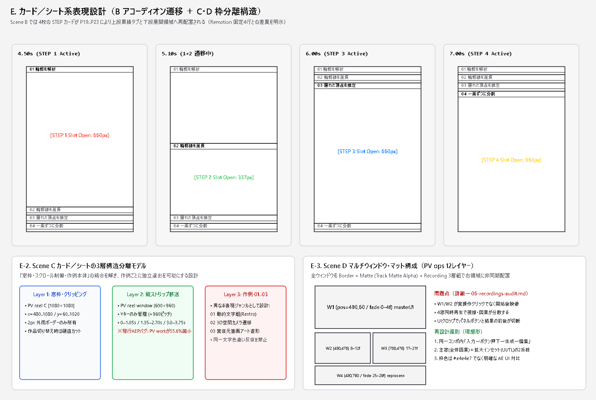

# E. カード／シート系表現設計（B アコーディオン・C ストリップ分離・D 操作窓）

> ← [設計パッケージ目次へ戻る](./README.md)
> 参照図版: [04-accordion-and-cards.png](./diagrams/04-accordion-and-cards.png) ／ [step1-4-intermediates.png](./assets/step1-4-intermediates.png)

---

## 1. Scene B のアコーディオンカード＆累積ヘッダ構造

`[回収事実 / 実測値]` 元 AEP (`05-master.ts`) の Scene B (`4.250..7.917s`) は、単なる「固定4行リスト＋下枠」ではなく、**上下2群に分かれたアコーディオンスタック** で構成されている（[verification/beats/beat-011..017.png](../../verification/beats/) とも一致）。

### 1.1 `Linked Quad 7..10` × `P 19..23` の幾何構造

- **幅と X 範囲**: Col 6..11（`x = 546..1048.08`, **幅 `502.08px`**）。
- **高さ配分**: 各 `STEP N card [264..267]` は対応する `Linked Quad` の 4隅座標を結ぶ表現を持ち、展開時 **`660px` 高**、格納時 **`38〜39px` 高**（`Divider N` は上端 `+27px` の位置に 1.5px 横線を引く：`Math.min(a[1]+27, e[1])`）。
- **白地マスク `tab backgrounds [170]`**: `502×26px` の白い短冊4枚（`y=210.96, 248.96, 287.96, 326.96`）がタイトル行背面を不透明白で覆い、背後の「筆」や背景グリッドがタブ文字と干渉するのを防いでいる。
- **4状態の時間遷移（[04-accordion-and-cards.png](./diagrams/04-accordion-and-cards.png) 上段参照）**:

| 時刻 / 拍 | 稼働中 (`100%`) | 上段スタック済 (`100%` or `45%`) | 展開スロット (`y`) | 下段待機スタック (`45%`) |
|---|---|---|---|---|
| **`4.333..5.000s`** (S1) | **`01 輪郭を解析した/中`** | （上段 1本のみ） | **`STEP 1`: `191..851`** | `02` (`851..889`), `03` (`889..928`), `04` (`928..967`) |
| **`5.208..5.625s`** (S2) | **`02 輪郭線を延長した/中`** | `01` (`191..229`) | **`STEP 2`: `229..889`** | `03` (`889..928`), `04` (`928..967`) |
| **`5.875..6.625s`** (S3) | **`03 隠れた頂点を推定した/中`** | `01`, `02` (`191..268`) | **`STEP 3`: `268..928`** | `04` (`928..967`) |
| **`6.917..7.917s`** (S4) | **`04 一画ずつに分割中/分けた`** | `01`, `02`, `03` (`191..307`) | **`STEP 4`: `307..967`** | （全開完了） |

### 1.2 `LENS frame [9]`・`lens matte [263]`・`Lens magnifier [23]` の関係

- **元 AEP 実測値**: `lens matte` は `pos=[660, 810]`、直径 **`420×420px`**（半径 `210px`、`4.250..7.917s` で配置、`4.967..5.070s` でフェードイン）。内部コンポ `45-Lens magnifier.ts` は `STEP1..4` を **`Scale = 300%`**, `Position = [-1731, -726]` で拡大しており、コンポ中心 `[540, 540]` は元文字の **`(757, 422)`**（竹冠左下〜左交差密集部）を拡大表示していた。`LENS frame` には `420×420`（`w=3`）の大円、`140×140`（`w=2`）の参照元リング、接続線 `connector`（`w=2`）が含まれる。
- **`[確定事項と現行Remotion実装の乖離]`**: 現行 `SceneB.tsx` はアコーディオン開閉（`P19..22`）を行わず上段4行へ固定配置（`y=196..342`）し、拡大鏡も `r=46px / zoom=1.8` へ縮小して隅へ逃がしている。本設計では「1つの文字に工程が累積重畳し、下端や未完部と干渉せず推定根拠を拡大実証する」という B 本来の役割を守るため、**タブ状態の視認性＋重なり禁止**を基準にアコーディオン式または累積帯＋拡大窓（元 `420px` 系と被らない位置調整を含む）を採用する。

---

## 2. Scene C の「窓枠・スクロール制御・作例本体」3層分離設計

`[回収事実 / 実測値]` 元 AEP (`54-PV reel C` → `59-PV reel window` → `62..64 PV work A/B/C`) には2つの構造欠陥があった：
1. `PV work A/B/C` (`1080×1080`) が `600×960` の `PV reel window` 内で **`Scale = 55.5556%`** へ機械縮小された結果、`作品 01`（`40pt`）の文字まで約 `22px` へ縮み、縦長スペースの左右に意図しない余白ができていた。
2. 3つのコンポすべてが **`PV glyph WA/WB/WC`（同一「筆」1文字）** を呼び出し、1枚の枠・1つの文字構造に縛られていた。

### `[理想的表現構想]` 3層の責務分離と各作例の世界観分化

1. **Layer 1：ビューポート窓枠 (`Viewport Frame`)** — 右ステージ（`x=480..1080, y=60..1020`, `600×960`）のクリップ領域と外枠（`2px`）のみを担当。作品内部の背景色（例：作例2のみ黒／ダーク地）は窓内部が所有し、外枠は常に端正に保つ。
2. **Layer 2：スクロール移送シート (`Strip Controller`)** — `960px`（または `1080px`）セル間隔でのY軸ページ送りのみを担当。`128 BPM` の拍点（例：`f237`, `f260`）に合わせ、長時間の曖昧スクロールを避けた**`3〜4f`（`0.12s〜0.17s`）のキレのあるハード寄りページ送り**で次作へ切り替える。
3. **Layer 3：作例セル本体 (`Work A / B / C`)** — 紙面／シート上の単一文字の反復を禁止し、互いに全く異なる3表現を作る：
   - **作例 01（キネティックタイポグラフィ）**: B 直後の「筆」または明朝・ゴシック文字を、**書き順（画の骨格）に沿って伸縮・跳躍させるモーショングラフィックス**（白地＋濃墨＋朱アクセント）。
   - **作例 02（3D カメラ空間展開）**: B や作例 01 と異なる曲線・斜画を持つ**別文字（実 Restro 新規分解出力）**を使い、分解済み筆画を Z 軸奥行きに配置して 3D カメラが空間を縫う構成（暗地コントラストまたは高奥行き背景で映像世界の差を明確化）。
   - **作例 03（グラフィック再構成／イラスト調分解）**: 文字の漢字枠だけでなく**絵柄・ベクターシェイプまたは「Restro」等の図案**を筆画単位で分解し、元の形とは別のパターンやリズムへ組み替える作品表現。

---

## 3. Scene D の操作ウィンドウ／マット分離

`[回収事実 / 実測値]` `52-PV ops.ts`（`12`レイヤー）は、`W1..W4` をすべて **`border` (2px 罫線 `#ebebf0`) ＋ `matte` (Track Matte 矩形) ＋ `rec` (.mp4 映像)** の3層1組として配置していた（`W1: pos=[480,60]`, `W2: [480,476]`, `W3: [788,476]`, `W4: [480,760]`）。

`[理想的表現構想]`：
- 枠色 `[0.92, 0.92, 0.94]` は背景 `#f7f7f7` 上で境界が消えてしまうため、実操作ウィンドウは **AE ダーク UI（`#1e1e1e` / `#232323`）との明快なコントラストと最小 1〜2px 暗枠** を持つ。
- 4つの小窓に別録画を同時表示すると視聴者の焦点が迷うため、**主窓（コンポ全体と結果）＋拡大インセット窓（パネルボタン押下・タイムライン `STROKE_*` 展開・キーフレーム操作）** の最大2系統へ役割を分離し、時間順（入力選択 → `Decompose` 実行 → レイヤー展開 → 個別アニメーション）を明確に見せる（録画素材は [06-recordings-audit.md](./06-recordings-audit.md) を参照）。
