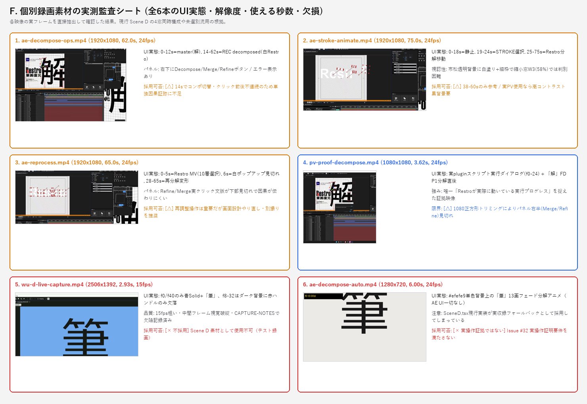

# F. 個別録画素材の一次監査と新規収録仕様

> ← [設計パッケージ目次へ戻る](./README.md)
> 参照図版: [05-recordings-audit-sheet.png](./diagrams/05-recordings-audit-sheet.png)

---

## 1. 全6本の録画ファイル個別監査結果

`[回収事実 / 実測値]` リポジトリ内に回収・保存されている全 `.mp4` 録画素材を1フレーム単位で抽出し、UI 表示・操作パネル・解像度・使える秒数・Scene D「同一コンポ内での因果証明」適格性を監査した結果は次の通りである。

| ファイル名 | 寸法 / FPS / 尺 | 画面内に実際に映っている内容（UI実態） | 欠陥・因果の断絶・視認性問題 | 判定と扱い |
|---|---|---|---|---|
| **`assets/rec/ae-decompose-ops.mp4`** | `1920×1080` / `24fps` / **`62.00s`** (`1488f`) | • `0..12s`: AE UI 上の `Composition master`（`STROKE_016_runs6` 選択＋`解`）＋右下 `Restro` パネル（`Decompose`/`Merge`/`Refine`）＋右側 `ty-plus`＋**左下エラーバナー (`expressions errors: error 1 of 16`)** • `14..36s`: `Composition REC decomposed`（市松透明背景に白文字 `Restro` のみ静止） • `38..62s`: `t/r/o` 4画の赤い選択ハンドル＆ベジェ運動 | • `14s` で別コンポへ切り替わっており、**「文字入力 → `Decompose` ボタン押下 → 分解完了」の一連の操作因果が映っていない** • 元の PV `master` 上に `error 1 of 16` バナーが映り込んでいる | **`[△ 要慎重]`** 単独の主証跡には不適。`38..60s` のタイムライン編集断片も背景コントラストが低い |
| **`assets/rec/ae-stroke-animate.mp4`** | `1920×1080` / `24fps` / **`75.00s`** (`1800f`) | • `0..18s`: 白 `Restro` 静止 • `19..24s`: `STROKE_003/005/007/009` 選択 • `25..75s`: CTI を動かし回転 (`0x+9°`)・位置キー操作 (`r/t/o` 移動) | • `52-PV ops.ts` では `st=-39.30` / `scale=58.26%` で `W3` 窓へ抜粋されたが、市松背景×白文字のため縮小窓で文字の境界・操作結果が読み取りにくい • 分解ボタンを押す瞬間は含まれない | **`[△ 部分可・要改善]`** キーフレーム操作の補足には使い得るが、新規収録に置換すべき素材 |
| **`assets/rec/ae-reprocess.mp4`** | `1920×1080` / `24fps` / **`65.00s`** (`1560f`) | • `0..5s`: `Restro / MV` 10層選択＋操作 • `6s`: **白いスクリプト実行UIウィンドウがビューア下端に見切れて一瞬開く** • `8..26s`: 静止 • `28..65s`: `Restro` 筆画の再調整・ズレ変形 | • `6s` の再処理ポップアップが画面下に見切れており、どのボタン/パラメータを操作した結果 `28s` に変形したかが不明瞭 • 同じく市松背景×白文字で視認性が低い | **`[△ 不十分]`** Merge/Refine の有用な動作テーマだが再撮影を推奨 |
| **`assets/rec/pv-proof-decompose.mp4`** | `1080×1080` / `24fps` / **`3.62s`** (`87f`) | • `f0..f24`: `master` コンポ上で **`Executing Script ... (Script execution time 0 minutes 4 seconds)`** ダイアログが進捗表示され、`FDP1 outline`・`解` の分解結果を伴う • `f25..f86`: 処理直後の静止 | • **現存動画の中で唯一「Restro スクリプトが実際に実行中である瞬間」を捉えている** • しかし `1080×1080` 正方形クロップのため **右側 `Restro` パネルの左端 `Decompose` しか映らず（`Merge/Refine` 見切れ）**、かつクリック前の「元テキスト選択」も映っていない | **`[△ 補助証拠のみ]`** 「実動作の証拠」としては参考価値があるが、因果連鎖の主映像には寸足らず |
| **`verification/wu-d-live/wu-d-live-capture.mp4`** | `2506×1392` / **`15fps`** / `2.93s` (`44f`) | • `f0`・`f40`: `Composition RestroLiveD` 青ソリッド背景 (`#6b9be8`)＋「筆」 • `f8..f32`: ダーク背景に赤い6点の角ハンドルだけが残り本体形状が消失 | • 中間フレームのシェイプ描画が完全に欠落しており、15fps と粗い（`CAPTURE-NOTES.md` でも欠陥記録済み） | **`[× 完全不採用]`** テスト捕捉の失敗素材。使用禁止 |
| **`assets/rec/ae-decompose-auto.mp4`** | `1280×720` / `24fps` / `6.00s` (`144f`) | • `#efefe9` 単一背景上で「筆」の13画が順番に薄くなりまた戻るだけ。**After Effects UI・タイムライン・Restro パネル一切なし** | • 現行 [SceneD.tsx](../../video/src/scenes/SceneD.tsx) がフォールバック素材として使ってしまっているが、**AE 実操作の録画ではなく合成モーション動画** である | **`[× Scene D として不適]`** 「After Effectsで操作できる」主張の証拠にならない |

---

## 2. Scene D 新規実機収録の必須要件 `[未確定・不足事項]`

現行 6本すべての欠陥（コンポ分断、市松白文字の低コントラスト、ボタン見切れ、クリック前の不在、`error 1 of 16` バナー映り込み）を踏まえ、本制作に向けた **新規実機収録仕様** を以下の通り定義する。

1. **クリーンな単一収録用コンポ（`1080×1080` または `16:9` 高コントラスト）**:
   - **市松透明×白文字を禁止**。PV 世界観と直結するオフホワイト背景（`#f7f7f7` 等）に濃墨（`#111111`）のテキスト/シェイプ、またはダークコンポ上にハイコントラスト表示を置き、縮小表示でも一目で文字と `STROKE_*` 選択枠が読める画質にする。
   - 不要な式エラーバナー（`expressions errors`）や PV 開発用他プラグイン窓を出しっぱなしにしない。
2. **撮影すべき「1本の連続因果」**（1カットまたは明確に繋がる2連続操作、15〜20秒分を収録して 3.75s 窓へ編集）：
   - **Phase 1 (Before)**: タイムラインに **単一テキストレイヤーまたは単一合成シェイプレイヤー**（例：「筆」や制作漢字・記号）が1本だけある状態を見せる。
   - **Phase 2 (Action)**: カーソルが明確に **`Restro` パネル（`Decompose` / `Merge` / `Refine` 全3ボタン見切れなし）** へ移動し、`Decompose` をクリック（またはプログレス完了）する瞬間を捉える。
   - **Phase 3 (After & Edit)**: タイムライン上に複数の **`STROKE_001..N` レイヤー** が一斉に生成・展開される様子 → そのうち数画を選択し、位置/回転キーやタイムラインを実際にドラッグ・ズラして文字が生き生きと動き出す瞬間までを、同じコンポ内で撮影する。
3. **画角設計（2窓構図への対応）**:
   - Full `1920×1080`（または `2560×1440`）で UI 文字が潰れないスケール（AE UI 125〜150% または高解像収録からの無劣化クロップ）で収録し、編集時に「**メインコンポ＋タイムライン全体（主窓）**」と「**`Restro` パネル＋クリック＋`STROKE_*` 層生成部のクローズアップ（副窓）**」へ無理なく切り出せる構図を取る。
