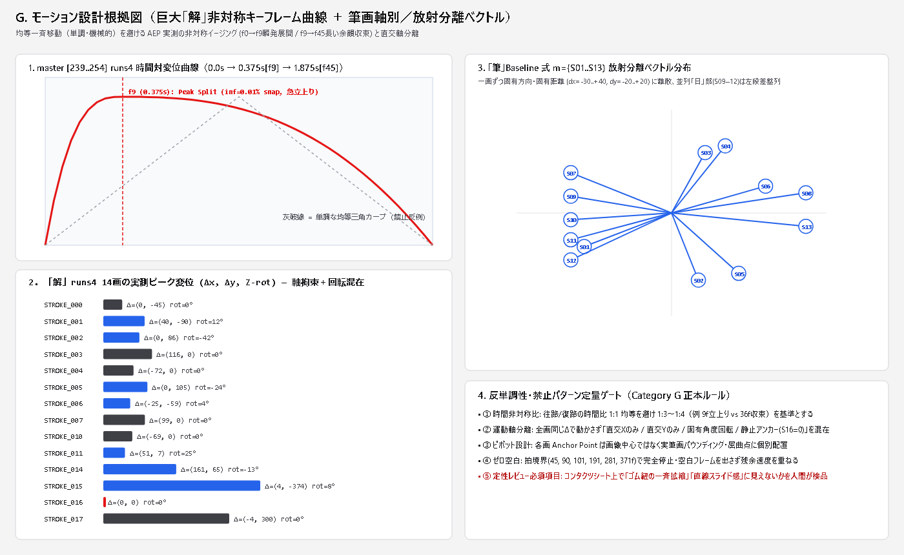
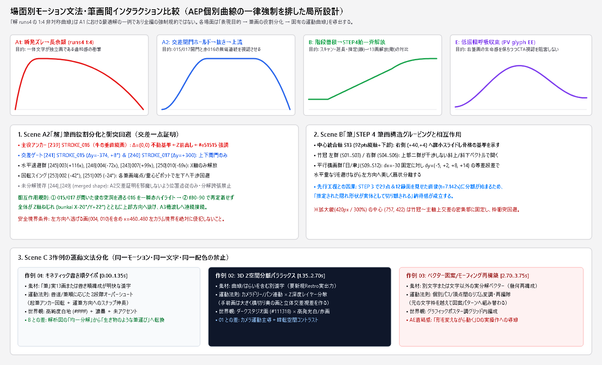
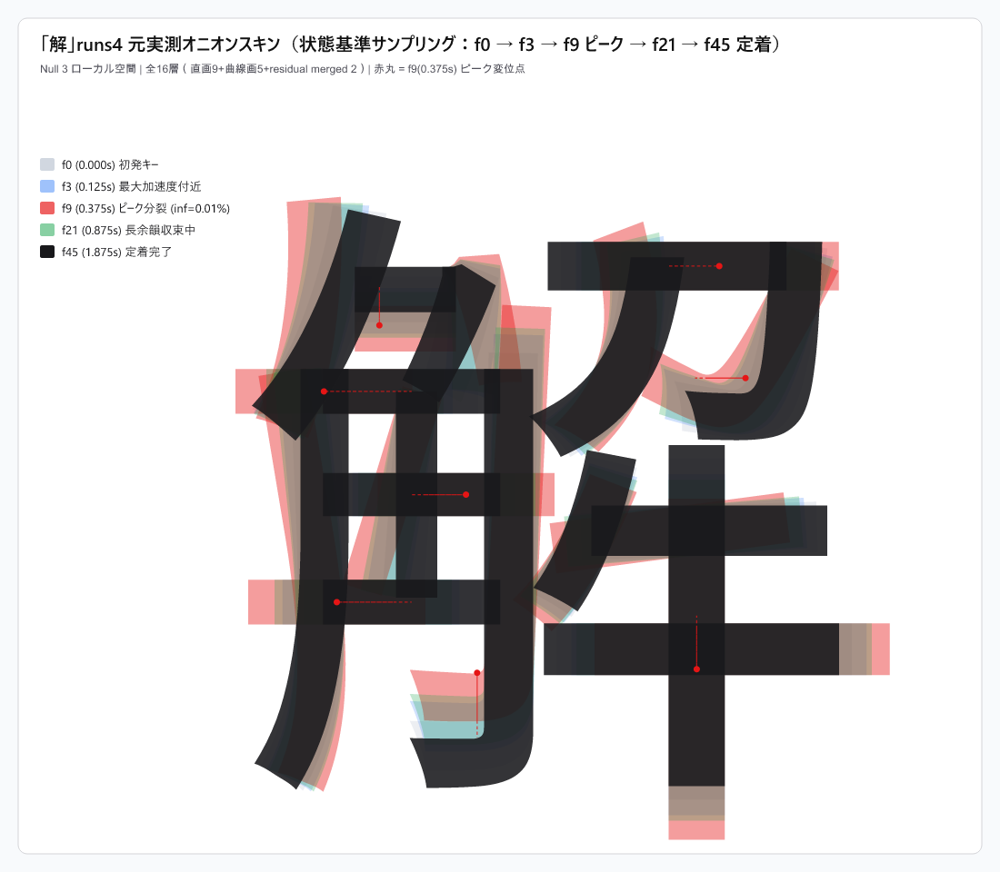

# G. モーション設計（個別筆画の運動役割・相互作用・場面別文法）

> ← [設計パッケージ目次へ戻る](./README.md)
> 参照図版: [06-motion-curves-and-vectors.png](./diagrams/06-motion-curves-and-vectors.png) ／ [08-per-stroke-choreography.png](./diagrams/08-per-stroke-choreography.png)
> 状態基準オニオンスキン: [「解」runs4 実測](./diagrams/motion-kai-runs4-onion.png) ／ [「筆」STEP 4 実測](./diagrams/motion-fude-onion.png) ／ [Scene A2 新設計](./diagrams/motion-kai-designed-a2-onion.png)

| モーション解析基礎（AEP実測データ） | 場面別モーション文法・筆画間相互作用図 |
|---|---|
|  |  |

| 「解」runs4 状態基準オニオンスキン | 「筆」STEP 4 式駆動オニオンスキン | Scene A2 新設計（開門ホールド→流出） |
|---|---|---|
|  |  |  |

---

## 1. 元 AEP 実在モーションの回収分析（参考事例であり全編強制規範ではない）

`[回収事実 / 実測値]` 元 AEP 内のモーションは全編均一ではなく、用途に応じて複数の手法が存在する。とくに高い評価を得た A1 導入（`beat-001..004`）がなぜ単調にならなかったかを一次実測値から分解する。

> **重要な設計分離**: ここで回収する `runs4` の `1:4` 時間比（`f0→f9→f45`）や `dx/dy` 値は、**A1 という導入場面（短い瞬間インパクト＋長い余韻定着）が生み出した固有の成功例** である。これを他場面（B の工程蓄積、C の3異なる作例、E の静かな収束）へそのまま強制テンプレートとしてコピーすることは誤りであり、設計時は「目的 → 各筆画の役割 → 固有の時間曲線」を場面ごとに導出する。

### 1.1 A1 巨大「解」(`runs4` / `bunkai`) の非対称カーブ実態

- 全アニメート対象レイヤーは **3キー（`@0.000s [f0]`, `@0.375s [f9]`, `@1.875s [f45]`）** で組まれている（`bunkai` 上は `st=0.083s`, `Null 3` 上で `YRotation=+20°, Z=-96`）。
- **往路 `f0 → f9`（`0.375s` = 9フレーム）**: Out Speed が高く設定され（X/Y `speed ≈ 19.5`, Z-rot `speed ≈ 3.3`）、**`influence = 100%` の鋭い初速立上り → `f9` ピークでは `influence = 0.01%` で急ブレーキ停止（スナップ感）** する。
- **復路 `f9 → f45`（`1.500s` = 36フレーム）**: 往路の **4倍の尺（時間比 1:4）** を使い、`inInfluence = 100%` の長い減衰曲線を描いてじわじわと完全静止ポーズへ吸い込まれる。
- **反復ミラー群（`runs5`, `runs6` 参考）**: `05-master.ts` `[214..230]`・`[196..212]`（現行無効 `DIS`）も同様に「急立上り＋長収束」系だが、C/D/E 本編へ機械移植せず局所目的に応じて採否を決める。

### 1.2 `runs4` の運動軸拘束と個別ピボット実測値

> **`[回収事実 / 実測値]`（2026-11 再検証訂正）** `runs4` 16層は**全層が「解」グリフに属する実 Restro 分解要素**（直線4頂点画9本＋3次ベジェ曲線画5本＋未分解 `merged shape` 2層）である（旧「プロキシ図形」記載を撤回、詳細は [03-assets-catalog.md §3](./03-assets-catalog.md)）。機械可読データ：[`data/kai-stroke-runs-2d.composition.json`](./data/kai-stroke-runs-2d.composition.json) 他。状態基準オニオンスキン：[`diagrams/motion-kai-runs4-onion.png`](./diagrams/motion-kai-runs4-onion.png)（[SVG](./diagrams/motion-kai-runs4-onion.svg)）— 均等サンプリングを廃止し、`f0 (0.000s 初発)`・`f3 (0.125s 最大加速付近)`・`f9 (0.375s ピーク停止, influence=0.01%)`・`f21 (0.875s 長余韻収束中)`・`f45 (1.875s 完全定着)` の5状態を重ねて形状と時間の対応を可視化。

`[回収事実 / 実測値]` `runs4` 16層（`14 STROKE_*` + `2 merged`）は一律の放射拡散ではなく、形状から割り当てられた役割で動いている：
- **アンカー静止基準**: **`STROKE_016_runs4` (`[239]`, `Δ=(0,0), rot=0°`)** は微動だにしない中心軸（不動の基準画）として固定。
- **垂直Y軸限定グループ**: `000 (0,-45)`, `002 (0,+86, -42°)`, `005 (0,+105, -24°)`。
- **水平X軸限定グループ**: `003 (+116,0)`, `004 (-72,0)`, `007 (+99,0)`, `010 (-69,0)`。
- **直交クロス＋個別ピボット**: 交差横画 **`015 (+4,-374, +8°)`**・**`017 (-4,+300, 0°)`** が垂直画 `016` を上下に跨いで大きく開き、各画の `Anchor Point` はコンポ中心ではなく **各筆画の屈曲点・重心**（例：`015=[200.5,413.5]`, `001=[-314.8,-125.1]`）へ設定されている。

---

## 2. `Baseline`「筆」と `PV glyph` の分離表現実測・再評価

| 対象 | 元 AEP 実測モーション | 長所 | 欠陥・改善設計 |
|---|---|---|---|
| **Baseline / STEP 4** | 式 `m={'S01':[-26,10]...}` × `easeOut(t, 7.142, 7.611, 0, 1)` | 13画が「中心軸 `S13(+40,+4)`」「竹冠左右群」「日段左段差 (`dx=-30, dy=-5/+2/+8/+14`)」で小気味よく展開 | STEP 3 の 29頂点＆推定面直後に一拍 (`0.47s`) で開くため**「解析→解放」の因果明快**。S13 が92pts総合軸であることを前提に周辺画と重なり制御 |
| **PV glyph A2 (`build-a2`)** | 全13画が斜上 (`dy=-30`) から降下定着 | 左→右の出現遅延がある | 「筆」を使っており A1「解」と不連続。A2 主役から除外し `解` 交差証明へ移行 |
| **PV glyph WA / WB / WC** | WA: 下+26pxから全画同速上昇 / WB: ±15..33px 外拡＋±2° / WC: `S04/08/12` のみ伸縮 | 作品ごとに動きを変えようとした意図がある | **同一文字「筆」** に留まり小変化止まり。新設計では 3異なる作例世界へ全面刷新 |
| **PV glyph EE** | `@0→1.4→2.8→4.54s` の微小呼吸（`±5〜20px`） | 右 CTA と喧嘩しない静かな生命感 | 継続採用。左 `Logo` 帰着後、CTA 文字可読性を守る振幅上限を順守 |

---

## 3. 各場面の具体的モーション設計・筆画役割・相互作用仕様 `[理想的表現構想]`

各場面の表現目的から導出した **運動曲線（Curve Grammar）・各筆画のピボット／役割・筆画間インタラクション** を規定する。

### 3.1 Scene A2（`f45..f101`）：巨大「解」交差一点突破と A3 上昇接続

- **運動文法（v2・元AEP実測準拠）**: **「一斉速攻→長い減衰収束→ブリード巨大ホールド→決めポーズ退出」**。元AEPの runs4 群キー実測（comp_05 idx 239-254、プローブ結果は本節末尾の検証JSONとダンプを参照）に基づき、旧来の「順次ペールカスケード＋縮小フィット＋フェード消失」は**発明された動き**として廃止した。実測では全16画が `t=0 / 0.2917 / 1.7917` の3キーで**同時に速く攻めて長い ease-out で収束**し、変位は符号非対称（pos -79..+49px、rot -38..+27°）であった。
- **個別筆画の役割と衝突防止**:
  1. **一斉アタック (`rel 0.2..0.42`)**: `JOLT_ATTACK` 窓で全画がほぼ同時（±0.015s のランク差のみ）に `JOLT_D` の実測ピーク変位＋`JOLT_ROT` の実測 RotZ へ跳ぶ。カスケードではなく「一発の衝撃」。
  2. **長い収束テール (`rel 0.42..1.45`)**: `JOLT_TAIL_END` までの長い ease-out で各画が固有の軌跡で静止位置へ戻る。交差三連（`015/016/017`）のみ `CROSS_RESID=0.55` の残差分離をホールド `[1.3,1.85]` まで保持し、「横画の裏に隠れていた縦画が切れていなかった」証明ビートを残す（`CROSS_RESID_OUT` で退出へ解放）。
  3. **ブリード・ホールド (`rel ~1.3..1.85`)**: フィールドは zoom 0.89 で固定（`bleedHoldStable` で検証）。union は画面 x≈472..1120・交差点 x≈1047 に収まり、右端へ約40-70px ブリードして「額縁で切れた巨大な字」の読みを作る。左カラム `x≥460` は回転込み実画面座標で `SAFE_LEFT=470` にクランプ（`strokeDelta` 内の rotated-bbox floor）。
  4. **未分解残存層 (`merged shape 2/3`)**: `JOLT_D`/`JOLT_ROT` に実測値を持ち、他画と同じ一斉アタックに参加するが過大な分離演出は掛けない。
- **A3 連続接続（`rel 1.85..2.33`）**: フェード（`SCENE_FADE 1.85..1.97`）で退場し、`DRIFT_UP`/`SETTLE_IN` のズームアウトが Scene B ハンドオフへ橋渡しする。元AEP同様「モーションカット」ではなくフェード退場を維持（ブリッジ層の重ね順は `masterPatch` が管理）。
- **制作経路の単一ソース化（2026-11 改訂 v2）**: A2 の振付は `video/src/design/choreography.ts` の `SCENE_A2` + `createA2Choreo(strokes)` が唯一の正本であり、`SceneA2.tsx`（Remotion 本番描画）・`tools/design/verify-local-motion.ts`（数値検証）・`tools/design/motion-figures.ts`（オニオンスキン図版）・`tools/design/render-scene-a2-prototype.ts`（ラスタ試作→mp4）の4系統が同一評価経路を共有する。ストローク変換は `strokePoint(name, p, rel)`（重心回転→フロア付き平行移動）に一本化され、検証・図版・試作・本番のいずれも独自の変換式を持たない。幾何は `glyph.tsx compStrokes("master")` が `comp_05` 実レイヤーから生成する。旧 `SCENE_A2_DESIGN` / `evalSceneA2StrokePose` は廃止済み。
- **状態基準図（本番経路版 v2）**：[`diagrams/motion-kai-designed-a2-onion.png`](./diagrams/motion-kai-designed-a2-onion.png)（[SVG](./diagrams/motion-kai-designed-a2-onion.svg)）— `compStrokes` 実形状ポリゴンを画面空間で位相別に重ね、ストローク重心の軌跡（破線）・ホールド時の全画群 union bbox（シアン破線）・復元縦画の交差点（赤丸）・`x=460` 左カラムクリップ境界を同一データから描画。`f45 (エントリー)` → `f~56 (一斉ジョルト・ピーク)` → `f~83 (ブリード・ホールド)` → `f~98 (フェード)`。
- **数値検証（[`verification/local-motion-check.json`](./verification/local-motion-check.json) の `sceneA2ProductionCheck`）**: 本番と同じ `compStrokes → createA2Choreo → strokePoint/toScreen` 経路で評価し、`crossingFullyVisible`（交差点が画内＋交差三連の bbox が重なりを維持）・`bleedHoldExpected`（左列クリア＋右/下ブリード＋縦中心が画内）・`leftColumnClear`・`joltAttackSimultaneous`（全画が攻撃窓内に env≥0.9）・`nonCrossSettled`・`crossResidHeld`・`bleedHoldStable`（ホールド中フィールド不変）・`fadeComplete` の8項目が全て `true`。
- **局所試作・実動画**: [`prototypes/scene-a2-kai/scene-a2-kai.mp4`](./prototypes/scene-a2-kai/scene-a2-kai.mp4)（comp `f45..f100`、56f、24fps）と静止画3枚（[`prototype-manifest.json`](./prototypes/scene-a2-kai/prototype-manifest.json)）を本番経路で再生成した。塗りつぶし＋復元縦画アクセント輪郭のみの近似で、ゴースト輪郭・ガイドエコー・交差マーカー等のプレゼンテーション層は `SceneA2.tsx` 側に残る（manifest に明記）。

### 3.2 Scene B（`f101..f191`）：工程蓄積（静）→ 13画解放（動）の落差

- **運動文法**: **「階段蓄積（STEP 1..3）→ 拍点一斉解放（STEP 4）」**。
- **筆画・要素間インタラクション**:
  - `STEP 1..3`（`4.25..7.00s`）では主文字「筆」そのものは **移動させず静止台座として保持** し、走査線 (`scanline`)・延長線 (`extend A/B`)・推定頂点 `29点` と `12緑面`・`300%` 拡大鏡の**解析レイヤーだけが累積加算**される。
  - `t = 7.142s`（`STEP 4` 開示直後）に、それまで静止して解析されていた「筆」13画が **初めて立体的に 13個のベクトルへ分離移動** し（[fude-strokes-exploded.png](./assets/fude-strokes-exploded.png)）、`S09..S12` 横画群が等差間隔 `dy={-5, +2, +8, +14}` で美しく開くことで、「推定結果＝独立編集できる 13 の筆画」を身体的に理解させる。
  - **アコーディオン構造図（リグ実評価版・2026-11 追加）**: [`diagrams/motion-scene-b-accordion.png`](./diagrams/motion-scene-b-accordion.png)（[SVG](./diagrams/motion-scene-b-accordion.svg)）— `buildSceneBAccordionRig`（`video/src/design/rig.ts`）を `activeStep = 0..3` で実評価し、4状態のタブスタック配置・`660px` 展開スロット・`140→420px(300%)` レンズ鎖（ソース円・焦点点）を comp 座標から縮尺描画したもの。`verify-local-motion.ts` の `accordionChecks` と同一リグが生成するため、図版・数値検証・本番実装が同一構造を共有する。**2026-11 収斂済**: `SceneB.tsx` はこのリグを `evalSceneBActiveStep(t)` 経由で本番消費し、タブ・スロット・レンズの全矩形を `worldRect` から取得する（[05-cards-and-sheets.md §1.2](./05-cards-and-sheets.md) 参照）。
- **状態基準実測オニオンスキン（2026-11 刷新）**: [`diagrams/motion-fude-onion.png`](./diagrams/motion-fude-onion.png)（[SVG](./diagrams/motion-fude-onion.svg)）— 旧版が参照していた `01-Baseline`（CTI 焼き込みにより `t=0` でも `IoU = 0.7310` で静止凍結していたコンポ）から無変位正本 **`06-PV glyph`（[`data/pv-glyph-fude.composition.json`](./data/pv-glyph-fude.composition.json), rest `IoU = 0.9998`）**＋実式 `easeOut(7.142..7.611s)` へ切り替え、`7.142s (u=0.00 解放開始)`・`7.200s (easeOut≈0.52 立ち上がり)`・`7.350s (easeOut≈0.87 減速展開)`・`7.611s (u=1.00 ピーク完了)` の4状態をベクトル注釈付きで検証。[`verification/assembly-metrics.json`](./verification/assembly-metrics.json) 参照。

### 3.3 Scene C（`f191..f281`）：3作例の独立運動文法（差別化設計）

> **2026-12 再設計（差し戻し対応）**: 前版3作例（同一「筆」字形に orbit/wave/fold を割り当てただけの仕上げバリエーション）は表現として不採用となり、`SceneC.tsx` を全面再設計した。
>
> **2026-11-28 再差し戻し対応（本節が正本）**: 3作例は「異なる文字・配色・アニメーション手法を採用しただけで作品と判定しない」というオーナー指示により、以下の3点で作り直した。
>
> 1. **作例03「紋章」（`46-Logo` 公式ロックアップ45層の解体流用 ＋ `STROKE CONSTRUCTION / 45 PARTS` 表記）は撤回。** ブランド意匠（Restro ＋ 筆画復元 の公式ロックアップ）を「実復元筆画の作品」として見せるのは**意匠と実復元筆画の混同**である。45 はブランド意匠を分解した**レイヤ数**であって、復元した画数でも作品件数でもない（「45 PARTS」表記も同じ理由で不採用）。素材不足を理由に禁止事項を上書きすることはしない。
> 2. **作例03は実機 After Effects で分解した第三の漢字**を使う（`verification/rec-newmat/`）。既存ダンプに実在する独立した復元作品は「筆」「解」**2点のみ**（[03-assets-catalog.md §4](./03-assets-catalog.md) の棚卸し実測）であり、筆/解のステージング変種（`PV glyph A/B/C/WA/WB/WC`、`STEP1..4`、`41-BG decomposed strokes`、`53-PV probe char`）は**同一作品の一時配置**であって別作品ではない。
> 3. **書き順は実物的順序に一致させる。** AEP の `FUDE S01..S13` は**抽出インデックスであって書き順ではない**（13片中9片が不一致）。真の書き順（筆＝12画、竹6＋聿6、聿の縦は最終画）は**実ジオメトリから導出**し（`video/src/design/strokeSemantics.ts` `deriveFudeRoles`）、テストで固定した（`tests/scene-c-stroke-semantics.test.ts`）。13片＝12画である理由は**聿の横折が横と折れ縦の2片に分割されている**ため。
>
> ソース比較図: [`diagrams/motion-scene-c-works.png`](./diagrams/motion-scene-c-works.png)（[SVG](./diagrams/motion-scene-c-works.svg)）— `SceneC.tsx` の `WORK_SOURCES` と同一データから生成。

- **作例 01「墨帖」（筆・写経帖 sheet）**: 構成＝**罫線つきの写経用紙**（`#fbfaf6`、縦罫 `x=88 / 512`）に「筆」を `fitW 404 / center (300,420)` で据え、左マージン `x=44` に**書き順目盛**（各画の起筆高度に番号 tick。番号は導出した真の書き順 01..12 で、15px 間隔へ押し離して重なりを排除）。完成後は字の右下に**朱の印**（28px）が捺される。運動＝**書き順のドローオン**：真の書き順の順に、各画を**筆の進行方向に沿って**現す（`brushRevealMask` — 画の主軸方向に沿った CSS マスクの境界が筆先として進む）。描画速度は一定（`BRUSH_SPEED = 2700 px/s`）で、長い画ほど長くかかる＝**等間隔の機械的 stagger ではなく、文字そのものが定めるリズム**。横折（S07横→S08縦）は1画として連続して現れる。
- **作例 02「深解」（解・構造分離）**: 構成＝**ダーク面 `#14161c`**（3作例中唯一の暗セル）。`bunkai` の16片は半径三分位ではなく**解自身の構造（角／刀／牛）**で3分割し（`splitKaiParts` — 文字の中央線より左＝角、右上＝刀、右下＝牛）、**書き順の順序がそのまま奥行きになる**（角＝far, 刀＝mid, 牛＝near）。値は空気遠近で far `#6b7078` → mid `#a9abb5` → near `#f2eee4`。運動＝**構造分離**：書かれる順に角が退き、刀が中間を保ち、牛が前に出る（`perspective 1400px` ＋ `translateZ -95/0/+95`、各部品は自身の放射方向へ僅かにドリフト）。任意の色分けではなく、**文字の部品が分離する**ことが読影できる。
- **作例 03「飛白」（第三の漢字・自由運動）**: 構成＝**生成り `#efe9db`** の地に、実機分解した第三の漢字を `fitW 452 / center (300,400)` で置く。運動＝**自由運動**：各画が3グループ（均等な機械 stagger ではなく部品単位）で順に飛び込み着地し、成立後**1画だけが字形から外へ弧を描いて浮遊**する（＝左コピーの「分解した筆画は、それぞれ自由に動かせる」の実証）。第二作が「構造の分離」なら第三作は「運動の自由」で、3作例の運動文法が重ならない。
- **撤去した要素**: 旧実装の**虹色プローフラッシュ**（色分解の装飾）は全廃。デバッグ表示的な絵画的装飾であり、単調さの温床でもあった。
- **作例別検証**: [`verification/scene-c-works-assembly.json`](./verification/scene-c-works-assembly.json)（`tools/design/verify-scene-c-works.ts`）、書き順の固定は `tests/scene-c-stroke-semantics.test.ts`、描画証拠は [`prototypes/scene-c/`](./prototypes/scene-c/) と [`verification/scene-c-stills.json`](./verification/scene-c-stills.json)。

### 3.4 Scene E（`f371..f480`）：作品の帰還と購入導線（2026-11-28 作り直し）

> **2026-11-28 作り直し（ Atención指示への対応）**: 終盤が「締め」として成立する表現へ作り直した。撤去・変更は次のとおり。
>
> - **回顧タイル（B/C/D の静止画3連）を撤去。** 視聴者は約3.7秒前に同じ場面を見ており、静止画のダイジェストは情報の重複になる。加上 **D タイルは未完成場面の静止画**（開発用プレースホルダを含む）で、これは完成映画に置いてよい素材ではなかった。**作品の帰還そのものが回顧になる**（B の原理＝筆、C の作例＝書き上の筆）。
> - **虹色（4色）分離フィールドを撤去。** 4色が黒へ交叉する flash は配色ではなく色点滅で、単調さの温床。終盤は**墨一色＋朱1画**（真の書き順の最終画＝中心の縦＝作品の背骨）に統一し、Scene C 作例01の印と同じ朱を使う。
> - **筆画の見切れを是正。** ヒーローは**1:1**（実寸688px）で画面左 x=500 に左端を置き、**右側だけ**を額縁外へはみ出させる（元AEP `PV end` と同じ挙動）。以前の配置は左右両方を窗で切っていた。
> - **CTAタイポグラフィと情報の重複を是正。** CTA は**購入導線だけ**（`BOOTH で販売中` 54px/800 ＋ URL 26px/700）を、確定グリッドのステージ列 x=546 へ整列して置く。左カラムが「Ae バッジ／AFTER EFFECTS PLUGIN／Restro 筆画復元／タグライン」を常に保持しているため、**製品説明の繰り返し（旧 `After Effects プラグイン` 行）は削除**。ロゴの二重出しも排除。
>
> - **運動文法**: **「作品の帰還（E1）→ 購入導線の提示（E2）→ 2秒以上の静謐定着（E3）」**。
- **相互作用**: 右側の復元筆画（例 `PV glyph EE` 13画系）は小幅（`±5〜20px`）の緩慢な減衰収束で組まれ、左 `Logo`＋`Heading`（`15.50..16.167s` で中央復帰）と右 CTA テキスト群が読み取れる終盤 **`2.2s` 以上（`~f427..480`）** においては主文字の大きな移動を止め、微かな余韻または完全静止で読みやすさと品位を最大化する。
- **2026-11 実測検証**: PV-Master/PV-Chrome の差分マスクでシーン内容のみを分離計測（`tools/design/sc-e-diff.ts`/`sc-e-motion.ts`/`sc-e-measure.ts`）。ヒーローは f410–415 で画素差分 0 の完全静止を確認。旧実装は CTA stagger が ~f441 まで残り静定が 1.58s しかなかったため、`SceneE.tsx` のスタッガーを圧縮し **f437 以降シーン内容が完全静止**（残り ~1.75s）へ改善。左カラム・ギャップへの侵入は全計測フレームで 0px。
- **2026-11 構造修正（表現・構造レビュー指摘への対応・参考）**: 以下の4件を `SceneE.tsx` で修正した（うちヒーローの散乱運動は 2026-11-28 に上書きされ、±78px の小分離＋呼吸に置き換わっている）。
  - **筆画素材を無変位 rest ポーズへ差し替え**: ヒーローの筆画源を `Baseline`（01、ダンプ時 CTI の easeOut 途中で `Position.value` に ~0.73 散開オフセットが焼き付き、結合 IoU 0.7310）から `PV glyph`（06）の FUDE S01..S13 `poseT=2`（結合 IoU 0.9998 の検証済み正本、SceneC W1 と同一源）へ変更。分離・再集合の終端が真の字形に一致する。
  - **散開則を index/mod ファンから形状拘束則へ**: 旧則は `dist = 80 + (i*89)%140`・`swing=(i*47)%60`・`rot=(i%2)…(i%4)` の配列 index 剰余で全方向へ機械的に散らしていた。新則は各画の実頂点の PCA 主軸の**法線方向**へ変位を拘束し（横画は縦へ、縦画は横へ、斜め画は自身の法線へ）、変位量は「文字中心から各画のスライド軸への射影距離」に比例（`SLIDE_MAX=170` comp px、中心軸上の画は静止アンカー）。小画（bbox が文字幅の18%未満の両軸）はドット扱いで変位0.4倍・回転なし。回転は各画の実重心ピボットで `reach*10°` まで。色相はダンプ配列順ではなく書き順 rank の巡回（SceneC proof と同じ convention）。
  - **重複ロゴの解消**: エンドカードが描画していた `Logo` comp（公式ロックアップ artwork）は、chrome overlay が全編左カラムに保持する master[18] `Logo` と同一素材の二重出しだった。`e-end-card-clean.svg` の役割分担（左＝ブランド標章／右＝復元された造形と購買導線）に従い、カードからロゴブロックを撤去し descriptor→BOOTH→URL の CTA 階層のみへ。カードは内容高 ~210px に合わせ `CARD_TOP=425` へ再配置。
  - **旧作例画像の更新**: recap タイル `assets/rec/e-band-{b,c,d}.png` は v13 時点（11-25）の B/C/D レンダー切り出しで、その後の Scene B accordion 再構成・Scene C 3作品差別化・Scene D 録画統合を反映していなかった。現行 PV-Master の代表フレーム（B=f185、C=f220、D=f330、右ステージ x480-1080 × y300-760 の 600×460）から再切り出しして差し替え。

---

## 4. 単調性・破綻を阻止するための設計判断ルール（検出と例外許容）

`[導出・推定]`＋`[理想的表現構想]` 以下の「既定パターンの無自覚な乱用」を設計レビューおよび実装検査で阻止する（**機械的な全面禁止ではなく、「表現上の必然性が説明できるか」を問う**）：

| 避けるべき単調・破綻パターン | なぜ単調／破綻になるか | 本 PV における具体的な設計代替・判定基準 |
|---|---|---|
| **1:1 三角イージング（全編均等加減速）** | 動きにタメ（予備・余韻）や質量差がなくなり、スライドショーに見える | 場面目的に応じた **意図的非対称カーブ** を選ぶ（衝撃は急立上り＋長余韻、開門証明はホールド付、工程は静→動の段差） |
| **単純等差スタガー（`t0 + i * k` 一辺倒）** | レイヤー番号順に機械的に波打つだけで、筆画の造形意味が無視される | まず **主役画・基準軸** と **追従画・開門画** へ意味グルーピングし、構造単位で緩急を設計する（例：`S09..12` の「日」組・`015/017` 対向組） |
| **index/mod 起因の全方向均等飛散・乱数回転** | 爆発エフェクトのようになり、漢字の骨格や Restro の「正確な筆画復元」と矛盾する | 各画の **形状（縦・横・点・払い）に応じた軸拘束**（X限定／Y限定／静止アンカー／端点ピボット回転）を割り当てる |
| **コンポ中心基準（`[540,540]`）の回転** | 各画が文字中心の周囲で公転してしまい、筆画固有の重心が失われる | 回転やスイングを伴う筆画には必ず **各筆画の実屈曲点・重心・端点** に個別 `Anchor Point` を設定する |
| **全体スケール拡大と個別筆画変位の混同** | 全画が同じ拡縮率で動くだけだと「画像を拡大した」のと区別がつかない | 全体ズーム（`Null 3` / カメラ等）と各筆画のローカル相対変位を構造分離し、交差裏抜き・層分離が必ず発生するようにする |
| **拍境界での完全停止・空白フレーム・無脈絡点滅** | 音と映像の繋がりがぶつ切りになり、視線が迷子になる | 境界フレーム（`f45, f90, f101, f191, f281, f371`）では余韻運動または次シーン導入運動をクロスオーバーさせ空白ゼロとする。単なる色点滅で強調を代用しない |
| **定性限界の明示（図・数式のみで確定としない）** | イージング指数やオフセット数式が正しくても、実速度の心地よさや衝突の違和感は数値からだけでは読めない | 本章の規則を満たしたうえで、後続の部分モーション試作・**`2fps / 24fps` 実再生目視確認** を必ず経てタイミングを最終確定する |
