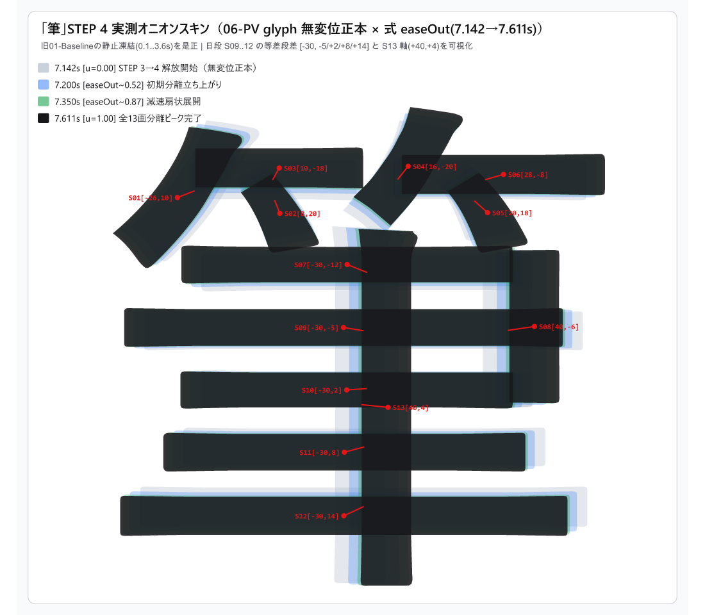
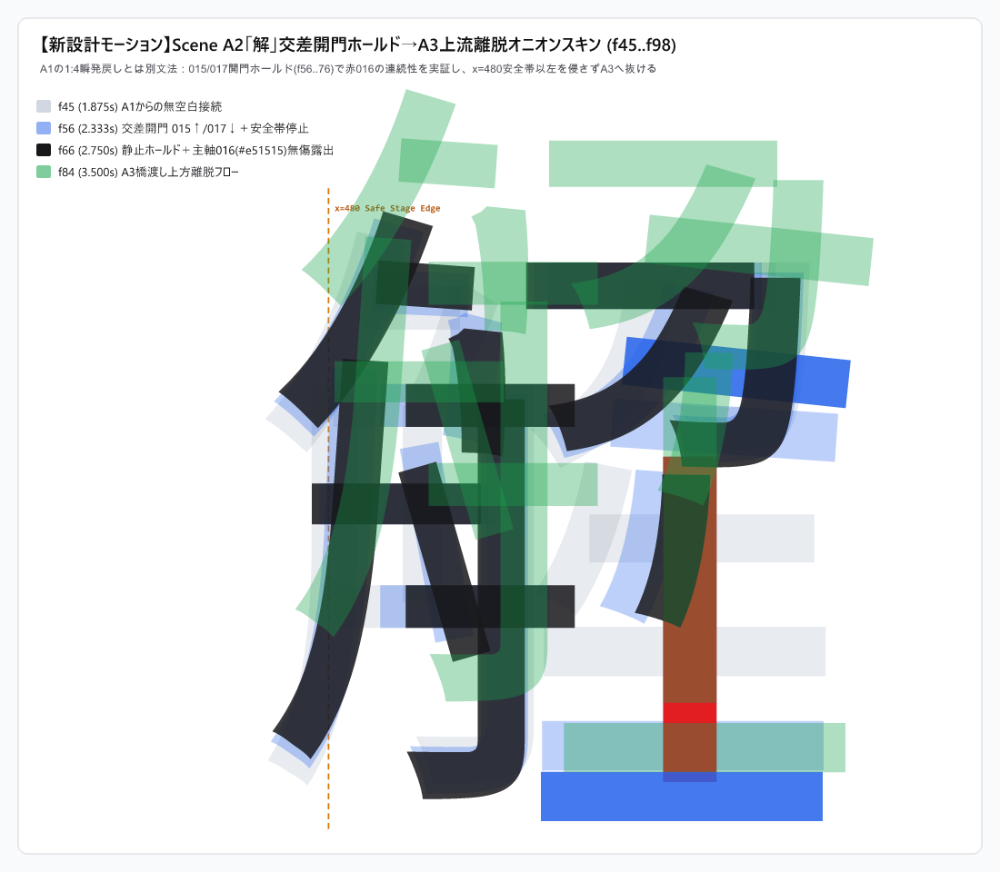

# G. モーション設計（個別筆画の運動役割・相互作用・場面別文法）

> ← [設計パッケージ目次へ戻る](./README.md)
> 参照図版: [06-motion-curves-and-vectors.png](./diagrams/06-motion-curves-and-vectors.png) ／ [08-per-stroke-choreography.png](./diagrams/08-per-stroke-choreography.png)
> 状態基準オニオンスキン: [「解」runs4 実測](./diagrams/motion-kai-runs4-onion.png) ／ [「筆」STEP 4 実測](./diagrams/motion-fude-onion.png) ／ [Scene A2 新設計](./diagrams/motion-kai-designed-a2-onion.png)

| モーション解析基礎（AEP実測データ） | 場面別モーション文法・筆画間相互作用図 |
|---|---|
|  |  |

| 「解」runs4 状態基準オニオンスキン | 「筆」STEP 4 式駆動オニオンスキン | Scene A2 新設計（開門ホールド→流出） |
|---|---|---|
|  |  |  |

---

## 1. 元 AEP 実在モーションの回収分析（参考事例であり全編強制規範ではない）

`[回収事実 / 実測値]` 元 AEP 内のモーションは全編均一ではなく、用途に応じて複数の手法が存在する。とくに高い評価を得た A1 導入（`beat-001..004`）がなぜ単調にならなかったかを一次実測値から分解する。

> **重要な設計分離**: ここで回収する `runs4` の `1:4` 時間比（`f0→f9→f45`）や `dx/dy` 値は、**A1 という導入場面（短い瞬間インパクト＋長い余韻定着）が生み出した固有の成功例** である。これを他場面（B の工程蓄積、C の3異なる作例、E の静かな収束）へそのまま強制テンプレートとしてコピーすることは誤りであり、設計時は「目的 → 各筆画の役割 → 固有の時間曲線」を場面ごとに導出する。

### 1.1 A1 巨大「解」(`runs4` / `bunkai`) の非対称カーブ実態

- 全アニメート対象レイヤーは **3キー（`@0.000s [f0]`, `@0.375s [f9]`, `@1.875s [f45]`）** で組まれている（`bunkai` 上は `st=0.083s`, `Null 3` 上で `YRotation=+20°, Z=-96`）。
- **往路 `f0 → f9`（`0.375s` = 9フレーム）**: Out Speed が高く設定され（X/Y `speed ≈ 19.5`, Z-rot `speed ≈ 3.3`）、**`influence = 100%` の鋭い初速立上り → `f9` ピークでは `influence = 0.01%` で急ブレーキ停止（スナップ感）** する。
- **復路 `f9 → f45`（`1.500s` = 36フレーム）**: 往路の **4倍の尺（時間比 1:4）** を使い、`inInfluence = 100%` の長い減衰曲線を描いてじわじわと完全静止ポーズへ吸い込まれる。
- **反復ミラー群（`runs5`, `runs6` 参考）**: `05-master.ts` `[214..230]`・`[196..212]`（現行無効 `DIS`）も同様に「急立上り＋長収束」系だが、C/D/E 本編へ機械移植せず局所目的に応じて採否を決める。

### 1.2 `runs4` の運動軸拘束と個別ピボット実測値

> **`[回収事実 / 実測値]`（2026-11 再検証訂正）** `runs4` 16層は**全層が「解」グリフに属する実 Restro 分解要素**（直線4頂点画9本＋3次ベジェ曲線画5本＋未分解 `merged shape` 2層）である（旧「プロキシ図形」記載を撤回、詳細は [03-assets-catalog.md §3](./03-assets-catalog.md)）。機械可読データ：[`data/kai-stroke-runs-2d.composition.json`](./data/kai-stroke-runs-2d.composition.json) 他。状態基準オニオンスキン：[`diagrams/motion-kai-runs4-onion.png`](./diagrams/motion-kai-runs4-onion.png)（[SVG](./diagrams/motion-kai-runs4-onion.svg)）— 均等サンプリングを廃止し、`f0 (0.000s 初発)`・`f3 (0.125s 最大加速付近)`・`f9 (0.375s ピーク停止, influence=0.01%)`・`f21 (0.875s 長余韻収束中)`・`f45 (1.875s 完全定着)` の5状態を重ねて形状と時間の対応を可視化。

`[回収事実 / 実測値]` `runs4` 16層（`14 STROKE_*` + `2 merged`）は一律の放射拡散ではなく、形状から割り当てられた役割で動いている：
- **アンカー静止基準**: **`STROKE_016_runs4` (`[239]`, `Δ=(0,0), rot=0°`)** は微動だにしない中心軸（不動の基準画）として固定。
- **垂直Y軸限定グループ**: `000 (0,-45)`, `002 (0,+86, -42°)`, `005 (0,+105, -24°)`。
- **水平X軸限定グループ**: `003 (+116,0)`, `004 (-72,0)`, `007 (+99,0)`, `010 (-69,0)`。
- **直交クロス＋個別ピボット**: 交差横画 **`015 (+4,-374, +8°)`**・**`017 (-4,+300, 0°)`** が垂直画 `016` を上下に跨いで大きく開き、各画の `Anchor Point` はコンポ中心ではなく **各筆画の屈曲点・重心**（例：`015=[200.5,413.5]`, `001=[-314.8,-125.1]`）へ設定されている。

---

## 2. `Baseline`「筆」と `PV glyph` の分離表現実測・再評価

| 対象 | 元 AEP 実測モーション | 長所 | 欠陥・改善設計 |
|---|---|---|---|
| **Baseline / STEP 4** | 式 `m={'S01':[-26,10]...}` × `easeOut(t, 7.142, 7.611, 0, 1)` | 13画が「中心軸 `S13(+40,+4)`」「竹冠左右群」「日段左段差 (`dx=-30, dy=-5/+2/+8/+14`)」で小気味よく展開 | STEP 3 の 29頂点＆推定面直後に一拍 (`0.47s`) で開くため**「解析→解放」の因果明快**。S13 が92pts総合軸であることを前提に周辺画と重なり制御 |
| **PV glyph A2 (`build-a2`)** | 全13画が斜上 (`dy=-30`) から降下定着 | 左→右の出現遅延がある | 「筆」を使っており A1「解」と不連続。A2 主役から除外し `解` 交差証明へ移行 |
| **PV glyph WA / WB / WC** | WA: 下+26pxから全画同速上昇 / WB: ±15..33px 外拡＋±2° / WC: `S04/08/12` のみ伸縮 | 作品ごとに動きを変えようとした意図がある | **同一文字「筆」** に留まり小変化止まり。新設計では 3異なる作例世界へ全面刷新 |
| **PV glyph EE** | `@0→1.4→2.8→4.54s` の微小呼吸（`±5〜20px`） | 右 CTA と喧嘩しない静かな生命感 | 継続採用。左 `Logo` 帰着後、CTA 文字可読性を守る振幅上限を順守 |

---

## 3. 各場面の具体的モーション設計・筆画役割・相互作用仕様 `[理想的表現構想]`

各場面の表現目的から導出した **運動曲線（Curve Grammar）・各筆画のピボット／役割・筆画間インタラクション** を規定する。

### 3.1 Scene A2（`f45..f101`）：巨大「解」交差一点突破と A3 上昇接続

- **運動文法**: **「ホールド開門＋主軸露光＋ねじれ抜け」**（A1 の `1:4` 瞬発衝撃ではなく、交差裏の連続性を**読み取らせるための短い滞留 `hold`** を中央に置く）。
- **個別筆画の役割と衝突防止**:
  1. **不動の主軸 (`STROKE_016_runs4 [239]`)**: `f45..f80` において位置ズレを最小〜ゼロに保ち、Z軸手前へ僅かに浮かせつつ、横遮蔽が開いた瞬間（`f56..72`）に **完全一本の連続縦画** として `#e51515` 強調を受ける。
  2. **交差遮蔽ゲート (`STROKE_015 [241]` 上行・`STROKE_017 [240]` 下行)**: `016` を挟んで上下直交方向へ素早く開き、`f60..76` にかけて開門ポーズを一瞬保つことで「普段は横画の裏に隠れていたが、切れていなかった」因果を視覚実証する。
  3. **周辺副筆画・回転画 (`000..014`)**: `003/007` は右へ、`004/010` は左安全帯 **`x ≥ 480` の手前で止める限界幅** まで逃がす。`002/005` は下端または交差支点ピボットで外向きスイングし、`016` 中心域へ絶対に被らない。
  4. **未分解残存層 (`[244], [249]` merged shape)**: 独立分離したかのような過大な回転・分裂演出を掛けず、一体輪郭ブロックとして自然追従・退避させ、素材の真実性を偽らない。
- **A3 連続接続（`f80..101`）**: 再び元の漢字へ戻って終わりにせず、開いた緊張状態のまま `bunkai` 空間傾き（`X=-20°, Y=+22°`）に乗って画群全体が上方向へ加速流出し、同時に左カラム開閉（`f93..108`）と Scene B「筆」下部せり出しを同じ上向きベクトルの流れで接続する。
- **新設計オニオンスキン＆局所実現可能性検証（[`tools/design/verify-local-motion.ts`](../../tools/design/verify-local-motion.ts)）**:
  - 状態基準図：[`diagrams/motion-kai-designed-a2-onion.png`](./diagrams/motion-kai-designed-a2-onion.png)（[SVG](./diagrams/motion-kai-designed-a2-onion.svg)）— `f45 (A1接続)` → `f56 (開門＋左安全停止)` → `f66 (ホールド＋赤016露出)` → `f84 (A3上方離脱)` の重要状態と `x=480 Safe Stage Edge` を可視化。
  - **実空間数値検証（[`verification/local-motion-check.json`](./verification/local-motion-check.json)）**: 3D カメラ投影＋左安全帯との干渉を検証した結果、ホールド時刻における `015` 下端（`y=385.4`）と `017` 上端（`y=905.6`）の縦開門窓は **`clearOpeningWindowHeightPx = 520.2px`**（視認閾値 `>120px` を十分確保）となり、一方の左向き退避画 `004` は元 `runs4` の `Δx = -72` のままでは 3D 投影後の左端が `x = 446.7px` へ達して左安全帯 `x = 460` を侵犯するため、**`Δx = -28` クランプにより `minScreenX = 490.4px`（`x ≥ 480` 厳守）** と定量補正した。

### 3.2 Scene B（`f101..f191`）：工程蓄積（静）→ 13画解放（動）の落差

- **運動文法**: **「階段蓄積（STEP 1..3）→ 拍点一斉解放（STEP 4）」**。
- **筆画・要素間インタラクション**:
  - `STEP 1..3`（`4.25..7.00s`）では主文字「筆」そのものは **移動させず静止台座として保持** し、走査線 (`scanline`)・延長線 (`extend A/B`)・推定頂点 `29点` と `12緑面`・`300%` 拡大鏡の**解析レイヤーだけが累積加算**される。
  - `t = 7.142s`（`STEP 4` 開示直後）に、それまで静止して解析されていた「筆」13画が **初めて立体的に 13個のベクトルへ分離移動** し（[fude-strokes-exploded.png](./assets/fude-strokes-exploded.png)）、`S09..S12` 横画群が等差間隔 `dy={-5, +2, +8, +14}` で美しく開くことで、「推定結果＝独立編集できる 13 の筆画」を身体的に理解させる。
  - **状態基準実測オニオンスキン（2026-11 刷新）**: [`diagrams/motion-fude-onion.png`](./diagrams/motion-fude-onion.png)（[SVG](./diagrams/motion-fude-onion.svg)）— 旧版が参照していた `01-Baseline`（CTI 焼き込みにより `t=0` でも `IoU = 0.7310` で静止凍結していたコンポ）から無変位正本 **`06-PV glyph`（[`data/pv-glyph-fude.composition.json`](./data/pv-glyph-fude.composition.json), rest `IoU = 0.9998`）**＋実式 `easeOut(7.142..7.611s)` へ切り替え、`7.142s (u=0.00 解放開始)`・`7.200s (easeOut≈0.52 立ち上がり)`・`7.350s (easeOut≈0.87 減速展開)`・`7.611s (u=1.00 ピーク完了)` の4状態をベクトル注釈付きで検証。[`verification/assembly-metrics.json`](./verification/assembly-metrics.json) 参照。

### 3.3 Scene C（`f191..f281`）：3作例の独立運動文法（差別化設計）

- **作例 01（書き順タイポグラフィ）**: 筆画を画数／筆順グループへ分け、**起筆点アンカー** を支点とした運筆スケール伸長＋微小オーバーシュート（`8〜10f` 伸び＋`4f` 収まり）をリズムよく連鎖させる（等間隔スタガー禁止・起筆とハネでテンポを変える）。
- **作例 02（3D Z軸カメラ空間）**: 暗転空間内（`#111318`）で、復元された曲線・斜画を含む別文字の筆画を Z 奥行 `-320..+260px` に配置。筆画同士の平行スライドではなく **カメラの回り込み（ヨー角パン＋緩い前進ドリー）** によって画の前後関係が立体的に入れ替わる運動を作る。
- **作例 03（ベクター幾何・図案再編成）**: 復元済みベクターの回転角・配置を拍ごとに別の幾何配列へスナップ／モーフ展開し、「元文字の拘束を離れたデザイン部品としての自由度」を示す（3作例すべてが異なる曲線・視点・色彩で成立する）。

### 3.4 Scene E（`f371..f480`）：呼吸する余韻収束と視認 CTA の共存

- **運動文法**: **「穏やかな減衰呼吸収束（E1）→ 2秒以上の静謐定着（E2）」**。
- **相互作用**: 右側の復元筆画（例 `PV glyph EE` 13画系）は小幅（`±5〜20px`）の緩慢な減衰収束で組まれ、左 `Logo`＋`Heading`（`15.50..16.167s` で中央復帰）と右 CTA テキスト群が読み取れる終盤 **`2.2s` 以上（`~f427..480`）** においては主文字の大きな移動を止め、微かな余韻または完全静止で読みやすさと品位を最大化する。

---

## 4. 単調性・破綻を阻止するための設計判断ルール（検出と例外許容）

`[導出・推定]`＋`[理想的表現構想]` 以下の「既定パターンの無自覚な乱用」を設計レビューおよび実装検査で阻止する（**機械的な全面禁止ではなく、「表現上の必然性が説明できるか」を問う**）：

| 避けるべき単調・破綻パターン | なぜ単調／破綻になるか | 本 PV における具体的な設計代替・判定基準 |
|---|---|---|
| **1:1 三角イージング（全編均等加減速）** | 動きにタメ（予備・余韻）や質量差がなくなり、スライドショーに見える | 場面目的に応じた **意図的非対称カーブ** を選ぶ（衝撃は急立上り＋長余韻、開門証明はホールド付、工程は静→動の段差） |
| **単純等差スタガー（`t0 + i * k` 一辺倒）** | レイヤー番号順に機械的に波打つだけで、筆画の造形意味が無視される | まず **主役画・基準軸** と **追従画・開門画** へ意味グルーピングし、構造単位で緩急を設計する（例：`S09..12` の「日」組・`015/017` 対向組） |
| **index/mod 起因の全方向均等飛散・乱数回転** | 爆発エフェクトのようになり、漢字の骨格や Restro の「正確な筆画復元」と矛盾する | 各画の **形状（縦・横・点・払い）に応じた軸拘束**（X限定／Y限定／静止アンカー／端点ピボット回転）を割り当てる |
| **コンポ中心基準（`[540,540]`）の回転** | 各画が文字中心の周囲で公転してしまい、筆画固有の重心が失われる | 回転やスイングを伴う筆画には必ず **各筆画の実屈曲点・重心・端点** に個別 `Anchor Point` を設定する |
| **全体スケール拡大と個別筆画変位の混同** | 全画が同じ拡縮率で動くだけだと「画像を拡大した」のと区別がつかない | 全体ズーム（`Null 3` / カメラ等）と各筆画のローカル相対変位を構造分離し、交差裏抜き・層分離が必ず発生するようにする |
| **拍境界での完全停止・空白フレーム・無脈絡点滅** | 音と映像の繋がりがぶつ切りになり、視線が迷子になる | 境界フレーム（`f45, f90, f101, f191, f281, f371`）では余韻運動または次シーン導入運動をクロスオーバーさせ空白ゼロとする。単なる色点滅で強調を代用しない |
| **定性限界の明示（図・数式のみで確定としない）** | イージング指数やオフセット数式が正しくても、実速度の心地よさや衝突の違和感は数値からだけでは読めない | 本章の規則を満たしたうえで、後続の部分モーション試作・**`2fps / 24fps` 実再生目視確認** を必ず経てタイミングを最終確定する |
