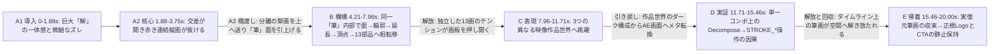
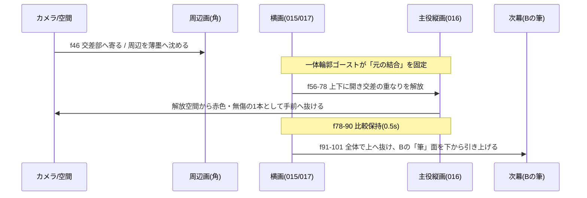
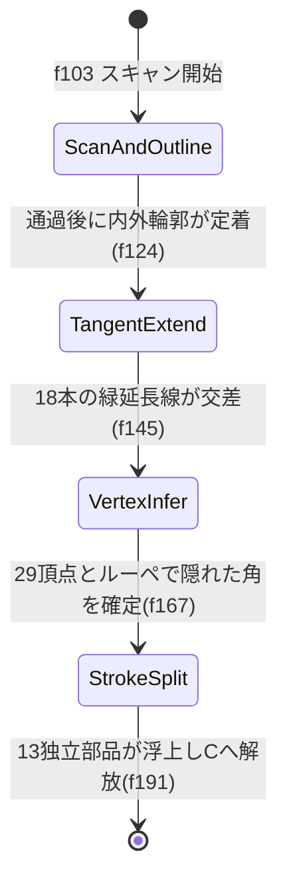

# Restro PV 右側コンテンツ 表現・構造設計図（履歴草案）

> **状態：履歴草案（Issue #32 に伴い正本を [docs/design/README.md](./design/README.md) へ移行）**
> **注記**：本書は Issue #32 発行前の予備検討メモであり、「一次ソース・確定」扱いとする位置づけは撤回し、履歴参考として保持する。AEP の実測値（`kg_LayoutGrid` / `P` リグ / 個別アセット / 実録画監査 / 品質保証基準）に基づく現在の設計正本は **[docs/design/](./design/README.md)** を参照すること。
> 対象：branch `23`（PR #27）
> 上位境界：[docs/issue30-recovery.md](./issue30-recovery.md)（サムネイル・共通背景・パースグリッド・左ブランドロックアップ・左カラム領域は確定事項として維持する）

本書は、確定済みの左カラムと共通レイアウトを前提としつつ、既存の技術的制約や仮組スクリプトの都合から切り離して**「Restro のプロモーション PV として本来実現したい理想的な映像表現」**と**「その表現を成立させる構造・時間・要素間の相互作用」**を定義した設計図である。

映像は1枚の静止画ではなく、意味・意図・造形・運動・時間変化を持つ複数の要素が互いに作用し合って成立する。本書はまず純粋な映像表現と構造を言語化・図解し（第1部〜第3部）、実装手段や素材調達（Remotion／After Effects 実機出力／プリレンダー動画／新規収録）の選択をその後段（第4部）へ明確に分離する。

---

## 第1部：理想的な映像表現の言語化（実装制約から独立した作品像）

### 1.1 この20秒が視聴者に残すべき体験

Restro（Restore Stroke）の本質は、「文字を細かく切り刻むこと」ではない。重なり合ってひとつの輪郭に溶けてしまった図形や文字から、**視覚的には隠れていた内部の線まで幾何学的に推定し、「本来そこに独立して存在していたはずの一画」を取り戻すこと**にある。

この20秒の正方形映像（1080×1080 / 24fps）を見たモーションデザイナーが抱くべき感情の連鎖は次の3段階である。

1. **「なぜ交差の裏から無傷の線が抜けてくるのか？」という知的な驚き（0〜4秒）**
   最初のサムネイル由来の巨大な「解」が、ただのパーツ分割ではなく、横棒に隠されていたはずの1本の長い縦棒を**傷ひとつない連続体**として引き抜いてみせる。ここで「ハサミで切った」のではなく「隠れた形を復元した」という製品固有の命題が、言葉より先に視覚の違和感として刺さる。
2. **「内部で起きている計算が納得でき、しかもこれだけの作品が作れるのか」という信頼と創作欲（4〜15.5秒）**
   単一の文字の内部で、皮膚（内外の輪郭）が剥がれ、骨格の延長線が交差し、隠れた角が点として結ばれ、最後に立体的な部品へ相転移していく。その機構への納得が冷めないうちに、解き放たれた筆画が書道的キネティック・3D空間の奥行き・グラフィック再構成という**まるで異なる3つの映像作品世界**へ跳躍する。さらに「それが実際の After Effects タイムライン上のワンクリックとキーフレーム操作で起きている」という現場の証拠が、憧れを現実の購買理由へ変える。
3. **「輪郭から筆画へ、筆画から表現へ」の余韻と迷いのない着地（15.5〜20秒）**
   バラバラに躍動していた筆画群が1つの確かな造形へ美しく収束し、その余韻を引き継いで公式ブランド（`Restro / 筆画復元`）と入手先（`After Effects プラグイン` / `BOOTHで販売中` / URL）が静かに、しかし揺るぎない存在感で残る。

### 1.2 右側ステージの視覚世界と「生きた物質」のルール

確定済みの左カラム（`x < 460`）が「静かな編集者の声（タイトルと要点）」を担うのに対し、右側ステージ（`x ≥ 480`、意図的な画面外ブリードを含む）は**思考と造形が実際に動く物理空間**である。

- **空間の物質感**: 斜めパースグリッドは単なる背景模様ではなく、ベクター幾何学が計測・再構成される**製図台（Drafting Plane）**である。巨大な黒文字は重みのある「墨の建築物」としてグリッドの上に乗り、画面端を大胆に突き抜けることで緊張感を生む。
- **色の意味論（全編一貫）**:
  - **墨黒（`#111`〜`#18181b`）とオフホワイト（`#F7F7F7`〜`#FAF9F6`）**: 造形そのものの質量と完成品の世界。
  - **Restro 赤（`#D64520`）**: 製品の核心・注目すべき復元対象・アクティブな現在地。乱用せず「いま何が起きたか／どこを見るべきか」の1点に集中させる。
  - **解析の緑・推定の青（B・D 限定）**: 輪郭延長（緑）と隠れた頂点・ハンドル推定（青）というアルゴリズム固有の言語。解析シーンを出たら持ち越さず、作品・ロゴの世界では白・黒・赤へ戻る。
- **左カラムとの掛け合い**: 左に固定・切替表示されるコピーは「問い・要約・宣言」であり、右側はそれを**繰り返さず、同じ内容の視覚的証拠または結果**を鳴らす。

---

## 第2部：全編を通した意味・造形・時間の連続性設計

### 2.1 全編の因果・造形連続性マップ

各場面を独立したスライドにせず、**「前場面の運動または造形上の緊張が、次場面の起点になる」**連続構造を持たせる。



### 2.2 全20秒の統合タイムライン（128 BPM / 実測 PCM アタック準拠）

音源 `assets/audio/drums-and-somps-background-music-458414.mp3` は `SPEC.md` 記載どおり **128 BPM（1拍 = `0.46875s` = `11.25f`）** である（`video/src/rejected/pv-full/music-analysis.json` の `129.2 BPM` は `tools/analyze-music.ts` の整数ラグ量子化 `bestLag=20` によるドリフト誤差）。ただし音源冒頭に約 `+40〜50ms`（約 `+1f`）の立ち上がり遅延があるため、**シーン窓・左コピー境界は SPEC（`f0, f45, f101, f191, f281, f371`）を維持し、右ステージの視覚的ピーク／着地を実測 PCM アタック（`f46, f91, f103, f136, f170, f192, f237, f282, f350, f372, f417, f473`）へ同期**させる。

| 区間（frame / sec） | 左カラム（確定・固定） | 右ステージの主役と状態遷移 | 同期する実音アタック |
|---|---|---|---|
| **A1** `f0–45` (`0–1.88s`) | `文字の輪郭から、筆画ごとのシェイプへ。` | 保護済み導入：巨大「解」の一瞬のズレと復帰 | `f12 (0.52s)`, `f24 (0.98s)` |
| **A2** `f45–90` (`1.88–3.75s`) | 同上 | 交差クローズアップ → 横2画が上下に開き、赤い連続縦画が抜けて独立証明 | `f46 (1.92s)`, `f69 (2.86s)` |
| **A3** `f90–101` (`3.75–4.21s`) | 同上（終了準備） | **空白ゼロの橋渡し**：分離した交差群が上へ抜け、B の「筆」輪郭面を背面から引き上げる | `f91 (3.80s)` |
| **B** `f101–191` (`4.21–7.96s`) | `HOW IT WORKS / つながった輪郭から…` | 同一「筆」上の4相転移（スキャン抽出 → 接線延長 → 29頂点推定＋追跡拡大鏡 → 13立体筆画分離） | `f103 (4.29s)`, `f136 (5.67s)`, `f170 (7.07s)` |
| **C** `f191–281` (`7.96–11.71s`) | `分解した筆画で作れるアニメーション…` | 縦スクロール窓内の3つの独立作品（01 書道的伸縮 → 02 3Dカメラ空間 → 03 グラフィック再構成） | `f192 (8.00s)`, `f237 (9.89s)`, `f260 (10.82s)` |
| **D** `f281–371` (`11.71–15.46s`) | `After Effectsで、そのまま動かせる。…` | 単一 AE コンポ連続操作（前状態テキスト → `Decompose` 実行 → `STROKE_*` 層＆タイムライン操作） | `f282 (11.75s)`, `f350 (14.57s)` |
| **E** `f371–480` (`15.46–20.00s`) | `輪郭から筆画へ。／筆画から表現へ。`（`17.35s` 左ロゴ退場） | 実復元筆画の躍動収束（E1） → 正規 `Logo` 原型＋`Ae`＋高コントラスト CTA の2秒超静止（E2） | `f372 (15.50s)`, **`f417 (17.38s)`**, `f473 (19.73s)` |

### 2.3 素材由来と用途境界の厳則

- **実 Restro 復元素材**（「解」`runs4` 群・「筆」`Baseline` 13画および `STEP1..3` 中間データ・新規に実プラグインで分解した検証済み文字）と、**ブランドロゴ造形**（`Logo` コンポ：`Restro / 筆画復元`、白抜き「元」と赤い `R` 弧を含む意匠済みアートワーク）を厳格に区別する。
- `Logo` を解体して「Restro の作例」や「汎用ペイオフ筆画」として流用しない。`Logo` は常に公式の完成ブランド標章として原型のまま扱う。

---

## 第3部：場面別 構造・演出設計図

以下、A1（現行保護）を除く右側全区間（A2〜A3・B・C・D・E）について、6つの設計観点と要素間相互作用を定義する。

---

### 3.1 場面 A2〜A3 `[45, 101)` (`1.875s – 4.208s`)：交差の裏にある連続性の発見と次幕への推進

#### 1. 意味と演出意図
- **意味**: Restro は輪郭を交差部で切断するのではなく、見えない裏側のつながりまで推定して「1本の連続した筆画」を取り出す。
- **演出意図**: A1 で感じた「何かがズレた」という疑問を、全体俯瞰（引いた比較図）ではなく**交差部への肉薄と分離の快感**によって1.8秒で解く。他の11画を同時にバラけさせると「ただの文字の分解」に見えるため、視線を右部「牛」の交差1点（横2本×縦1本）に釘付けにする。

#### 2. 構成要素と役割

| 要素 | 視覚形態 | 役割 |
|---|---|---|
| **主役縦画** | 「解」右部縦画（`STROKE_016`）、初期濃墨→分離時に **Restro 赤（`#D64520`）** | 交差に隠されていた連続体。色と前方移動で「無傷の1本」を証明する主人公 |
| **交差横画ペア** | 上横画（`STROKE_015`）・下横画（`STROKE_017`）、濃墨 `#141416` | 主役を覆い隠していた遮蔽物。上下に開いて「舞台の幕」のように縦画を露出させる |
| **周辺部（「角」ほか）** | 左偏「角」と周辺画 | 文脈としての漢字輪郭。A2 進入時に墨色を落として（低コントラスト化）主役交差を浮かせる |
| **一体輪郭ゴースト** | 元文字の交差部のみの細い基準線＋2つの交差リング | 「元は完全に1つのつながった輪郭だった」ことを示す位置基準（Anchor） |

#### 3. 空間的関係
```text
x=0..460 (確定左領域) | 460..480 (安全帯) | x=480..1080 (右ステージ)
                      |                   |
  Ae / Restro         |                   |   [背景] パースグリッド（視線を散らさぬよう薄く）
  筆画復元            |                   |     └─ [低存在感] 左偏「角」（x>=490 に留め左侵入禁止）
  Heading             |                   |          └─ [主役舞台 x≈720..1080]
                      |                   |               ・横画015 ── 上へ開く (-y)
                      |                   |               ・縦画016（赤）── 手前左へ抜ける + ゴースト残置
                      |                   |               ・横画017 ── 下へ開く (+y)
```

#### 4. 時間方向の状態変化と相互作用
- **Phase 1：収斂（`f45–56` / `1.88–2.33s`）**: `f46` のアタックに合わせてカメラが交差中心へゆっくり寄り（`1.0 → 1.15×`）、同時に「角」など非交差画の濃度がすっと下がる（**周囲の沈黙が主役の注目を準備する**）。一体輪郭ゴーストが交差部だけ X 線のように浮かぶ。
- **Phase 2：幕開きと抽出（`f56–78` / `2.33–3.25s`）**: 横画 `015` が上、横画 `017` が下へスライドして交差の重なりを解放する。**横画が開いた空間の奥から、赤い縦画 `016` がわずかに斜め手前（`-x, -y`）へ滑り出す**。2つの交差リングは元の交点に残り、赤縦画の「本来隠れていた2区間」が途中で切れていないことと対比される。
- **Phase 3：余韻保持（`f78–90` / `3.25–3.75s`）**: 分離状態を約0.5秒保持し、視聴者の頭の中で「切れたのではなく繋がっていた」が定着する時間を確保。
- **Phase 4：A3 橋渡し（`f90–101` / `3.75–4.21s`）**: `f91` のライズ音に合わせ、開いた交差群全体が 1 つのグループとして上方向へ加速退場する。**空白フレームを一切作らず**、その上向き運動に引きずられるように背面から B の「筆」シルエット面が下からせり上がり、`f101` でピタッと静止着地する。



---

### 3.2 場面 B `[101, 191)` (`4.208s – 7.958s`)：同一文字の内部で起きる「4段階の相転移」と追跡観察

#### 1. 意味と演出意図
- **意味**: Restro の復元は魔法やランダム処理ではなく、**「輪郭抽出（外・内）→ 接線延長 → 隠れた頂点の推定 → 独立筆画への再構成」**という幾何学的に一貫した4段階の処理である。
- **演出意図**: 左カラムが「つながった輪郭から、一画ずつの形を復元する」と解説する横で、**1つの巨大な「筆」が一度も場所を移さず、物質の層（皮膚→骨格→神経節→独立部品）を順にめくるように相転移していく**。情報量を減らして簡略化するのではなく、**全中間情報（内外輪郭・18本の延長線・29個の推定点・推定領域）を役割色と階層で整理して提示し、因果そのものを視覚で理解させる**。また、箱枠に閉じ込めず開かれた製図台の上に大きく展開する。

#### 2. 構成要素と役割

| 要素 | 視覚形態 | 役割 |
|---|---|---|
| **工程インデックス帯** | 上部 `01〜04` の4行リスト（現行行は赤バー＋ハイライト） | 時間軸上の現在地ナビゲーション。左の説明文と右の相転移を同期させる目次 |
| **同一「筆」実シルエット** | 枠なしの開かれた白ベール上の巨大「筆」（墨 `#141416`） | 全90フレームを通じて位置固定される唯一の被写体（Product Anchor） |
| **01 スキャン＋内外輪郭** | 赤い水平スキャンライン ＋ 外周輪郭（実線）＋ 穴の内輪郭（破線）＋ 既存頂点ドット | 「塗り」が「解析可能なベクター境界線」へ分解された状態を示す |
| **02 接線延長レイ** | 交差部の隙間へ向かって伸びるエメラルド線（`#1E9E63`）全18本＋先端ティック | 途切れた輪郭線の先をどう延長して交差の裏を繋ぐかという「橋渡し計算」の可視化 |
| **03 推定頂点群＆補完領域** | 29個の実推定頂点ノード（白縁付きコバルト青 `r=5px`）＋ 推定交差面（青半透明） | 延長線の交点から「隠れていた角と辺」が確定したことを示す計算結果 |
| **追跡観察ルーペ** | 左下余白（`Ø190〜210px`, `2.5×`）＋ 焦点枠とリーダー線 | 全体図では細かすぎる「輪郭＋延長線→推定頂点誕生」の1交差点を拡大実演する顕微鏡 |
| **04 独立13筆画** | 13の閉じた独立シェイプ（濃墨＋白隙間ギャップ＋注目画の赤/青アクセント） | 「推定された内部境界によって、本当に13個の動く部品になった」という最終証明 |

#### 3. 空間的関係
```text
                 x=480..1080 (枠なしの開放製図ステージ：背景グリッド上に柔らかな紙面ベール)
                 ┌──────────────────────────────────────────────────────────┐
  y=90..250      │  [01 輪郭を解析] / [02 輪郭線を延長] / [03 頂点推定] / [04 分割] │
                 ├──────────────────────────────────────────────────────────┤
                 │               ┌──[焦点枠] (竹冠左上の交差部)              │
  y=270..990     │       ┌───────┴─────────────────────────────┐            │
                 │       │     同一「筆」巨大ステージ（左右ブリード可） │            │
                 │       │     (外・内輪郭 / 18延長線 / 29推定頂点) │            │
                 │   ┌───┴───┐                                 │            │
                 │   │大型   │                                 │            │
  y=770..990     │   │ルーペ │  ← 2.5×で「延長線交差→青頂点誕生」を拡大       │
                 │   └───────┘                                 │            │
                 └──────────────────────────────────────────────────────────┘
```

#### 4. 時間方向の状態変化と相互作用（4段階のカスケード因果）
ここでは各ステップが「単独で切り替わる」のではなく、**前ステップの出力が次ステップの入力になる因果連鎖**として動く。

1. **Step 01 輪郭を解析（`4.25–5.15s / f102–123`）**:
   `f103` の強拍で赤い水平スキャンラインが上から下へ「筆」を走査する。**スキャンラインが通過した領域から順に、黒塗りの面が剥がれて「外輪郭＋内輪郭＋既存頂点」の線画骨格が現れる**。スキャンと抽出が1つの因果になる。
2. **Step 02 輪郭線を延長（`5.15–6.05s / f124–145`）**:
   抽出輪郭が落ち着いた濃灰へ退くことで主役の座を譲り、**途切れた角からエメラルド色の延長線18本が一斉に線描画で伸び出す**。文字の内部に緑色の格子状の延長ルートが張り巡らされ、「交差の奥が幾何学的に結ばれうる」ことが視覚化される。
3. **Step 03 隠れた頂点を推定（`6.05–6.95s / f145–167`）**:
   伸び切った緑延長線の交点に、**29個の実推定頂点が重心周りの波動順に点灯**し、続いて青の補完領域（`inferred`）が面として結ばれる。同時に左下余白へ **大型ルーペ（`Ø190〜210px`）が立ち上がり、文字全体と同じ時計で「緑線が交わった瞬間に青頂点が結ばれる」局部拡大を連動表示**する。
4. **Step 04 一画ずつに分割（`6.95–7.96s / f167–191`）**:
   `f170 (7.07s)` のアタックで解析ラインとルーペがスッと引き、推定された内部境界線が**白い境界ギャップ（`1.5px`）**として彫り込まれる。13の筆画が濃墨＋注目2画の赤/青アクセントを持って**互いに `15〜24px` 浮き上がり分離**し、単一の文字が「いまにも動かし出せる13個の部品」へ変貌した瞬間で C へ渡す。



---

### 3.3 場面 C `[191, 281)` (`7.958s – 11.708s`)：独立筆画が開く「3つの異なる映像作品世界」

#### 1. 意味と演出意図
- **意味**: Restro で独立シェイプになった筆画を使えば、1つの「文字出し」にとどまらない**多彩なモーショングラフィックス表現**が作れる。
- **演出意図**: 左カラムが「分解した筆画で作れるアニメーション／それぞれ自由に動かせる」と語る間、右側には縦スクロールするフィルムストリップ窓（SPEC の骨格）が現れ、**背景トーン・タイポ構成・カメラ感覚・運動文法のすべてが異なる3つの映像作品**を連続上映する。
- **時間配分の現実的原則**: 総尺 `90フレーム（3.75s）` ÷ 3作品 ＝ **1作品あたり約 `30フレーム（1.25s）`**。各作品に「静止待ち→変化→復帰」の多段階を詰め込むと破綻するため、**「画面に入った瞬間からすでに作品としての1つの明確なモーションが走っており、30フレームかけて美しく決まる（または展開する）」単一アーク構成**を採る。また「筆」1文字の反復を避け、造形・世界観・運動の種類を完全に分離する。

#### 2. 3作品の独立した世界設計（すべて異なる映像作品として設計）

| 作品番号・尺 | 作品コンセプトと題材 | 世界観・色彩設計 | 空間構成・要素の役割 | 30フレーム内の運動アークと相互作用 |
|---|---|---|---|---|
| **作例 01**<br>`f191–221`<br>(`7.96–9.21s`) | **『書道的キネティック』**<br>題材：実復元「筆」（13画） | **生成り和紙調（`#F5F3EE`）**＋濃墨＋白縁取り＋Restro赤の1画＋印鑑風赤印 | 中央の文字＋右上の縦組み副題＋左上の赤落款。筆画同士の重なり順を白縁で美しく見せる縦型エディトリアル作品 | **進入即発進**：S01→S13 が各筆画の筆致方向へ伸びながら（軸方向スケール＋位置滑り込み）2f刻みで弾性的に書き込まれ、`8.88s` で力強く着地・呼吸保持 |
| **作例 02**<br>`f221–251`<br>(`9.21–10.46s`) | **『3D空間パララックス』**<br>題材：実復元「解」（14+2画） | **漆黒空間（`#121316`）**＋白主役＋Restro赤ワイヤー＋コバルト青ワイヤー | 平面の漢字を**奥・中・手前の3つの Z 深度レイヤー**へ解体し、仮想カメラが斜め前へ抜ける立体空間作品 | **カメラ×筆画視差**：カメラが回り込み／押し込むにつれ、各筆画が Z 距離に応じた速度差と立体影を持って浮遊し、楽曲最大級の打点 **`f237 (9.89s)`〜`f243 (10.12s)`** でカメラ視点と3層がピタッと合致・一文字へ結晶 |
| **作例 03**<br>`f251–281`<br>(`10.46–11.71s`) | **『グラフィック構成・変形』**<br>題材：実復元「筆」または新規実分解文字のエレメント群 | **白×黒帯×Restro赤ライン**（バウハウス／グラフィックポスター調） | 上部に黒帯・下に分割グリッドを敷き、筆画を「文字」としてではなく**画面全幅を横断する幾何パーツ（水平バー・斜角ブロック）**として再配置 | **造形から文字への再編**：画面全体を走る水平・回転バーの抽象グラフィック構成が、`f260 (10.82s)`〜`f268 (11.18s)` のリズムに乗って連動回転・スライドし、一瞬で「筆」の造形構成へと組み替わる |

#### 3. 場面内スクロールと C→D の接続設計
- **スクロール遷移**: 作品間の縦スクロールは `5〜6フレーム（約0.21〜0.25s）` の鋭いイージング（Quintic / Expo）で「ページをめくる」ように送り、移動中も次作品のモーションはすでに開始している状態にしてデッドタイムをなくす。
- **C→D 接続**: 作例 03 の上部黒帯（`#141416`）と水平バーのグラフィック構図が持つ「ダーク枠＋幾何要素」のトーンをそのまま D のダーク After Effects ワークスペース枠へ引き継ぎ、違和感のないハードカットで制作現場の画面へ切り替える。

---

### 3.4 場面 D `[281, 371)` (`11.708s – 15.458s`)：After Effects 上での「操作と結果の因果」の立証

#### 1. 意味と演出意図
- **意味**: C で見せた自由な筆画アニメーションは、特別な外部ツールではなく **After Effects 上で Restro を使い、生成された `STROKE_*` シェイプレイヤーを普段どおり操作するだけで実現できる**。
- **演出意図**: 左カラムが「After Effectsで、そのまま動かせる。／分解した筆画がレイヤーとして動く」と宣言する横で、**偽りや飛躍のない実ワークスペースの時系列因果**を見せる。視聴者が「(1) 分解前の1つのレイヤー → (2) Restro の操作 → (3) タイムライン上に増えた独立シェイプレイヤー群 → (4) 1本を掴んで動かすとタイムライン上のキーと連動して絵が変わる」という4つの対応関係を、**同一の対象・同一の時間軸**上で追えることが絶対条件である。

#### 2. 構成要素と空間・時間的相互作用（連動モデル）

| 要素 | 空間配置（右ステージ内） | 担う証拠 | 相互作用 |
|---|---|---|---|
| **① Comp Viewer（上段主役）** | 右ステージ上半（約 `y=80..520`）、高コントラスト明背景（市松模様排除） | 文字・推定頂点・ハンドル・1画移動の視覚結果 | タイムラインの選択状態と再生ヘッドに**1フレーム単位で完全同期**して変化 |
| **② Restro プラグインパネル** | Viewer 内右下または隣接ドック（判読可能な倍率） | `Decompose / Merge / Refine` を備えた実プラグイン UI | パネル上の実行トリガーがタイムラインのレイヤー分裂を直接引き起こす |
| **③ 同期 Timeline（下段）** | 右ステージ下半（約 `y=535..845`）、レイヤー名列とキー列を近接トリミング | 単一レイヤー → 複数 `STROKE_*` 層出現 → Position キーフレームと青再生ヘッド移動 | レイヤー選択・再生ヘッド通過が Viewer 上の赤選択枠・筆画移動と一対一対応 |
| **④ 1行の簡潔な補助ラベル** | ワークスペース直下（`y=860` 付近） | 操作段階の言語補助（例：`Decompose → 独立シェイプ層でキーフレーム編集`） | UI 本体の文字を邪魔せず、初見視聴者の視線順序だけを案内 |

```text
時間軸 [11.71s ─────────────── 13.00s ─────────────────────────── 15.46s]
       │                       │                                   │
[Before: 1本のレイヤー]  [Trigger: Decompose実行]        [After: 1画の選択とキーフレーム再生]
Viewer:  一体の黒文字      →  推定頂点・バウンディング出現  →  1本の筆画が独立して移動・回転
Panel :  Restroパネル待機  →  Decomposeボタン反応        →  (背景で確証として静止)
Timeln:  1行の元レイヤー   →  STROKE_000..が一斉出現     →  再生ヘッドがキーを跨ぎ動きと同期
```

- **絶対避けるべき破綻**: 別々の収録・別々の文字（例：上段は「解」で下段は「Restro」のタイムライン）を継ぎ接ぎして因果を偽装しない。**同一コンポ・同一タイムラインの連続した時系列**を保つ。

---

### 3.5 場面 E `[371, 480)` (`15.458s – 20.000s`)：筆画の統合ペイオフと揺るぎないブランド着地

#### 1. 意味と演出意図
- **意味**: 「輪郭から筆画へ、筆画から表現へ」—— Restro によって解き放たれた筆画が、再び美しく確かな1つの造形を結び、製品名と入手先（`Restro / 筆画復元`・`After Effects プラグイン`・`BOOTHで販売中`・URL）へ帰着する。
- **演出意図**: 旧案の9フレーム点滅要約（読めないサムネイルフラッシュ）や、不自然に壁でクリップされた散乱を排し、**「動のクライマックス（Beat E1）」から「静の信頼と購買導線（Beat E2）」への落差**で記憶に残す。左カラムでは `17.35s` に左ブランドロックアップが退場し、「輪郭から筆画へ。／筆画から表現へ。」だけが残るため、右側が名実ともに主役ロゴと CTA を引き受ける。

#### 2. 構成要素と役割（2ビート構成・素材の厳密分離）

| ビート・時間 | 構成要素 | 視覚役割と素材境界 |
|---|---|---|
| **Beat E1：実復元筆画の収束**<br>`f371–417` (`15.46–17.38s`) | **実 Restro 復元筆画群**（`Baseline`「筆」または `bunkai`「解」の実筆画。**`Logo` は使わない**） | D のタイムライン上で動いていた「1画の自由さ」が全ステージ空間へ解き放たれ、楽曲ブレイク明けの加速とともに1つの力強い文字造形へ美しく組み上がる。左端 `x=480` で不自然に切れない安全軌道を描く |
| **境界転換（`17.30–17.38s`）** | グラフィック・ワイプ／クロス | **`17.38s (f417)` の楽曲最大アタック**を境に、収束した造形が静かな白基調の最終紙面へと切り替わり、空白フレームを一切生まない |
| **Beat E2：ブランドと CTA**<br>`f417–479` (`17.38–20.00s`) | 1. **正規 `Logo` コンポ**（原型・赤 `R` 弧・白抜き「元」を100%無改変保持）<br>2. **`Ae` バッジ ＋ `After Effects プラグイン`**<br>3. **高コントラスト CTA ブロック**（黒帯白抜き `BOOTHで販売中`＋赤ワンポイント）<br>4. **URL**（`361do.booth.pm/items/9029239`） | 右ステージ背面に柔らかい白グラデーション紙面を敷き、パースグリッドが小文字・URL の可読性を邪魔しないように整理。`17.85s` までに全要素が整然と着地し、**最後の2.15秒（50フレーム超）を完全静止保持**して読了と記憶定着を確実にする |

---

## 第4部：表現設計と実現手段の分離（Implementation Separation Matrix）

第1部〜第3部で定義した表現仕様は、特定の描画方式を前提としていない。後続フェーズでは、各シーンの表現要件を満たすために**最も精度・品質・制作速度が高い実現手段**を個別に選択する。

| 場面 | 表現上の要求（変えてはならない仕様） | 実現手段の選択肢と推奨アプローチ | 現時点で不足している素材・技術課題 |
|---|---|---|---|
| **A2〜A3** | ・周辺画の自然な減光<br>・横2画の上下開きに連動した赤連続縦画の抜け<br>・空白ゼロで B の「筆」を引き上げる上向き連動 | **Remotion SVG 制御**で実現可能（既存の `StrokeField`・`ContourField` と `bunkai runs4` 実データ）。ただし A3 での空白を生む `masterPatch.ts` 側の切り落としや `bunkai` 232番の二重露出を整理し、`SceneA2` と `SceneB` の進入窓を物理的に繋ぐ | ・A2→B 境界（`f90–103`）の連続モーション制御<br>・左偏「角」が `x=460` クリップ壁で不自然に切断されないフレーミング設計 |
| **B** | ・枠なし開放空間に大きな「筆」<br>・スキャンに追従する内外輪郭抽出<br>・18本延長線と29全推定頂点の階層可視化<br>・2.5×追跡ルーペ連動<br>・13立体部品の分離 | **選択肢1**: Remotion 上で `StrokeField`＋`DrawnContours`＋実座標プロットを精細制御する。<br>**選択肢2**: 実機 AE 上で Trim Paths・マスク・トラッキングルーペを組んで透過／白背景ムービーを書き出し、`PvStage` へ合成する。<br>※ いずれも全29点・`outline inset`・`extend A/B` を欠落させないことを優先して選ぶ | ・現行 `SceneB.tsx` は座標変換や `extend` 描画順を持ちつつ、枠制約とマーカー肥大化が表現を阻害している。スキャンライン通過に追従するマスク抜きの実装可否が分岐点 |
| **C** | ・90フレーム（3.75秒）内に**異なる3つの映像作品世界**（書道的伸縮・3Dカメラ空間・幾何グラフィック再編）<br>・すべて実 Restro 復元筆画で構成 | **選択肢1**: Remotion（CSS 3D / SVG / パス変形）で3作を直接組む。<br>**選択肢2（推奨検討）**: 特に作例02（3D カメラパララックス）や作例01（筆致の有機的伸縮）は **After Effects 上で実 Restro レイヤーに対して 3D カメラ・被写界・グラフエディタ・Trim Paths を駆使して制作し、各作品 30f の高品質プリレンダー素材を縦スクロール窓へ供給**する方が、表現の豊かさと作品としての完成度を高めやすい | ・作例03 で「筆」以外の文字（または英語テキスト）を使う場合は、AE 実機で `Restro: Decompose` を実行・ダンプした新規検証済み筆画素材が必要（`Logo` の流用は不可） |
| **D** | ・**同一コンポ・同一タイムライン**上で「1レイヤー → `Decompose` → `STROKE_*` 出現＆1画移動」が時系列同期して見えること<br>・市松模様なしの読みやすい UI | **新規 AE 実機連続収録が必須**（既存 `ae-decompose-ops.mp4` 等は別コンポ・別時刻・低コントラストのため因果要件を満たさない）。<br>既存の自動収録基盤（`verification/wu-d-live/wu-d-live.jsx` 系統）または定フレーム録画（OBS/FFmpeg 等）で、高コントラスト白背景コンポ＋`Restro` パネル＋同期タイムラインを1本連続撮影し、Remotion 側で Viewer 領域と Timeline 領域を見やすい倍率で同期配置する | ・既存録画には「白背景黒文字×単一コンポ連続操作×黒抜けなし」の素材がない。新規収録（`ae-workflow-clean.mp4` 仮称）の撮影工程を独立タスクとして組み込む |
| **E** | ・`Baseline` 等実復元筆画の躍動収束（E1）<br>・`17.38s (f417)` 打点での正規 `Logo` 切り替え（E2）<br>・`Logo` の赤弧・白抜き「元」の無改変保持<br>・`Ae` バッジ＋黒反転 CTA＋URL の2秒超静止 | E1 は Remotion SVG（または AE 書き出し）、E2 は現行 `CompView(compByName("Logo"))`＋静的 HTML/CSS レイアウトで高精度に実現できる。`Logo` を `StrokeField` で上書き再着色しないよう、`CompView` のまま表示する | ・`17.38s` 境界のワイプ／切り替え時に空白フレームを挟まないタイミング統一<br>・`Ae.png` の E2 右ステージ配置と `hideBrandLockupForEndCard` (`17.35s`) の連携確認 |

---

## 第5部：後続フェーズの制作工程（進め方の定義）

これまでの「先に静止画モックを1枚描いてコードへ当てはめる」手順を改め、以下の順で制作を進める。

1. **工程1：表現確定（本設計図＝完了）**
   実装手段から独立した意味・連続性・構造・時間軸・相互作用を一次ソースとして確定する。
2. **工程2：素材・収録準備（手段の調達）**
   - Scene D 用の単一コンポ連続操作録画（新規収録）を取得し、フレーム単位で因果・可読性を確認する。
   - Scene B・C について、Remotion 直接描画で表現品質が出せる箇所と、AE ネイティブ（3D カメラ・Trim Paths・グラフエディタ）で書き出して合成すべき箇所を切り分ける。C で第3の文字を使う場合は実プラグインで分解・ダンプする。
3. **工程3：連続モーション試作（シーン単位＋境界接続）**
   静止フレーム単体ではなく、前後境界を含む短尺動画（例：A1→A2→B 接続、B→C 接続、C→D→E 接続）で「要素の相互作用」「音ハメ（実測 128 BPM アタック）」「空白ゼロ」を検証する。
4. **工程4：統合と契約検証**
   確定レイアウト保護契約（`bun test tests/pv-layout-contract.test.ts`、`bun test tests/stroke-contract.test.ts`、`bun tools/verify-layout.ts`）および `PV-Master` 全編20秒音声付き動画の等速視聴によって最終受入を判定する。
