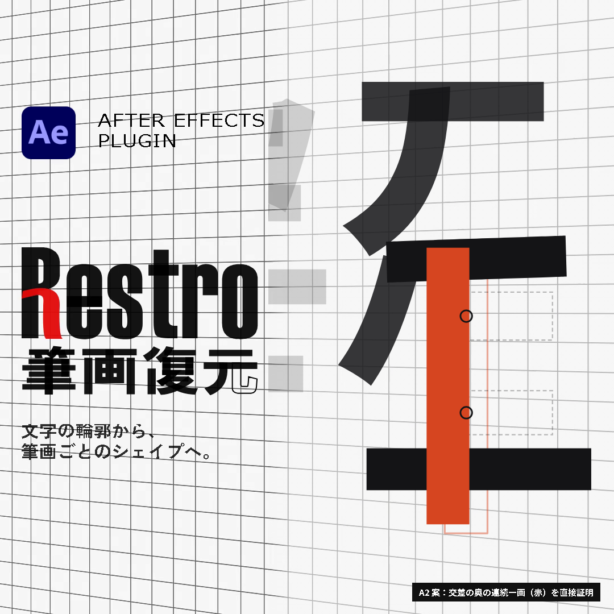
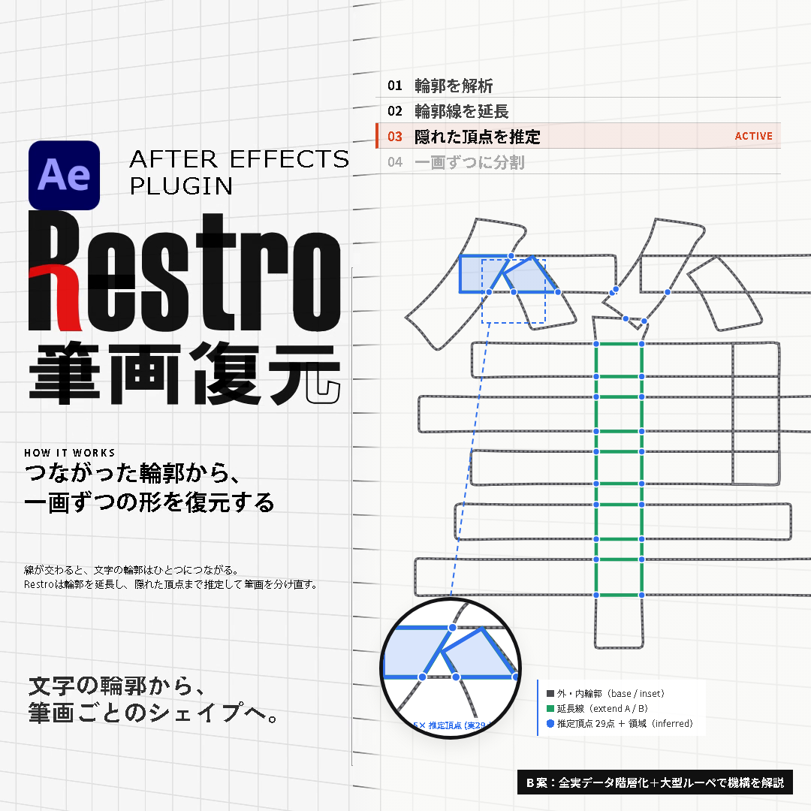
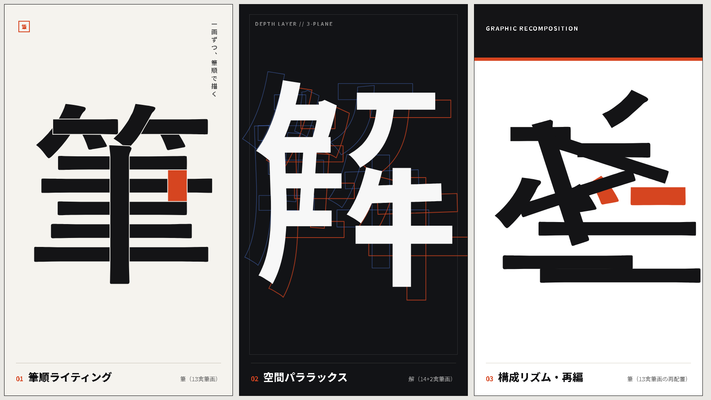
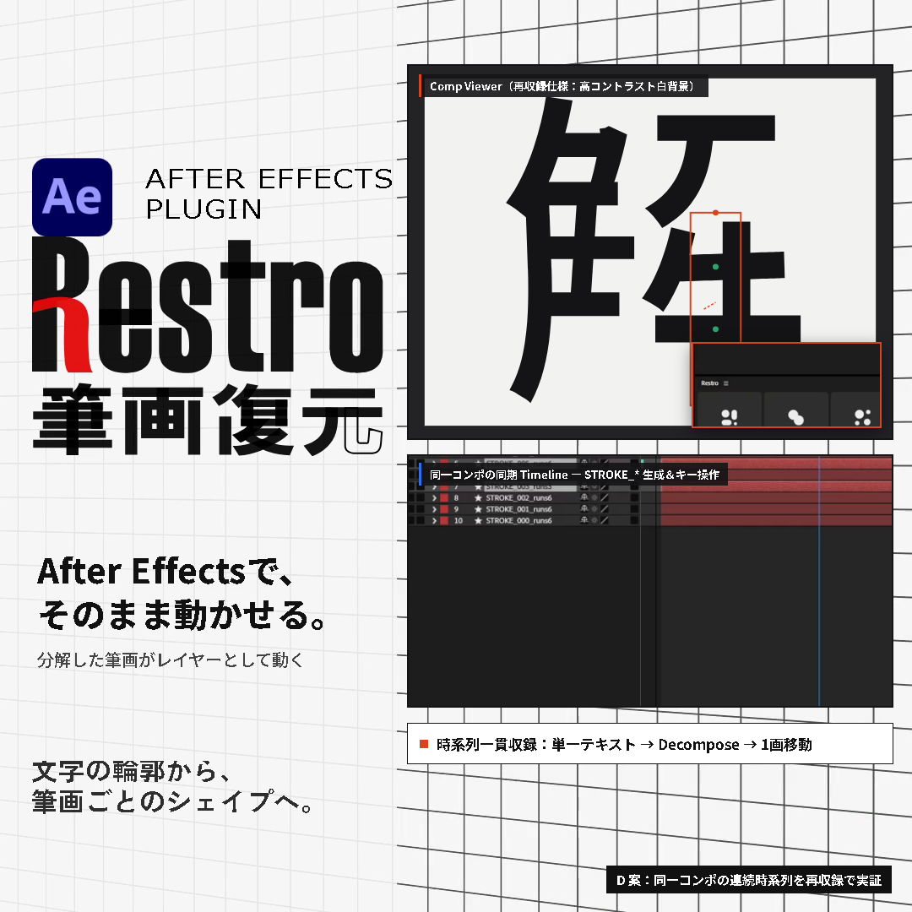
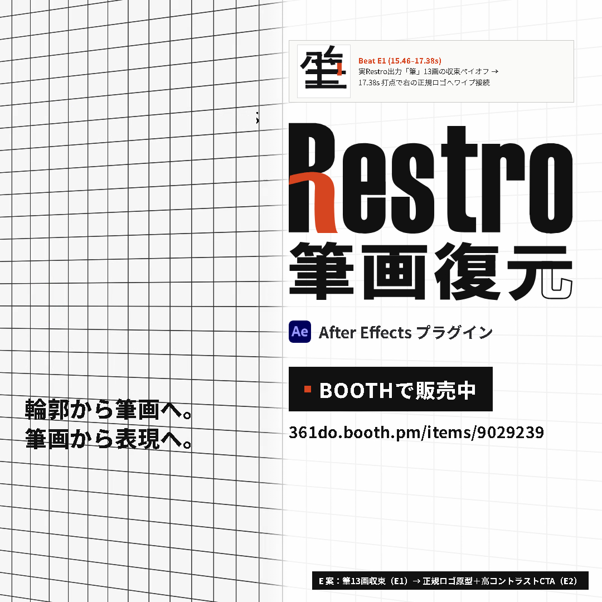

# Restro PV 右側コンテンツ再制作計画

> 状態：**承認済み方針の是正後確定版（一次ソース）**
> 対象：branch `23`（PR #27、`video/src/scenes/` および `STAGE_SCENES`）
> 上位境界：[docs/issue30-recovery.md](./issue30-recovery.md)（サムネイル・共通背景・グリッド・ブランド・左カラムおよび Issue #30 の変更境界を維持する）

本書は、確定済みの左カラム・共通レイアウト（`video/src/layout/`）を一切変更せず、右側ステージ（`x ≥ 480`、意図的な画面端ブリードを含む）の**内容・デザイン・モーション・場面間接続**を再構成するための一次仕様である。後続の実装エージェントは本計画と `docs/images/replan/` 配下の構成案画像を直接参照して制作を進める。

---

## 1. 変更境界と制作対象

- **変更不可（確定事項）**:
  - `assets/images/samune-v1-master.png` と連続する共通背景・斜めパースグリッド、`Ae`・`AFTER EFFECTS PLUGIN`・`Restro / 筆画復元` の左ブランドロックアップ、左カラム（`x < 460`）のコピー・切替時刻（`LeftCopy.tsx`・`description`・`Heading`）。
  - 保護構造は `video/src/PvVideo.tsx`（`PvChromeBase → PvStage → PvLeftGuard → PvChromeOverlay`）および `tests/pv-layout-contract.test.ts`・`tools/verify-layout.ts` で強制される。
- **本計画の制作範囲（可変領域）**:
  - `video/src/scenes/SceneA2.tsx`・`SceneB.tsx`・`SceneC.tsx`・`SceneD.tsx`・`SceneE.tsx`
  - `video/src/layout/Stage.tsx` のシーン窓・接続調整（左カラムや保護レイヤーへは踏み込まない）
  - Scene D 用の新規 After Effects 実操作収録（[§5 Scene D](#scene-d-281-371-11708s--15458s同一コンポの時系列再収録によるae実操作証明) 参照）

---

## 2. 素材の由来と区別（混同禁止ルール）

リポジトリ内のベクター形状・映像素材は、由来と用途を厳密に区別して扱う。**ブランドロゴ用アートワークを「Restro の復元証明素材」として流用・改変しない。**

| 区分 | コンポ／ファイル | 実体と由来 | 許容される用途 |
|---|---|---|---|
| **実 Restro 復元筆画（検証済み）** | `Baseline`（`FUDE S01..S13`、`FUDE outline base/inset`） | 漢字「筆」に対する Restro の実出力 13 筆画＋抽出輪郭（`pv/generated/01-Baseline.ts`） | B（工程）・C（作例）・E（ペイオフ）の筆画表現 |
| **実 Restro 中間処理データ** | `STEP1 outline` / `STEP2 extend` / `STEP3 infer [checkpoint before wipe removal]` | `FUDE scanline`、`FUDE extend A/B`（18本）、`FUDE inferred`、`FUDE points`（29点） | B のアルゴリズム可視化図解 |
| **実 Restro 復元筆画（検証済み）** | `master #239..254`（`bunkai` `runs4` 系 14+2層）、`PV glyph A2` | 漢字「解」に対する Restro の実出力＋元輪郭（`05-master.ts`, `08-PV glyph A2.ts`） | A1（保護）・A2（交差復元証明）・C（作例02） |
| **ブランドロゴ アートワーク** | `Logo`（`46-Logo.ts`, `#1..45`） | `Restro / 筆画復元` のブランド固定造形。`STROKE_*` に加え `Ae_Restro part/merged shape`、赤弧（`#44`）、白抜き黒線「元」（`#1`）など**意匠加工を含む** | **E 終了カードの公式ロゴ表示のみ**（`CompView` 等で原型・配色を無改変表示） |
| **既存 AE 収録フッテージ** | `assets/rec/ae-*.mp4`、`verification/wu-d-live/wu-d-live-capture.mp4` | 過去収録の画面キャプチャ（1920×1080 / 1280×720 / 2506×1392） | 必要時の補助参照。D の主映像は時系列一貫版を新規収録（[§5 Scene D](#scene-d-281-371-11708s--15458s同一コンポの時系列再収録によるae実操作証明)） |

- `Logo` コンポのシェイプ（欧文 `Restro` `#37..45` 等）を単色ベタ塗り化したり、Scene C の作例や Scene E の筆画展開に流用しない。もし Scene C で「筆」「解」以外の第3の文字・欧文を動かす場合は、必ず AE 上で `Restro: Decompose` を実実行してダンプ取得した純粋な実復元出力を使う。

---

## 3. 時間基準と楽曲解析の整合（BPM 不一致の是正）

既存資料間で発生していた楽曲テンポ・拍位置の不一致を、`tools/analyze-music.ts` のコードと音声ファイル `assets/audio/drums-and-somps-background-music-458414.mp3` の生 PCM 波形の双方から実測し、以下のとおり基準を統一する。

### 不一致の事実と原因

1. **`docs/SPEC.md` §3**: `BPM 128`（1拍 = `0.46875s` = `11.25f`）、理論拍頭 `f0, f45 (1.875s), f90 (3.750s), f101 (4.208s), f191 (7.958s), f281 (11.708s), f371 (15.458s), f472.5 (19.688s)`。
2. **`video/src/rejected/pv-full/music-analysis.json`**: `tempoBpm: 129.2`, `beatsSec[0]: 0.093s`（beat 43 = `19.598s / f470.4`）。
3. **原因特定（`tools/analyze-music.ts` L96–123）**: `tempoAndBeats` が自己相関ラグ `bestLag` を `hopSec = 512 / 22050 = 0.02322s` 単位の**整数フレーム**へ丸めているため、128 BPM の理論ラグ `20.1874` が **`20` へ切り捨てられ、`129.20 BPM`（`0.46440s/拍`）へ誤差拡大**した。その結果、`beatsSec` は序盤で `+93ms` 遅く、終盤で `-90ms`（約2〜3フレーム）早くドリフトしている。
4. **生 PCM 実測（0〜20秒）**: 実際のキック／クラップ強拍は `0.524s (f12.6)`〜`19.725s (f473.4)` までの 41 拍間隔平均が **`0.4683s/拍`（実測 `128.1 BPM`）** であり、**`SPEC.md` の `128 BPM` が楽曲の真のテンポと一致**する。ただし音源冒頭に約 **`+40〜50ms`（約 `+1フレーム`）の立ち上がり遅延** があるため、実音のピークは SPEC 理論位置より約 1 フレーム後に着地する。

### 統一する時間設計ルール

- **シーン境界・左カラム切替（変更不可）**: `SPEC.md` と `LeftCopy.tsx` / `description` に合わせ、`f0 / f45 / f101 / f191 / f281 / f371` を維持する。
- **右ステージの音ハメ基準**: `music-analysis.json` のドリフトした `beatsSec` は使わず、**`SPEC 128 BPM`＋実測 PCM アタック（`accentsSec` と一致する実ピーク）** へ合わせる。主要アタック位置：
  - `1.92–1.93s (f46)`: A2 交差クローズアップ開始
  - `3.79–3.80s (f91)`: A3 橋渡し上昇開始
  - `4.29s (f103)`: B Step 01 スキャン開始（強拍）
  - `5.67s (f136)` / `7.07s (f170)`: B Step 02→03 / Step 04 分割着地
  - `8.00s (f192)`: C 作例01 進入
  - `9.89–10.12s (f237–243)`: C 作例02 空間パララックス収束ピーク（楽曲内最大級アタック）
  - `11.75s (f282)`: D 実操作開始
  - `14.57s (f350)`: D 操作結果ピーク
  - `15.50s (f372)`: E ペイオフ進入（直前の小休止明け）
  - **`17.38–17.39s (f417)`**: E 公式ロゴ着地（最大ヒット）
  - `19.26s (f462)` / `19.73s (f473)`: 終了保持確認点

---

## 4. 旧制作（`v18`・`pv-review`・`beats`）への作品批評

`verification/pv-remotion-v18.mp4`、`verification/pv-review.mp4`、`verification/beats/` を通して確認した結果、サムネと A1 が持つグラフィックの強度が A2 以降で失われている原因は次の6点にある。

1. **13秒以上の「筆」単一文字反復**: B・C（3作すべて）・D（バグによる誤クロップ）・E の 4.2s〜17.4s で、ほぼ同じ正位置の「筆」が出続け、製品の汎用性と面白さが伝わらない。
2. **A2 の主眼ぼけと A3 の空白フレーム**: A2（`SceneA2.tsx`）は後半 `0.61×` まで引きつつ全14画をバラけさせ、`f92〜96` で右ステージを完全な空白グリッドにしてしまう。「交差の奥から一本の縦画が欠けずに現れる」核心が弱まっている。
3. **B の閉塞感と情報衝突**: 白箱枠（`VIEW`）がスケールを縮め、サーモンピンク塗り・緑線・29個の三重丸（`r=11`）が縦画に密集する。`92px` の極小ルーペが右下ならぬ左下端に追いやられ、対角破線が文字を横切るため図解として読みにくい。
4. **C の多色フラッシュがバグに見える**: 0.55秒静止のあと 0.2秒だけ原色5色で揺れる演出は、完成作品の表現ではなく描画エラーのチラつきに見える。3作とも「筆」の同じ構図のため映像作品としての差別化がない。
5. **D に致命的な解像度取り違えがあり AE 画面が映っていない**: `SceneD.tsx` は `1280×720` の `ae-decompose-auto.mp4` に対して `SRC_W=1920, SRC_H=1080` で計算しているため、ベージュ背景の「筆」の左端を拡大した静止画に近い映像になり、AE のタイムライン・パネル・アンカー操作が一切映っていない。
6. **E の 9フレーム点滅と CTA 視認性不足**: 冒頭の 3〜4フレーム要約点滅が視認不能で、左壁 `x=480` で切れた「筆」が一度消えて空白グリッドを挟んだ後、グリッド線と干渉するテキストが並ぶ。最終フレームに `Ae` バッジも残らない。

---

## 5. シーン別 再制作計画（構図・内容・モーション・接続）

### Scene A2〜A3 `[45, 101)` (`1.875s – 4.208s`)：交差の奥から「一本の連続筆画」を引き抜く

- **参照画像**: [scene-a2.png](./images/replan/scene-a2.png)
- **左カラム（確定）**: `Heading`（「文字の輪郭から、筆画ごとのシェイプへ。」）
- **構図・内容**:
  - `0.61×` の引きと全14画カスケードを廃止し、A1 終端の「解」のまま右部「牛」の交差クラスタ（`STROKE_016_runs4` 縦画＋`015`/`017` 横画）へ `1.0 → 1.14×` で寄る。
  - 左部の「角」（`x < 760`）は背景側へ退かせるため墨色 `18%` に落とし、`STROKE_016` だけを **Restro 赤（`#D64520`）**、横画 `015`/`017` を濃墨（`#141416`）にして視線を集中させる。
  - 元位置の薄い赤輪郭と2箇所の交差リング＋破線ガイドだけを残し、他の筆画のガイド線を描かない。
- **モーションと接続**:
  - `f45–56 (1.88–2.33s)`: `f46 (1.92s)` の打点で交差部へ寄り、「角」を退色。
  - `f56–78 (2.33–3.25s)`: 横画 `015` が上へ `-88px`、`017` が下へ `+88px` 開き、交差の裏から **途切れていない1本の赤い縦画 `016`** が手前左（`-28, -14`）へ抜ける。
  - `f78–90 (3.25–3.75s)`: 比較保持。
  - `f90–101 (3.75–4.21s, A3)`: **空白フレームを出さず**、`f91 (3.80s)` のアタックで赤い縦画＋横画グループが上方向へスライド退場すると同時に、背面から B の白紙面と「筆」の輪郭が同じ上方向ベクトルでせり上がり、`f101` に直接接続する（旧 `bunkai` 232番の二重露出は無効化）。

---

### Scene B `[101, 191)` (`4.208s – 7.958s`)：実アルゴリズムの全中間情報を階層化して見せる技術図解

- **参照画像**: [scene-b.png](./images/replan/scene-b.png)
- **左カラム（確定）**: `HOW IT WORKS / つながった輪郭から、一画ずつの形を復元する` ＋ 2行本文
- **設計原則（情報の削減をしない）**:
  - 既存の全実処理データ（`FUDE scanline`, `FUDE outline base`, `FUDE outline inset`, `FUDE extend A/B` 全18本, `FUDE inferred`, `FUDE points` **全29点**, `FUDE S01..S13`）を省略せずすべて可視化し、**「線幅・役割色・出現タイミング・大型ルーペ」の階層設計**で迷わず理解できる図解にする。
- **構図・デザイン**:
  - 窮屈な矩形枠（`VIEW` border）を廃し、右ステージに柔らかい白ベール（`rgba(250,250,248,0.93)`）を敷いて「筆」を大きく（`scale ≈ 0.82`）開放配置する。
  - 上部工程帯（`01〜04`）は現行ステップに **Restro 赤左バー（`4px`）＋薄赤ハイライト＋`ACTIVE`** を付け、視線誘導を明確化する。
  - **29個の `FUDE points`** は巨大な三重丸（`r=11`）ではなく、**高精細なコバルト青ノード（`r=5.5px`＋`2px` 白縁）** として全点をプロットし、下段空白（`x≈505, y≈795`）に **直径 `190px`・`2.5×` の大型ルーペ** と色凡例（`外・内輪郭 / 延長線 / 推定頂点29点＋領域`）を配置する。
- **4段階の実処理モーション（90f）**:
  1. **01 輪郭を解析 (`4.25–5.15s / f102–123`)**: `4.29s (f103)` の強拍で開始。濃墨（`#141416`）の「筆」を実素材 `FUDE scanline`（赤）が上から下へ走査し、通過後に**外周（`outline base`）だけでなく囲まれた穴の内輪郭（`outline inset`）**を含めた全輪郭線＋既存アンカー点を抽出する（サーモン塗り廃止）。
  2. **02 輪郭線を延長 (`5.15–6.05s / f124–145`)**: 抽出輪郭が濃灰へ切り替わり、`FUDE extend A/B` の全18本が**エメラルド（`#1E9E63`）で交差の奥へ伸びていく**。どの辺の接線延長が交差を跨ぐかが一目で読める。
  3. **03 隠れた頂点を推定 (`6.05–6.95s / f145–167`)**: 延長線の交点に **全29個の `FUDE points`** が順に点灯し、`FUDE inferred`（青塗り＋境界線）が立ち上がる。同時に **`190px` ルーペ** が竹冠左上の実交差部を `2.5×` で拡大し、「外・内輪郭＋緑延長線の交点に、推定頂点（青点）と隠れた角が生まれる」因果を詳細に示す。
  4. **04 一画ずつに分割 (`6.95–7.96s / f167–191`)**: `7.07s (f170)` の打点に合わせて解析線を引き、13本の `FUDE S01..S13` を**濃墨＋白の境界ギャップ（`1.5px`）＋注目2〜3画のアクセント色**で独立実体化し、各画を `14〜22px` 分離して「13の独立シェイプ完成」を明示する。
- **B→C 接続**: Step 04 で独立した濃墨「筆」のビジュアルテンションを保ったまま、白い画板（作例01）が下から素早くスライドインして引き継ぐ。

---

### Scene C `[191, 281)` (`7.958s – 11.708s`)：実 Restro 筆画による「3つの異なる映像作品」と現実的な時間設計

- **参照画像**: [scene-c.png](./images/replan/scene-c.png)
- **左カラム（確定）**: `分解した筆画で作れるアニメーション / 分解した筆画は、それぞれ自由に動かせる`
- **実現性の見直し（90フレーム = 3.75秒の現実解）**:
  - 左カラム固定により Scene C の総尺は **90フレーム（3.75秒）**。3作品を入れ替えると、スクロール遷移（各 `6f = 0.25s`）を含め **1作品あたり `30フレーム（1.25秒）`** が上限となる。
  - `1.25s` の中で「静止→色分解→動き→再構成→静止」の5相を回すと各相が4〜6フレームになり破綻する。そのため本計画では、**静止待ちをゼロにし、各作品が「1つの明確なグラフィック・モーション概念」を最初から最後まで1本のアークとして演じ切る設計**に改める。
  - 使用素材はすべて検証済みの実 Restro 復元筆画（`Baseline`「筆」13画・`master`/`bunkai`「解」14+2画）に限定し、`Logo` コンポは使わない。
- **3つの映像作品（縦スクロール窓 `x=490..1060, y=60..1020`）**:
  1. **作例 01「筆順ライティング」（`f191–221 / 7.96–9.21s`） — 和紙縦組みポスター作品（題材：筆 13実筆画）**
     - **アートディレクション**: 生成り和紙調（`#F5F3EE`）、右上に縦組みサブコピー（`一画ずつ、筆順で描く`）、左上に赤い印鑑風バッジ。文字自体は白縁取り付き濃墨＋縦1画（`S08`）のみ Restro 赤。
     - **モーション（30f）**: `f191` 進入時点から間髪入れず、S01→S13 が各筆画の軸方向に伸びながら2フレーム刻みで書き順どおりに弾性着地し、`f213 (8.88s)` で堂々完成・余韻保持。
  2. **作例 02「空間パララックス」（`f221–251 / 9.21–10.46s`） — ダーク空間映像作品（題材：解 14+2実筆画）**
     - **アートディレクション**: 漆黒キャンバス（`#121316`）＋細いコーナーフレーム＋`DEPTH LAYER // 3-PLANE`。「解」を奥（コバルト青ワイヤー）・中（Restro 赤ワイヤー）・手前（白ベタ）の3層に配置。
     - **モーション（30f）**: カメラのパン／プッシュに連動して遠景・中景・前景が視差速度差を持って斜め奥から滑り込み、楽曲最大の強拍 **`9.89s (f237)`〜`10.12s (f243)`** で3層が空間的に噛み合って1つの鋭い「解」へ収束する。
  3. **作例 03「構成リズム・再編」（`f251–281 / 10.46–11.71s`） — 幾何構成グラフィック作品（題材：筆 13実筆画の再配置）**
     - **アートディレクション**: 上部に黒帯（`#141416`）と Restro 赤ラインを配した白黒赤のバウハウス風分割ポスター。漢字1文字として中央に置くのではなく、**「筆」の13個の実筆画を独立した幾何グラフィック部品として画面幅いっぱいに展開**する。
     - **モーション（30f）**: 画面左右・上下にグラフィカルに散開・回転（横画群が水平バー、竹冠が斜めアクセント）した構成状態から、`10.82s (f260)`〜`11.18s (f268)` の連打に合わせてリズミカルに引き寄せられ、再編された構図としてキレよく決まる。
- **C→D 接続**: 作例03上部のダーク帯（`#141416`）と水平バー構成から、D のダーク AE ワークスペース枠へハードカットで明暗・形状の連続性を保つ。

---

### Scene D `[281, 371)` (`11.708s – 15.458s`)：同一コンポの時系列再収録による AE 実操作証明

- **参照画像**: [scene-d.png](./images/replan/scene-d.png)
- **左カラム（確定）**: `After Effectsで、そのまま動かせる。 / 分解した筆画がレイヤーとして動く`
- **既存収録の監査結論と再収録の決定**:
  - 既存の `ae-decompose-ops.mp4` は前半（`解`＋`Executing Script` ダイアログ）と後半（`Restro` 白文字の移動）が別コンポであり、`ae-stroke-animate.mp4` は既に分解済みの白文字×市松模様（低コントラスト）、`wu-d-live-capture.mp4` は2.93秒かつ処理中黒抜けがある。これらを継ぎ接ぎしても「1つの文字を Decompose してそのままタイムラインで動かす」因果が成立しない。
  - よって、**既存自動化スクリプト（`verification/wu-d-live/wu-d-live.jsx` 系統）または定フレーム録画を用い、同一コンポ上の連続操作を1本新規収録する（例：`assets/rec/ae-workflow-clean.mp4`）**。
- **新規収録仕様（1920×1080, 固定 24fps または 30fps・コマ抜けなし）**:
  1. **撮影用 AE ワークスペース構成**:
     - コンポ背景は `#F2F2F0`（市松模様 OFF）、文字は濃墨 `#141416` の「解」（または「筆」）でコントラストを最大化。
     - 上左に Comp Viewer、上右に **`Restro` パネル（`Decompose / Merge / Refine`）**、下段に同じコンポの **Timeline** を配置（`Executing Script` モーダルが出る処理時間は編集でカットせず、自然かつ短い実行またはスクリプト処理後にスムーズに接続。ダイアログが画面を覆う場合は対象文字の初期実行負荷が軽いフォント／サイズで瞬間完了させる）。
  2. **時系列連続操作（収録約8〜10秒 → PV の `3.75s` へ時系列順のまま圧縮編集）**:
     - **D1 (`11.71–13.00s / f281–312`)**: タイムラインが単一テキストレイヤー1本だけの状態 → `Restro` パネルの `Decompose` 実行 → **同一タイムライン上に `STROKE_000..` 層が生成され、ビューア上の文字に実アンカー・ハンドルが現れる**。
     - **D2 (`13.00–15.46s / f312–370`)**: そのまま同じコンポ・同じタイムラインで、生成された1本の筆画（交差縦画など）を選択して位置キーフレームを打ち、再生ヘッドが動いて**ビューア内の筆画移動とタイムラインのキー通過が完全同期**して終わる（`14.57s / f350` ピーク）。
- **PV 右ステージ配置**:
  - 1枚のワークスペースの中で上段に `Comp Viewer ＋ 右下ドック Restro パネル`（`576×445`）、下段に **同一コンポの同期 `Timeline`**（`576×300`：左の `STROKE_*` レイヤー名列と右のキーフレーム列を横並びで読める倍率にトリミング）、最下部に1行説明帯を配置する。

---

### Scene E `[371, 480)` (`15.458s – 20.00s`)：実復元筆画の収束ペイオフ → 正規ロゴ原型＋高コントラスト CTA

- **参照画像**: [scene-e.png](./images/replan/scene-e.png)
- **左カラム（確定）**: `輪郭から筆画へ。／筆画から表現へ。`（`17.35s` で左のブランドロックアップが退場）
- **構成・素材分離（2ビート構成）**:
  - 旧案の9フレーム要約点滅を廃止し、また `Logo` シェイプを分解・改変せず、**「実 Restro 復元筆画によるペイオフ（E1）」と「正規 `Logo` 原型＋販売 CTA（E2）」を明確に分離して接続**する。
  1. **Beat E1 — 実 Restro 筆画の収束ペイオフ (`15.46–17.38s / f371–417`)**:
     - D の終端から連続し、右ステージ内（`x=495..1050` の安全範囲内。`x=480` の壁で切れないよう配置）で、検証済みの **`Baseline`「筆」13実筆画**（濃墨＋白縁＋`S08` Restro 赤1画）が躍動的な展開状態から楽曲ブレイク明けの打点（`16.46s`, `16.70s`）に合わせて中央へ引き寄せられ、`17.10s` に力強い完成字形へ着地する。
     - `17.20–17.38s` にかけて、`f417 (17.38s)` の楽曲最大ヒットへ向かう短い水平/垂直グラフィックワイプで E2 へ引き継ぐ（空白フレームなし）。
  2. **Beat E2 — 正規ロゴ原型＋CTA 保持 (`17.38–20.00s / f417–479`、2.6秒保持)**:
     - **公式ロゴ**: `compByName("Logo")` を `CompView` でそのまま描画し、**赤い `R` の弧と白抜き黒線の「元」（`#1`）を含む公式意匠を100%保持**する。
     - **背景処理**: 右ステージ全面に柔らかい白グラデーション面（`rgba(255,255,255,0.92)`）を敷き、斜めグリッドの文脈を残しつつ小文字と URL へのグリッド線干渉をなくす。
     - **視認階層**:
       1. **`Restro / 筆画復元`**（正規 `Logo`、幅約 `510px`）
       2. **`Ae` バッジ（`40×40`）＋ `After Effects プラグイン`**（左ロゴ退場後も製品種別を明示）
       3. **黒ベタ反転 CTA バー（`#111` 背景＋Restro 赤スクエア＋白文字 `BOOTHで販売中` `36px`）**
       4. **`361do.booth.pm/items/9029239`**（`28px` 太字、`#111`）
     - `17.85s` までに全要素を着地させ、最後の約2.15秒（50フレーム超）を静止保持する。

---

## 6. 後続実装エージェント向けの作業順と検証ゲート

実装は後続フェーズで行う。推奨着手順は次のとおり。

1. **Scene D 新規連続録画の取得**: 撮影用 AE ワークスペースで `ae-workflow-clean.mp4`（単一コンポ：前状態 → `Decompose` → `STROKE_*` 移動＆キーフレーム同期）を収録し、全フレームデコードでコマ位置を確認する。
2. **Scene A2〜A3 と Scene B の実装**: `f90–105` の連続性と、Scene B 全29点＋外内輪郭＋延長線＋`190px` ルーペの可読性を静止画・連続動画で確認する。
3. **Scene C と Scene E の実装**: `Baseline`・`bunkai` の実筆画のみを使って C の3作品を実装し、E は `Baseline` 収束 → `CompView("Logo")` 維持の2ビートを `17.38s (f417)` ヒットへ合わせる。
4. **契約・回帰検証（必須）**:
   - `bun test tests/pv-layout-contract.test.ts`（確定境界・保護層・import 境界）
   - `bun test tests/stroke-contract.test.ts`（実筆画契約）
   - `bun tools/verify-layout.ts`（`PV-Master` vs `PV-Chrome` 左領域 `x < 455` SSIM ≥ 0.999）
   - `PV-Master` 480フレーム（音声付き 20秒）フルレンダーの等速再生目視確認。
